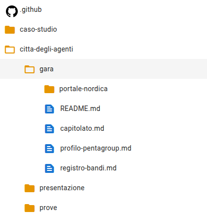
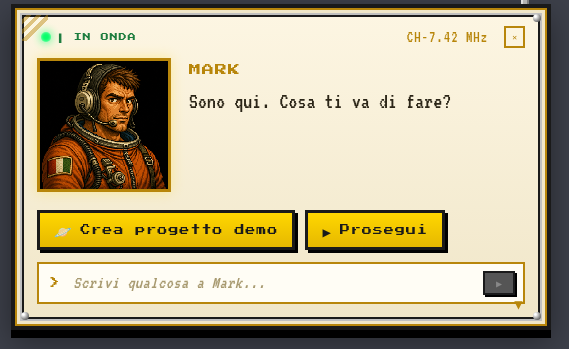

# Check 1: the demo project is open

## TL;DR

The tender round runs on the MdExplorer demo project, created with «Create demo project». This page tells you how to check,
in one minute, that the open project is the right one and that the agents have a place to deliver their work.
If a check fails, what to do is at the bottom.

- The tree must contain the `agent-city/tender` folder with the specification.
- Next to the project folder there must be a `<name>.origin.git` folder.
- The project must have an AI engine: Copilot, Claude Code or opencode.

## Check 1: the tender is there

In the left panel open `agent-city` and then `tender`. You must see this:



| What | What it is for |
|---|---|
| `nordica-portal` | the calls for tenders website, simulated |
| `tender-documents` | the tender documents downloaded from the portal (at the start only the README) |
| `tools` | the program that downloads them |
| `pentagroup-profile.md` | who the company is and with which criteria it chooses a call for tenders |
| `tender-register.md` | the calls for tenders already seen |

**No `tender` folder?** The demo is an old version: update it with the pull from the git bar, or create it again.

## Check 2: the agents have a place to deliver

The agents in this case write documents and deliver them to a repository they can write to. «Create demo project» prepares
it by itself, **next to** the project folder.

Open the folder that contains the project (usually `Documents`) with File Explorer. You must see two folders:

```text
mdexplorer-demo
mdexplorer-demo.origin.git
```

What that folder is and why it protects the public demo is explained in the
[technical note on the local repository](technical-note-local-repository.md).

**The second one is missing?** You cloned the demo by hand, or the app is older than 3 October 2026. The agents will work,
but the delivery will fail and a message in the mailbox will tell you so. Create the project again with «Create demo project».

## Check 3: there is an AI engine

1. Go to the recent projects page and click the gear on the project card.
2. In the **AI & RAG** tab look at the agent environment: it must be Copilot, Claude Code or opencode.

The round was tested with **Copilot**. With «None» the agents do not start and the app says the engine is missing.

## If you have to create the project

1. At the top right click the question mark, «Open Mark's guide».
2. In Mark's panel click **Create demo project**.



Mark checks which AI engines are on the computer, downloads the demo in MdExplorer's language and opens it already set up.
At the end it says «The demo project is open and set up for …».

[Check 2: the city is on](check-2-city-on.md) · [Back to the guide](../presentation/step-by-step-guide.md#/1)
