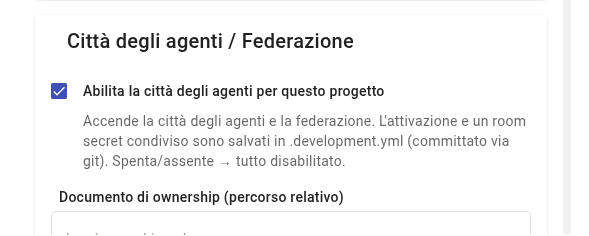

# Check 2: the city is on

## TL;DR

The agent city is off in every project until you turn it on. This page tells you how to see at a glance whether it is on
and, if it is not, how to turn it on with a checkbox in the project settings.
Turning it on changes a single file, which in this demo must not be committed.

- When it is on, the toolbar has **four more icons**.
- You turn it on from «Project Settings», section «Agent City / Federation», where the workflow document also is.
- After turning it on the project says «1 to commit»: **do not commit**.

## The check: four icons in the bar

Look at the toolbar, at the top. With the city on, the last four icons on the right are these:

| Icon | It is called | What it is for in the round |
|---|---|---|
| the two people | «City of agents» | the registry: who the agents are and who you enabled |
| the person in a circle | the identity | not needed in this case |
| the head with the light bulb | the agents' memory | not needed in this case |
| the speech bubble | «Agent messages» | the mailbox and the work to review: you will use it all the time |

**You don't see the two people and the speech bubble?** The city is off: turn it on.

## How to turn it on

1. Go back to the **recent projects** page: it is the one you see when you start MdExplorer.
2. On the project card click the **gear**, on the right.

   

3. Scroll down to the **Agent City / Federation** section and tick «Enable the agent city for this project».

   

4. In the same section check two fields, which the demo has already filled in:
   - **Ownership document (relative path)**: `agent-city/tender/responsibilities.md`;
   - **Workflow document (relative path)**: `agent-city/tender/workflow.md`. It is the plan of the round: without it,
     «Start the round» just wakes the account manager, instead of starting the three sheets.
5. Click **Close** and reopen the project by clicking its card.

## What changes in the project

At the top right «1 to commit» appears. The changed file is `.development.yml`, with two new lines: the switch and a random
key generated on your computer.

> **Do not commit `.development.yml` in this demo.** The key is a credential and the demo repository is public.

[Check 3: the agents are enabled](check-3-agents-enabled.md) · [Check 1](check-1-demo-project.md) · [Back to the guide](../presentation/step-by-step-guide.md#/1)
