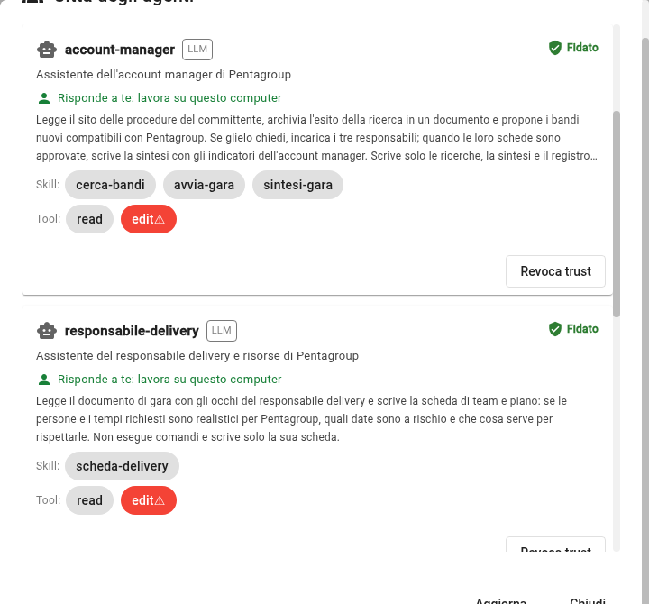
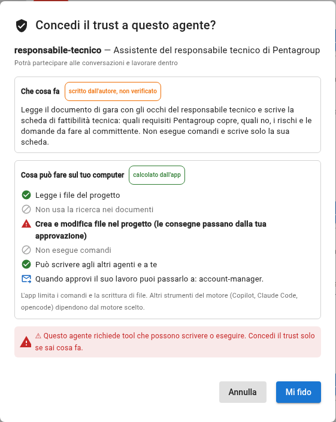

# Check 3: the four agents are enabled

## TL;DR

An agent starts only if it has an owner and that owner has enabled it. This page tells you how to check in the registry that
the four tender agents are yours and «Trusted» and, if they are not, how to fix them.
If an agent's card changes after your yes, the enabling expires and must be done again.

- The registry opens from the **two people** icon.
- Under each name there must be **«Answers to you»**, and at the top right the green **Trusted** mark.
- `a2a-ping` can stay «Not trusted»: it is not needed in this case.

## The check: four «Trusted»

Click the two people icon, «City of agents». Scroll the list: these four must have **Trusted**, in green, at the top right
of their card.

| Agent | Whose assistant it is |
|---|---|
| `account-manager` | the account manager's |
| `technical-lead` | the technical lead's |
| `legal-lead` | the legal and commercial lead's |
| `delivery-lead` | the delivery lead's |

In the picture `account-manager` and `delivery-lead` answer to you and are enabled: under the name there is «Answers to you:
it works on this computer», on the right «Trusted».

## If an agent says «Nobody answers for it: it does not start»

Nobody has said yet whose it is. At the top of the registry click **They are all mine** (or **It is mine** on the single
card): MdExplorer writes your name in the document [Who answers for which agent](../tender/responsibilities.md) and under the
name «Answers to you: it works on this computer» appears, in green. Only then can the agent be enabled.

At the top of the registry you also read who you are for this project: it is your git email. If it is missing, set it with
`git config user.email` in the project folder.

## If an agent says «Not trusted»

1. On its card click **Trust**.
2. A window opens with two blocks. Read them:
   - **«What it does»** was written by the agent's author: nobody checks it.
   - **«What it can do on your computer»** is computed by the app: this part is guaranteed.

   

3. Click **I trust it**.

The tender agents can read and write files. **They cannot run commands**, except the account manager, which runs only one:
the program that downloads the tender document. What they write stays in a separate copy until you approve it.

## If an agent says «Trust expired»

Its card changed after your yes: for example after an update of the demo. Read the window again and enable it again.

## If you don't see the four agents

- Wait a few seconds for the project to finish indexing, then click **Refresh**.
- If an agent appears under «Excluded», its card has an error: the reason is written next to it.

[Back to the guide](../presentation/step-by-step-guide.md#/1) · [Check 2](check-2-city-on.md)
