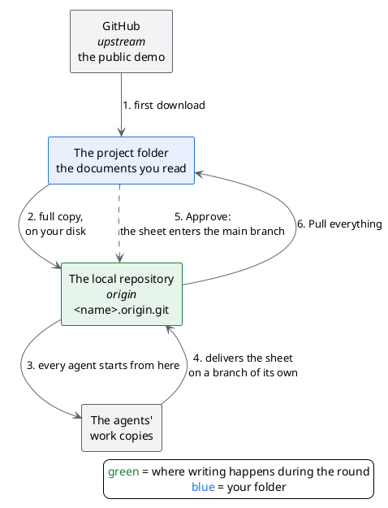

# Technical note: where the agents' work ends up

## TL;DR

The demo's agents write documents, and to deliver them they need a git repository they can write to. «Create demo project»
prepares one **on your disk**, next to the project, and from then on the whole round writes there: the public demo on
GitHub is never touched. This page explains what really happens, for whoever wants to understand it or has to explain it.

- The project has two remotes: **`origin`**, the local repository, and **`upstream`**, the demo on GitHub.
- The agents' deliveries, «Approve» and «Pull everything» work **only on `origin`**.
- MdExplorer has no command that writes to `upstream`.

## The problem

An agent that writes a document does not put it in your folder: it delivers it on a separate branch, and you approve it. To
do that it has to **publish** that branch to a shared repository, the one git calls `origin`.

Right after download, the demo has the public repository on GitHub as `origin`. Whoever tries the demo cannot write there,
and whoever can (the author) must not: the trial sheets would end up in everybody's demo.

## The solution: a local repository

When you create the project with «Create demo project», MdExplorer does four things, only once:

1. it copies the repository just downloaded into a folder next to the project, `<name>.origin.git`;
2. it renames the remote to GitHub from `origin` to **`upstream`**: it is not lost, only its name changes;
3. it creates a new remote, **`origin`**, pointing to the local copy;
4. it attaches the project's branch to that copy.



After the first download, GitHub no longer appears in any step.

## What the `.origin.git` folder is

It is a **full** copy of the demo, with all its history: not just the agents' part. It is however a «bare» copy (in git:
*bare*): it contains git's data but not the documents in plain form. If you open it with File Explorer you see technical
folders such as `objects` and `refs`. It does not open in MdExplorer and it is not edited by hand.

| | The project folder | `<name>.origin.git` |
|---|---|---|
| What it contains | the documents you read and edit | the same history, without readable files |
| Who uses it | you, in MdExplorer | git, when the agents deliver and when you approve |
| It plays the role of | your working copy | the shared repository |

Think of it as a small private GitHub on your disk. It is the same pattern as working on a fork: `origin` is your own copy,
which you write to; `upstream` is the original, from which you take the updates.

## Who writes where

| Action | Where it reads or writes |
|---|---|
| Reading and editing the documents | the project folder |
| An agent delivers a sheet | a new branch on `origin` (local) |
| **Approve** | the main branch of `origin` (local) |
| The register of the workflow rounds (who started, delivered, approved) | the `mde/giri` branch of `origin` (local), with a hidden copy in the `.git` folder |
| **Pull everything** | from `origin` (local) to the project folder |
| Commit and publish from the git bar | `origin` (local) |
| Updating the demo to a new version | from `upstream` (GitHub), with **Download the updates** |

## When a new version of the demo comes out

MdExplorer's «to pull» looks at `origin`, so at the local repository: the demo updates on GitHub do not show up there. That
is why, when the source has something new, a light blue button appears at the top right, for example **«3 updates»**.

1. Hover over it with the mouse: «Updates from the source» opens, with the address they come from.
2. Click **Download the updates**.

MdExplorer brings the new version into your folder and then also copies it into the local repository, so the agents restart
from it. It never sends anything to GitHub. If the updates touch a file you changed too, it downloads nothing, leaves the
project as it was and tells you which file it is: commit or undo your change and try again.

## How to check it

From a terminal, in the project folder:

```text
git remote -v
```

You must see `origin` pointing to a folder on your disk ending in `.origin.git`, and `upstream` pointing to GitHub.

## What to know

- **It applies only to the demo.** MdExplorer prepares the local repository only when the project is the clone of the demo
  and you create it with «Create demo project». Your own projects are not touched.
- **If you clone the demo by hand**, `origin` stays GitHub: for most people the agents' delivery is rejected, and the app
  says so with a message in the mailbox. Whoever has write permission on the demo must avoid this: the agents would publish
  to the public repository.
- **It contains the branch you downloaded**, that is MdExplorer's language. The other language stays on GitHub.
- **If you delete the project**, also delete `<name>.origin.git` by hand: MdExplorer does not do it.
- **`.development.yml` must not be committed**: turning on the city puts a key in it. With the local repository it would not
  reach GitHub anyway, but it is a good habit.

[Check 1: the demo project is open](check-1-demo-project.md) · [Back to the guide](../presentation/step-by-step-guide.md#/1)
