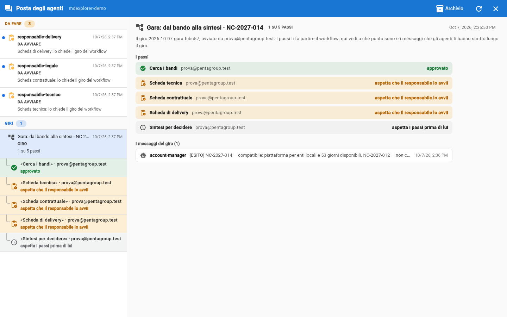
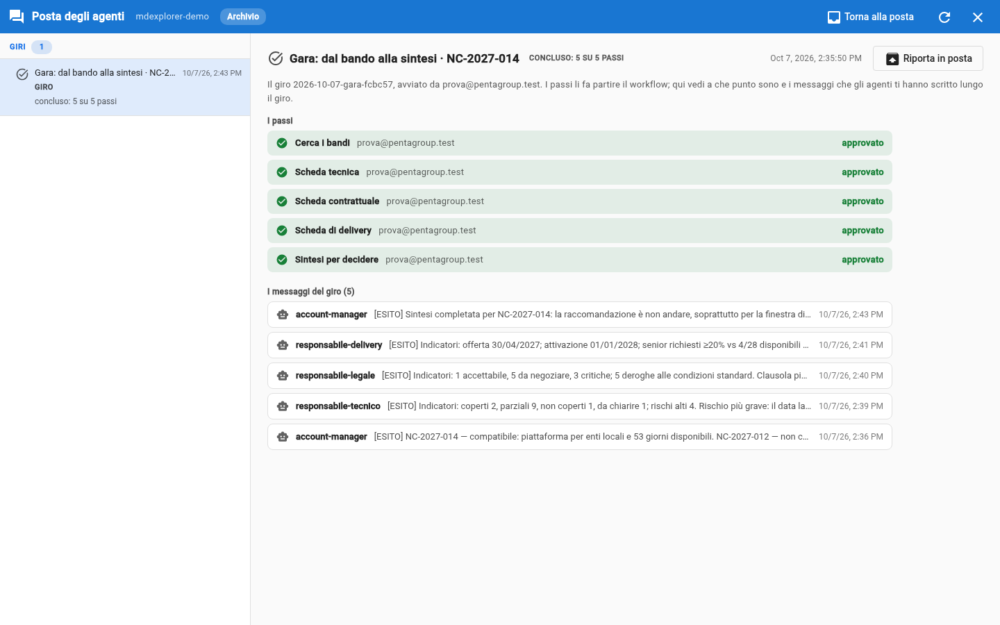

# The agents' mailbox

## TL;DR

The speech bubble in the toolbar opens the agents' mailbox: a full-screen page, on top of the project. On the left the list,
split by **what each item wants from you**; on the right the details of what you pick. The number on the bubble counts
only the decisions waiting for you, not the messages to read.

- **To do**: what waits for a decision of yours (to start, to approve, buttons you have not answered).
- **Rounds**: a workflow round is a single item, with its steps and its messages; **Messages**: the rest, to read.
- A finished round is archived in one gesture, with all its messages; «Archive read» removes the messages already read.

## The three sections

| Section | What is there | Why there |
|---|---|---|
| **To do** (amber) | «To start», «To approve» (also a work stopped after a rejection), colleagues' requests, and messages with buttons you have not answered yet | they wait for a decision of yours: until you decide, someone's work is stopped |
| **Rounds** (light blue) | one item per workflow round, for example «Tender · NC-2027-014 · 3 of 5 steps»; the ones in progress first, with the step rows below | the round moves on by itself: you follow it, you do not have to push it |
| **Messages** | what the agents wrote to you outside a round | to read |

A message written during a round sits **inside the round**, not in «Messages». The exception is while it waits for a decision
of yours (for example its artifact is to approve): then it stays in «To do», and once you have decided it goes into the round.

## The items in the list

| Icon | What it is | What you do on the right |
|---|---|---|
| the robot | a message from an agent | you read it, open the artifacts, reply with its buttons |
| the checklist, in orange, indented under a message | the artifact of that work, **to approve** | you open the files, then **Approve**, **Take it over** or **Reject** |
| the paperclip with the clock, «To start» | a step of a round that is **yours**: the assignment the workflow wrote for your agent | **Open to start**, **Don't start it** (with the reason), or **Pass to a colleague** of the team |
| the tree diagram, in «Rounds» | a workflow **round**: title, call for tenders, finished steps out of total | on the right the steps with who answers for them and their state, and the round's messages (one click opens them); when the round is finished, **Archive the round** |
| a coloured row, indented under a round | a **step** of the round, with who answers for it | nothing: the row changes state by itself; «no message» if the agent delivered without writing to you |
| the node, in purple | a **colleague's request**: their agent asks for the work of yours | **Authorize** or **Reject**: your agent starts only if you accept |

Opening a message marks it as read: the dot disappears, but the message stays in the list as long as you need it.

## One work, one row

An agent at work leaves two things: the message it writes to you and the approval request for its artifact. In the list
they are not two unrelated items: the request sits **under** the message of the same work, indented, with the words «To
approve: the artefact». The link is the id of the work turn, not the time.

## Replying to an agent

Under a message you find **what you can reply**: one button for each reply the agent accepts, saying what happens when you
press it (who is contacted, and to get what). If the project has a workflow and the button starts steps (for example
«Start the round»), pressing it does not wake the agent: it opens a round, and the steps arrive as «To start» to whoever
answers for them. If one of those agents has more than one owner, under the button you choose who does it. The replies are
declared by the agent's card, in the block covered by trust: a button can only send what you already saw when you trusted
the agent.

- **Until the artifact of that work is approved, the buttons are locked.** First you decide on what the agent produced,
  then you tell it to go on.
- An agent that asks you nothing has no buttons.
- Under the buttons there is always a **box to write in your own words**: to ask «why don't I see the buttons?», or to tell
  the agent something its card does not cover. The agent wakes up with no memory, so it receives what you write together
  with its earlier message, quoted, and the buttons it had offered you. The box also stays locked until the artifact is
  approved.
- An agent that declares replies must say every time which ones apply, even «none». If it forgets, MdExplorer rejects the
  message and the agent sends it again, corrected: you never get a message without buttons by mistake.

## Rejecting

Rejecting is the exception: usually an artifact that does not convince you is fixed in the agent copy and then approved.
**Reject** always asks for the reason, and then stops everything: nothing restarts by itself.

| The work was asked by | After the rejection |
|---|---|
| another agent, which waits for it | it stays in the mailbox as «Rejected: the work is stopped». When you want, press **Restart**: the agent receives the same assignment and your reason. Before that, if needed, fix its card |
| you | it is a closed branch: the reply buttons stay locked. To try again, launch the agent again |

## Following a round

Select the round in the «Rounds» section: on the right you find **the steps**, each with who answers for it and its state, and
**the round's messages**, that is the ones the agents wrote to you along the round. One click on a message opens it; at the
top there is the way back to the round. The rows change by themselves, and when one changes it blinks for a few seconds.

| State | Background |
|---|---|
| waiting for its owner to start it, awaiting approval | amber |
| working, being redone | light blue |
| approved, done | green |
| rejected, stopped; failed; its owner did not start it | red |
| waits for the steps before it | grey |

If a row says **«no message»**, the agent delivered its work but did not write you the message its card asks for: look at
the file directly.

## Archiving

- **Archive**, in the details of a message, removes it from the list.
- **Archive read (N)**, in the bar at the top, removes in one gesture the messages already read in the «Messages» section.
  Unread ones, decisions and rounds stay.
- **Archive the round**, in the details of a finished round, removes it from the mailbox with all its messages. A round still
  in progress cannot be archived: it has steps waiting for someone.

Nothing is deleted: **Archive**, in the bar at the top, shows archived messages and rounds, and from there **Back to the
mail** puts them back in the list. Archiving a round concerns only your mailbox: the round's register, in git, does not change.

## The artifacts of a message

An agent always produces two things: the document and the message that tells you where it is. Under the text of the message,
the **Artifacts** section lists the documents the message cites, each with its state.

| State | What it means | What you can do |
|---|---|---|
| In the agent's copy, waiting for your approval | the agent wrote it, but it is not in the project yet | **Open** to read it, **Go to the request** to decide |
| Approved: it is in the repository, not in your folder yet | you approved it | you bring it into the folder with «… to pull» → **Pull everything** |
| In the project | it is in your folder | **Open** |
| Not found | the message cites a file that does not exist anywhere | ask the agent, or check the path |

**Open** shows the document in the right part of the page, laid out, with where it comes from at the top. **Back** returns
to the message.

## Approving without leaving the mailbox

1. Pick a **To approve** item in the list.
2. Each file has **Open**: you read the document as it is in the agent's delivery.
3. **Approve**: the document enters the repository and the item disappears from the list. If the work is a step of a round,
   the approval also goes into the round's register, and the workflow starts whoever comes next.

Without a workflow, if the agent declares who it passes the work to, before approving you choose the colleague to notify (or
«none»).

You no longer need «Take it over» to read a document: that stays the gesture to **fix it** yourself before approving.

## When an agent writes to another

Every time an agent wakes up, a person decided it. With the workflow MdExplorer does the hand-overs, and each step is started
by whoever answers for it. Without a workflow, if an agent writes to a colleague, the message does not wake it: it arrives in
the mailbox of the colleague's owner as **«To start»**, and it starts when that person starts it. This is why there is no
window to stop two agents that write to each other without end: they cannot do it on their own.

If the agents' memory is on, the details of a message also have **Consolidate**: you pick the facts the agent learned and
that you want to keep in its card; the others fade away.

[Section index](../README.md)
