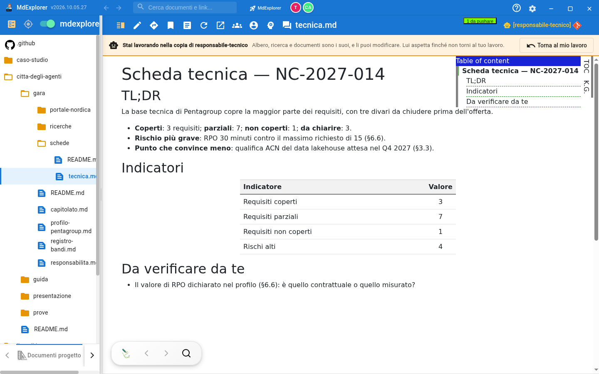
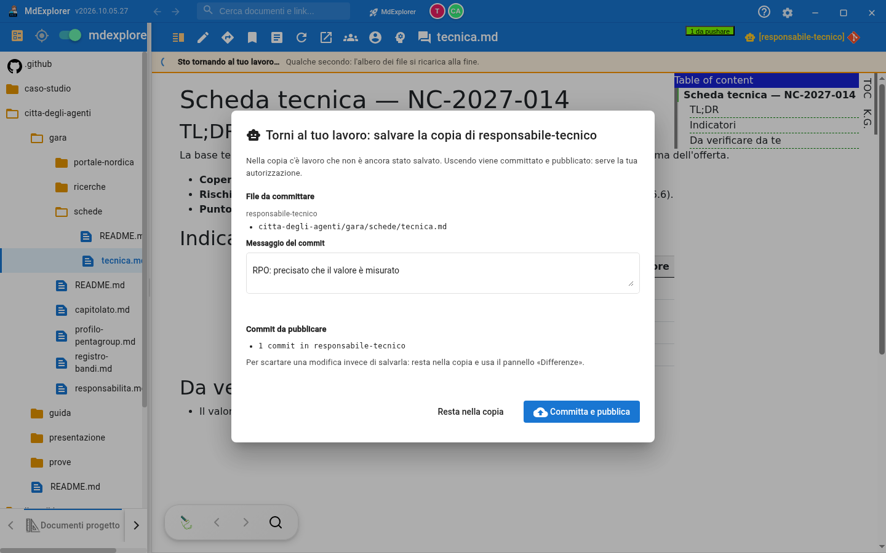

# Working in an agent copy

## TL;DR

Each agent works in its own copy of the project, not in your folder. If what it wrote does not convince you, you enter its
copy and fix it yourself: for the app it is like switching branch, with the file tree, the search and the documents of the
copy. When you go back to your work, the app asks you to authorize saving what you changed.

- You enter from the branch selector, item **Worktree**, by choosing the agent.
- While you are inside, the agent waits: nobody touches that copy.
- To leave, **Back to my work**: if you changed something, you authorize commit and publish in one gesture.

## When you need it

An agent delivered a document to you and something needs fixing: a figure, a sentence, a missing section. Rejecting is the
exception; the normal way is **fix and approve**. You can also change other parts of the project, if the fix needs it: in
the copy you can do everything you would do in your folder.

## Entering

1. At the top right, click the branch label (usually `[main]`).
2. Choose **Worktree**, then the agent.

What changes:

| Where | What you see |
|---|---|
| The branch label | the agent's name, with the robot, instead of `main` |
| The strip above the document | «You are working in the copy of …», with **Back to my work** |
| The file tree | the copy's tree: the files the agent created are there |
| The counters at the top | the files to commit and to publish **of the copy** |

While the app opens the copy, the strip shows a spinner: it takes a few seconds.

You cannot enter the copy of an agent that is working at that moment: the app tells you to wait until it finishes.

## Working

Open the files from the tree and edit them as usual. Meanwhile the agent is **queued**: if a message reaches it, it waits
until you have left. This is why the copy is safe while you work in it.

If you close or reload the window while you are inside, when it reopens the app takes you back into the same copy.

## Leaving

Click **Back to my work**.

- **If you changed nothing**, you go straight back to your branch.
- **If you changed something**, a window opens with the changed files and the field for the commit message.

| Button | What it does |
|---|---|
| **Commit and publish** | saves your changes on the agent's branch, publishes them, and takes you back to your work |
| **Stay in the copy** | nothing happens: you keep working |

There is no «leave without saving»: a change left half-done in the copy would never be remembered by anyone. To throw one
away, stay inside and use the **Changes** panel: there you discard file by file.

If the commit or the publish fails (for example there is no network), you stay in the copy and the app tells you why.

## Afterwards

Your fix is on the agent's branch, and the approval request in the mailbox includes it: when you press **Approve**, both the
agent's work and your fix enter the project. There is still only one request.

## Good to know

- There are two work places. While you are inside a copy, the agents have one left: they work one at a time.
- The selector lists the agents that have a copy at that moment. If an agent's copy has already passed to another one, its
  document can still be read from the mailbox, with **Open**.
- The commit carries **your name**, not the agent's: the project history shows who did what.

[The agents' mailbox](the-agents-mailbox.md) · [Section index](../README.md)
