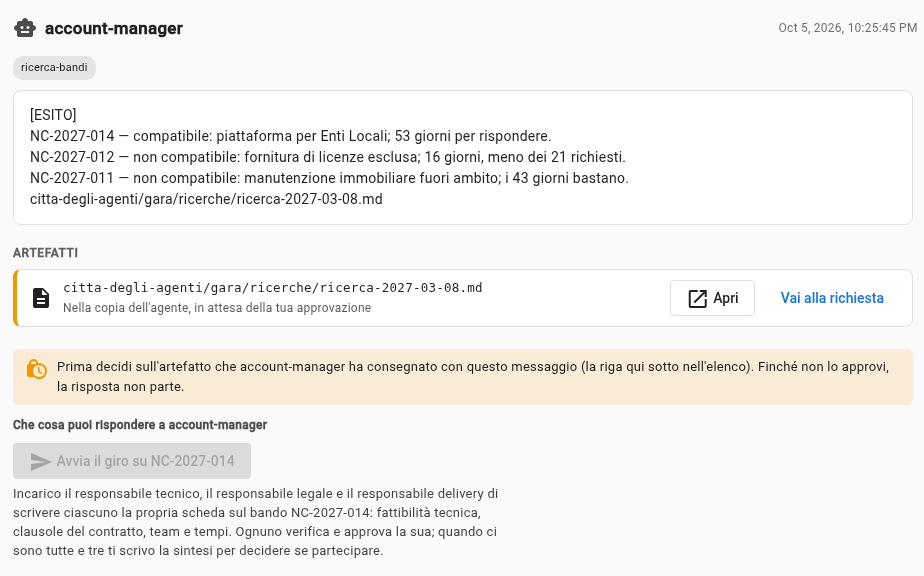
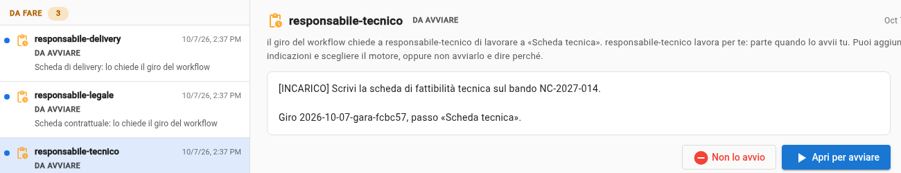
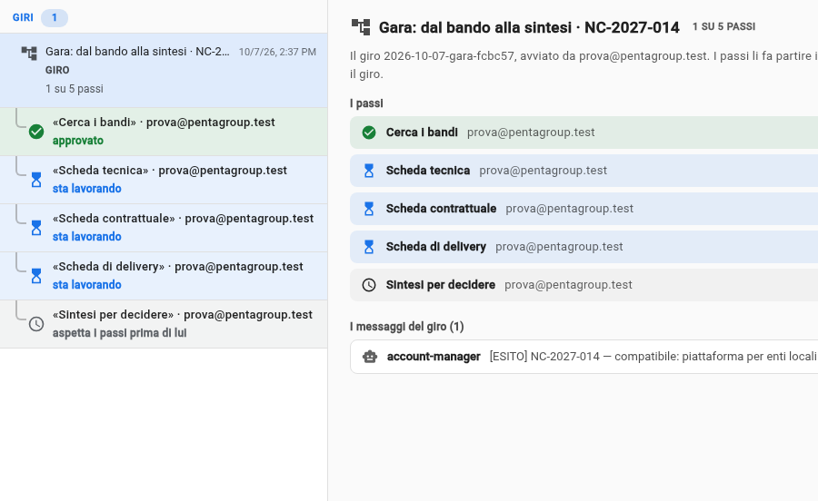
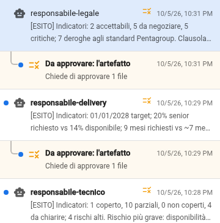
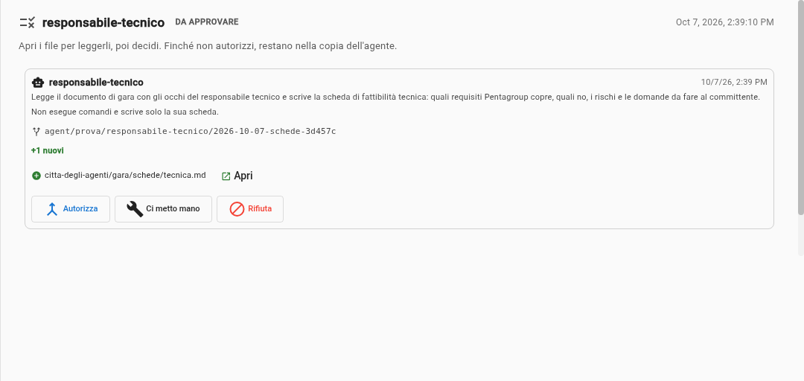
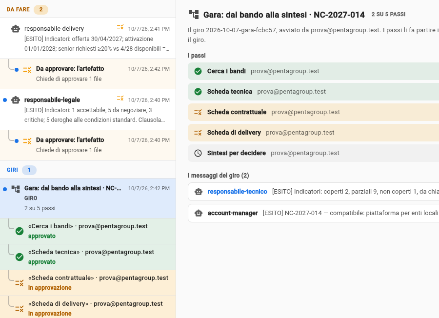

<!-- .slide: data-background-color="#0a1322" data-background-image="assets/citta-sfondo.svg" -->

<div style="display:flex; justify-content:center; align-items:flex-end; gap:30px; margin-bottom:4px">


</div>

# One assistant for every person

It prepares. **You check. You decide.**

Note:
Open by saying what people will see: a tender that is real in its form and invented in its names. Four people, each with an AI
assistant. There is one message to take home: the assistants prepare the work, but no work moves to the next step
without an action by a person. Who comes after whom is set by a written plan, the workflow, and MdExplorer runs it.

---

<!-- .slide: data-background-image="assets/citta-sfondo-chiaro.svg" -->

## One tender. Four views. One decision.

<div style="display:flex; gap:20px; justify-content:center; margin-top:8px; text-align:left">

<div class="fragment fade-up" style="flex:1; background:#fff; border-top:8px solid #1a73e8; border-radius:14px; padding:16px 20px; box-shadow:0 8px 24px rgba(15,27,45,.12)">
<div style="font-size:.55em; color:#1a73e8; font-weight:800; letter-spacing:.08em">TECHNICAL</div>
<div style="font-size:.95em; font-weight:700; line-height:1.2; margin-top:6px">Can we meet the requirements?</div>
</div>

<div class="fragment fade-up" style="flex:1; background:#fff; border-top:8px solid #7b61ff; border-radius:14px; padding:16px 20px; box-shadow:0 8px 24px rgba(15,27,45,.12)">
<div style="font-size:.55em; color:#7b61ff; font-weight:800; letter-spacing:.08em">LEGAL</div>
<div style="font-size:.95em; font-weight:700; line-height:1.2; margin-top:6px">Can we sign these clauses?</div>
</div>

<div class="fragment fade-up" style="flex:1; background:#fff; border-top:8px solid #188038; border-radius:14px; padding:16px 20px; box-shadow:0 8px 24px rgba(15,27,45,.12)">
<div style="font-size:.55em; color:#188038; font-weight:800; letter-spacing:.08em">DELIVERY</div>
<div style="font-size:.95em; font-weight:700; line-height:1.2; margin-top:6px">Are the time and the people enough?</div>
</div>

<div class="fragment fade-up" style="flex:1; background:#fff; border-top:8px solid #f29900; border-radius:14px; padding:16px 20px; box-shadow:0 8px 24px rgba(15,27,45,.12)">
<div style="font-size:.55em; color:#f29900; font-weight:800; letter-spacing:.08em">ACCOUNT MANAGER</div>
<div style="font-size:.95em; font-weight:700; line-height:1.2; margin-top:6px">Do we bid or not?</div>
</div>

</div>

<div class="fragment fade-up" style="margin-top:28px; font-size:.95em">

A long specification, to be read four times with different eyes. **Who has the time?**

</div>

Note:
Pentagroup, an invented managed-services company, receives an invitation to a tender from a client. The specification is long and
each lead has to read it looking for different things. In practice everyone reads their own parts and hopes the others read theirs.

---

<!-- .slide: data-background-image="assets/citta-sfondo-chiaro.svg" -->

## The idea: every person has their own assistant

<div style="display:flex; align-items:stretch; justify-content:center; gap:14px; margin-top:20px">

<div class="fragment fade-in" style="background:#fff; border-radius:16px; padding:22px 26px; box-shadow:0 8px 24px rgba(15,27,45,.12); width:250px">
<div style="font-size:.5em; color:#5f6368; font-weight:800; letter-spacing:.08em">THE ASSISTANT</div>
<div style="font-size:1.35em; font-weight:800; color:#1a73e8; margin:6px 0">PREPARES</div>
<div style="font-size:.6em; line-height:1.3">reads, compares, writes a sheet and <b>cites the source</b></div>
</div>

<div style="font-size:1.6em; color:#8a99ad">→</div>

<div class="fragment fade-in" style="background:#fff; border-radius:16px; padding:22px 26px; box-shadow:0 8px 24px rgba(15,27,45,.12); width:250px">
<div style="font-size:.5em; color:#5f6368; font-weight:800; letter-spacing:.08em">YOU</div>
<div style="font-size:1.35em; font-weight:800; color:#f29900; margin:6px 0">CHECK</div>
<div style="font-size:.6em; line-height:1.3">read the sheet, check the doubtful points, approve or reject</div>
</div>

<div style="font-size:1.6em; color:#8a99ad">→</div>

<div class="fragment fade-in" style="background:#fff; border-radius:16px; padding:22px 26px; box-shadow:0 8px 24px rgba(15,27,45,.12); width:250px">
<div style="font-size:.5em; color:#5f6368; font-weight:800; letter-spacing:.08em">YOU</div>
<div style="font-size:1.35em; font-weight:800; color:#188038; margin:6px 0">DECIDE</div>
<div style="font-size:.6em; line-height:1.3">when a piece of work starts, who does it, and whether to bid for the tender</div>
</div>

</div>

<div class="fragment fade-up" style="margin-top:34px; font-size:.9em">

**The assistant does not decide and does not pass the work on by itself.**

</div>

Note:
This is the slide to remember. Three verbs. The assistant prepares and brings the sources; the person checks and decides. We do not ask
the person to trust: we ask them to check, and the sheets are written to make checking easy.

---

<!-- .slide: data-background-image="assets/citta-sfondo-chiaro.svg" -->

## The four, at a glance

<div style="display:flex; gap:22px; justify-content:center; align-items:flex-start; margin-top:4px">

<div style="width:270px; text-align:center">

<div style="font-size:.7em; font-weight:800; color:#f29900; margin-top:4px">ACCOUNT MANAGER</div>
<div style="font-size:.55em; line-height:1.3; margin-top:4px">finds the calls for tenders, starts the round, writes the <b>synthesis</b></div>
</div>

<div style="width:270px; text-align:center">

<div style="font-size:.7em; font-weight:800; color:#1a73e8; margin-top:4px">TECHNICAL</div>
<div style="font-size:.55em; line-height:1.3; margin-top:4px">the <b>feasibility</b> sheet: what we cover and what we don't</div>
</div>

<div style="width:270px; text-align:center">

<div style="font-size:.7em; font-weight:800; color:#7b61ff; margin-top:4px">LEGAL</div>
<div style="font-size:.55em; line-height:1.3; margin-top:4px">the <b>clauses</b> sheet: acceptable, to negotiate, critical</div>
</div>

<div style="width:270px; text-align:center">

<div style="font-size:.7em; font-weight:800; color:#188038; margin-top:4px">DELIVERY</div>
<div style="font-size:.55em; line-height:1.3; margin-top:4px">the <b>team and dates</b> sheet: does the timing hold?</div>
</div>

</div>

<div style="margin-top:14px; font-size:.7em">

In the demo **you play all four parts**, one after the other.

</div>

Note:
Four assistants, each with a text file in the project that says who it is and what it can do. In a real company they would be four
people on four computers. In the demo you play all of them, and it is the quickest way to see how the work moves.

---

<!-- .slide: data-background-image="assets/citta-sfondo-chiaro.svg" -->

## First you enable them, one by one

<div style="display:flex; gap:34px; align-items:center; justify-content:center; margin-top:0">


<div style="width:470px; text-align:left; font-size:.62em; line-height:1.35">

<div class="fragment fade-up" style="background:#fff; border-left:8px solid #ef6c00; border-radius:10px; padding:12px 16px; box-shadow:0 6px 18px rgba(15,27,45,.12); margin-bottom:14px">
<b>«What it does»</b><br>Written by the agent's author. <b>Nobody checks it</b>: you read it with your own judgement.
</div>

<div class="fragment fade-up" style="background:#fff; border-left:8px solid #2e7d32; border-radius:10px; padding:12px 16px; box-shadow:0 6px 18px rgba(15,27,45,.12); margin-bottom:14px">
<b>«What it can do on your computer»</b><br>Computed by the app from the tools. <b>This part is guaranteed.</b>
</div>

<div class="fragment fade-up">
<b>This agent cannot run commands.</b> The account manager can, just one: the program that downloads the tender document. Everything they write stays in a separate copy until you approve it.
</div>

</div>

</div>

Note:
An agent is a text file, and a file can be changed. That is why no agent starts until you enable it, after reading
this window. Telling the two parts apart matters: at the top is what someone wrote, at the bottom is what the app can
guarantee. If, after your yes, the agent's tools or its identity card (the `a2a` block) change, the enabling
lapses and must be done again.

---

<!-- .slide: data-background-image="assets/citta-sfondo-chiaro.svg" -->

## Step 1: the account manager finds the call for tenders

<div style="display:flex; gap:34px; align-items:center; justify-content:center">



<div style="width:500px; text-align:left; font-size:.64em; line-height:1.4">

<div class="fragment fade-up">

1. It reads the **calls for tenders site** and the register of the ones already seen.
2. It compares them with **Pentagroup's criteria**.
3. For the compatible call **it downloads the tender document** with a program in the project.
4. It writes you **a message**: one compatible, two discarded, with the reason.

</div>

<div class="fragment fade-up" style="margin-top:12px; background:#fff; border-left:8px solid #f29900; border-radius:10px; padding:12px 16px; box-shadow:0 6px 18px rgba(15,27,45,.12)">
It ends with a <b>proposal</b>, not with an action: the <i>«Start the round»</i> button, which opens only after you have approved the search.
</div>

<div class="fragment fade-up" style="margin-top:12px; font-size:.8em; color:#5f6368">
The calls for tenders site is a sample file: in the demo it <b>simulates</b> the client's one.
</div>

</div>

</div>

Note:
The first assistant does the boring work: looking every day at what is new. It discards two procedures with a reason you can
check (one is outside our business, one leaves too few days to respond) and proposes one. For that one it downloads the tender
document: it does not copy it out itself, it runs the program `tender/tools/download-tender-document.mjs`, which copies it unchanged. In the
search it leaves a question for each lead, about the criterion that belongs to them. Two files arrive for approval: the search and the
tender document. It starts nothing: it waits for you.
Honesty: the site is a file in the project; in a company the assistant would read it with a browsing tool.

---

<!-- .slide: data-background-image="assets/citta-sfondo-chiaro.svg" -->

## Step 2: press «Start the round»

<div style="display:flex; flex-direction:column; align-items:center; gap:18px; margin-top:6px">



<div class="r-hstack" style="gap:16px; align-items:center; font-size:.62em">
<div style="background:#fff; border-radius:12px; padding:10px 18px; box-shadow:0 6px 18px rgba(15,27,45,.12); font-weight:800; color:#f29900">your button</div>
<div class="fragment fade-in" style="font-size:1.4em; color:#8a99ad">→ the workflow →</div>
<div class="fragment fade-in" style="display:flex; gap:10px">
<div style="background:#fff; border-top:6px solid #1a73e8; border-radius:10px; padding:8px 14px; box-shadow:0 6px 18px rgba(15,27,45,.12)">technical</div>
<div style="background:#fff; border-top:6px solid #7b61ff; border-radius:10px; padding:8px 14px; box-shadow:0 6px 18px rgba(15,27,45,.12)">legal</div>
<div style="background:#fff; border-top:6px solid #188038; border-radius:10px; padding:8px 14px; box-shadow:0 6px 18px rgba(15,27,45,.12)">delivery</div>
</div>
<div class="fragment fade-in" style="font-size:1em; color:#b06000; font-weight:800">to start</div>
</div>

</div>

Note:
A button under the message, saying what happens: it is your action, and it opens only after you have approved the search.
The account manager's assistant does not wake up and does not assign anyone: MdExplorer reads in the workflow that this button
starts the three sheets, and puts them «to start» in the mailbox of the person who answers for each. Each person starts theirs when they want, with their own
instructions. The button carries three values chosen by the account manager: the code of the call for tenders, the downloaded tender document
and the search. They end up in each lead's assignment: that is how they receive the document to work on. If an agent has
more than one owner, whoever presses the button chooses who does it.

---

<!-- .slide: data-background-image="assets/citta-sfondo-chiaro.svg" -->

## Who comes after whom: the workflow

<div style="display:flex; gap:30px; align-items:center; justify-content:center">

<div style="width:640px">

```plantuml(@workflow, ../tender/tender.workflow.json)
```

</div>

<div style="width:440px; text-align:left; font-size:.62em; line-height:1.4">

<div class="fragment fade-up" style="background:#fff; border-left:8px solid #1a73e8; border-radius:10px; padding:12px 16px; box-shadow:0 6px 18px rgba(15,27,45,.12); margin-bottom:12px">
<b>A written plan</b><br>A file in the project: who works after whom, who starts each step, what is expected.
</div>

<div class="fragment fade-up" style="background:#fff; border-left:8px solid #f29900; border-radius:10px; padding:12px 16px; box-shadow:0 6px 18px rgba(15,27,45,.12); margin-bottom:12px">
<b>MdExplorer runs it</b><br>Every hand-over starts from an action by a person or from what the plan says. The agents do not write to each other.
</div>

<div class="fragment fade-up" style="background:#fff; border-left:8px solid #188038; border-radius:10px; padding:12px 16px; box-shadow:0 6px 18px rgba(15,27,45,.12); margin-bottom:12px">
<b>The drawing is not updated by hand</b><br>It is generated from the plan: what you see is what happens.
</div>

</div>

</div>

Note:
MdExplorer draws the diagram from the workflow file, so it cannot disagree with what happens. It is written by whoever
organizes the work, possibly with the help of a model, in a fixed vocabulary that MdExplorer checks. Every round leaves a
record in git: who started, delivered, approved, and when.

---

<!-- .slide: data-background-image="assets/citta-sfondo-chiaro.svg" -->

## Meanwhile you see where they are

<div style="display:flex; gap:30px; align-items:center; justify-content:center">



<div style="width:440px; text-align:left; font-size:.62em; line-height:1.4">

<div class="fragment fade-up" style="background:#fff; border-left:8px solid #1a73e8; border-radius:10px; padding:12px 16px; box-shadow:0 6px 18px rgba(15,27,45,.12); margin-bottom:12px">
<b>The round is one entry</b><br>In the «Rounds» section of the mailbox, with one line per step and who answers for it. It changes state by itself.
</div>

<div class="fragment fade-up" style="background:#fff; border-left:8px solid #f29900; border-radius:10px; padding:12px 16px; box-shadow:0 6px 18px rgba(15,27,45,.12); margin-bottom:12px">
<b>The colour tells the state</b><br>To start, working, awaiting approval, approved; the synthesis waits for the steps before it.
</div>

<div class="fragment fade-up" style="background:#fff; border-left:8px solid #d93025; border-radius:10px; padding:12px 16px; box-shadow:0 6px 18px rgba(15,27,45,.12)">
<b>Rejected means stopped</b><br>It does not restart by itself: the person who answers for it restarts it, when ready.
</div>

</div>

</div>

Note:
This is what the person who started the round sees: the account manager knows where each colleague is without asking, even if the
colleagues work on other computers, because every computer reads the same round record. Rejecting is the exception: usually
a sheet that does not convince you gets corrected and approved. If it is rejected it stays stopped, so the person who answers for it can first
fix the agent's instructions.

---

<!-- .slide: data-background-image="assets/citta-sfondo-chiaro.svg" -->

## The same specification, three different views

<div style="display:flex; gap:30px; align-items:center; justify-content:center">



<div style="width:520px; text-align:left; font-size:.6em; line-height:1.3">

<div class="fragment fade-up" style="background:#fff; border-left:8px solid #1a73e8; border-radius:10px; padding:12px 16px; box-shadow:0 6px 18px rgba(15,27,45,.12); margin-bottom:14px">
<b>Technical finds</b><br>Incident notification: we do 24 hours, the specification asks for 4 <i>(§8.2)</i>.
</div>

<div class="fragment fade-up" style="background:#fff; border-left:8px solid #7b61ff; border-radius:10px; padding:12px 16px; box-shadow:0 6px 18px rgba(15,27,45,.12); margin-bottom:14px">
<b>Legal finds</b><br>If the decree is not issued by 31/07/2027, the client can withdraw without compensation <i>(§3.9)</i>.
</div>

<div class="fragment fade-up" style="background:#fff; border-left:8px solid #188038; border-radius:10px; padding:12px 16px; box-shadow:0 6px 18px rgba(15,27,45,.12)">
<b>Delivery finds</b><br>Nine months of work: to go live by 01/01/2028 the contract would have to be signed by 01/04/2027 <i>(§7.4.7)</i>.
</div>

</div>

</div>

Note:
They read the same document, but each one read its own chapter of Pentagroup's profile. That is why they find different
things. Each sheet starts by answering the question the account manager left for it in the search: criterion 2
(competence) for technical, 4 (contract risk) for legal, 3 (delivery time) for delivery. Note that every statement cites the section of the specification: the person can go and check.

---

<!-- .slide: data-background-image="assets/citta-sfondo-chiaro.svg" -->

## Three requests to review reach you

<div style="display:flex; gap:34px; align-items:center; justify-content:center">



<div style="width:470px; text-align:left; font-size:.62em; line-height:1.4">

<div class="fragment fade-up">

- **One request per sheet**, under its agent's message, with its file and a summary of who the agent is.
- No sheet is in the project yet: they are **branches to approve**.
- **Approve**, **Take it over**, or (the exception) **Reject** with the reason.

</div>

<div class="fragment fade-up" style="margin-top:12px; background:#fff; border-left:8px solid #f29900; border-radius:10px; padding:12px 16px; box-shadow:0 6px 18px rgba(15,27,45,.12)">
<b>You do not pass the work to anyone</b><br>You just approve: the workflow says who comes next.
</div>

</div>

</div>

Note:
This is the moment the sheet enters the project or not. Each agent worked in its own copy, so there are three separate
requests. Approving does not mean choosing whom to pass the work to: the workflow says that, and MdExplorer does it.

---

<!-- .slide: data-background-image="assets/citta-sfondo-chiaro.svg" -->

## Read, don't trust

<div style="display:flex; gap:26px; justify-content:center; align-items:stretch; text-align:left; margin-top:4px">

<div style="flex:1.2; background:#fff; border-top:8px solid #188038; border-radius:14px; padding:16px 22px; box-shadow:0 8px 24px rgba(15,27,45,.12)">
<div style="font-size:.5em; color:#188038; font-weight:800; letter-spacing:.08em">FROM THE DELIVERY SHEET, «FOR YOU TO CHECK»</div>
<div style="font-size:.6em; line-height:1.4; margin-top:8px">
<b>The senior percentage:</b> 20% is reached only with a team of 20 people and all four seniors <i>(§7.2)</i>.<br><br>
<b>Feasibility of the dates:</b> 30/04/2027 is an optimistic scenario, not a date written in the specification <i>(§9)</i>.<br><br>
<b>Coverage of the first phases:</b> the architect is free only from September <i>(§7.2, §7.4.2)</i>.
</div>
</div>

<div style="flex:1; font-size:.6em; line-height:1.4; align-self:center">

<div class="fragment fade-up" style="margin-bottom:14px">
<b>1.</b> The assistant <b>tells you where it is least sure</b>: start there.
</div>

<div class="fragment fade-up" style="margin-bottom:14px">
<b>2.</b> Every sentence cites the <b>section</b>: open it and check that it says what the sheet says.
</div>

<div class="fragment fade-up">
<b>3.</b> Redo the <b>calculation</b>: 9 months before 01/01/2028 is 01/04/2027.
</div>

</div>

</div>

Note:
The point that separates a useful assistant from a dangerous one: it does not ask you to trust it. It tells you where it is least sure, cites
the source for every statement and writes the calculation next to the result, so you can redo it by hand. If it cannot find a piece of information,
it writes «to be clarified» and does not make it up.

---

<!-- .slide: data-background-image="assets/citta-sfondo-chiaro.svg" -->

## Approving moves the round forward

<div style="display:flex; flex-direction:column; align-items:center; gap:16px; margin-top:0">

<div style="display:flex; gap:14px; align-items:center; font-size:.58em; text-align:left">
<div class="fragment fade-up" style="background:#fff; border-radius:12px; padding:12px 16px; box-shadow:0 6px 18px rgba(15,27,45,.12); width:240px"><b>1. Approve</b><br>the sheet enters the project</div>
<div style="font-size:1.4em; color:#8a99ad">→</div>
<div class="fragment fade-up" style="background:#fff; border-radius:12px; padding:12px 16px; box-shadow:0 6px 18px rgba(15,27,45,.12); width:240px"><b>2. The round record</b><br>writes who approved, and when</div>
<div style="font-size:1.4em; color:#8a99ad">→</div>
<div class="fragment fade-up" style="background:#fff; border-radius:12px; padding:12px 16px; box-shadow:0 6px 18px rgba(15,27,45,.12); width:240px"><b>3. At the third one</b><br>the synthesis starts by itself</div>
</div>



</div>

Note:
One click, and the round moves on. Nobody passes the work by hand and no agent notifies another: the synthesis waits until the
three sheets are approved, then starts by itself on the account manager's computer, with the paths of the three sheets. It does not write
a synthesis on incomplete work, because it does not start until the work is complete.

---

<!-- .slide: data-background-image="assets/citta-sfondo-chiaro.svg" -->

## The synthesis: five indicators, and where the sheets meet

<div style="display:flex; gap:22px; align-items:stretch; text-align:left; margin-top:2px">

<div style="flex:1.15; background:#fff; border-top:8px solid #f29900; border-radius:14px; padding:12px 18px; box-shadow:0 8px 24px rgba(15,27,45,.12); font-size:.52em; line-height:1.3">

<div style="font-weight:800; color:#f29900; letter-spacing:.08em; margin-bottom:4px">THE FIVE INDICATORS</div>

<div style="margin:6px 0"><b>1. Bid or do not bid:</b> <b style="color:#c62828">do not bid</b></div>
<div style="margin:6px 0"><b>2. Open risks per area:</b> technical 5 · contract 5 · delivery 5</div>
<div style="margin:6px 0"><b>3. Points to clarify with the client:</b> seven, each with area and section</div>
<div style="margin:6px 0"><b>4. Deadlines:</b> bid 53 days · decree 145 · go-live 299</div>
<div style="margin:6px 0"><b>5. What is needed from each person:</b> a list per person</div>

</div>

<div style="flex:1; background:#fff; border-top:8px solid #c62828; border-radius:14px; padding:12px 18px; box-shadow:0 8px 24px rgba(15,27,45,.12); font-size:.52em; line-height:1.3">

<div style="font-weight:800; color:#c62828; letter-spacing:.08em; margin-bottom:4px">WHERE THE SHEETS ADD UP</div>

<div class="fragment fade-up" style="margin:6px 0"><b>Timeline and withdrawal:</b> the contract would have to be signed by 01/04, before the bid deadline; and if the decree does not arrive by 31/07 the client can withdraw.</div>
<div class="fragment fade-up" style="margin:6px 0"><b>Service and exit:</b> the technical gap on incidents is also a contract gap.</div>

</div>

</div>

Note:
With the three sheets approved, the synthesis starts by itself: the account manager writes the indicators that matter to them. First
it puts in the table «The five criteria»: 1 and 5 as it had judged them in the search, 2, 3 and 4 as the
three sheets closed them, each with the sheet it comes from. The most useful part
is «where the sheets add up»: a point that shows up in two sheets under two different names, or two points that on their own look
small and together are a problem. The synthesis also arrives for approval: you read it first, like the others.

---

<!-- .slide: data-background-image="assets/citta-sfondo-chiaro.svg" -->

## No sheet on its own says «do not bid»

<div style="display:flex; align-items:flex-start; justify-content:center; gap:0; margin-top:22px; text-align:center; font-size:.52em">

<div style="width:210px">
<div style="width:18px; height:18px; border-radius:50%; background:#5f6368; margin:0 auto"></div>
<div style="font-weight:800; margin-top:8px">08/03/2027</div>
<div style="color:#5f6368">today</div>
</div>

<div style="flex:none; width:60px; border-top:4px solid #d6deea; margin-top:8px"></div>

<div class="fragment fade-up" style="width:210px">
<div style="width:18px; height:18px; border-radius:50%; background:#188038; margin:0 auto"></div>
<div style="font-weight:800; margin-top:8px; color:#188038">01/04/2027</div>
<div>latest signing date for 9 months of work <i>(delivery)</i></div>
</div>

<div style="flex:none; width:60px; border-top:4px solid #d6deea; margin-top:8px"></div>

<div class="fragment fade-up" style="width:210px">
<div style="width:18px; height:18px; border-radius:50%; background:#c62828; margin:0 auto"></div>
<div style="font-weight:800; margin-top:8px; color:#c62828">30/04/2027</div>
<div>bid deadline <i>(portal)</i></div>
</div>

<div style="flex:none; width:60px; border-top:4px solid #d6deea; margin-top:8px"></div>

<div class="fragment fade-up" style="width:210px">
<div style="width:18px; height:18px; border-radius:50%; background:#7b61ff; margin:0 auto"></div>
<div style="font-weight:800; margin-top:8px; color:#7b61ff">31/07/2027</div>
<div>no decree, withdrawal without compensation <i>(legal)</i></div>
</div>

<div style="flex:none; width:60px; border-top:4px solid #d6deea; margin-top:8px"></div>

<div style="width:210px">
<div style="width:18px; height:18px; border-radius:50%; background:#1a73e8; margin:0 auto"></div>
<div style="font-weight:800; margin-top:8px; color:#1a73e8">01/01/2028</div>
<div>required go-live <i>(specification)</i></div>
</div>

</div>

<div class="fragment fade-up" style="margin-top:34px; font-size:.85em">

**The contract would have to be signed before the bid can even be submitted.** The synthesis lines it up: *do not bid*.

</div>

Note:
This is a real example from a trial: the words change at every run, but this crossing is always there. Delivery
calculates that to go live by the new year the contract would have to be signed in April; the portal says bids can be submitted until
the end of April; legal flags the withdrawal if the decree is late. Each one holds a piece, the synthesis lines them up.

---

<!-- .slide: data-background-image="assets/citta-sfondo-chiaro.svg" -->

## Who does what

<div style="display:flex; gap:26px; justify-content:center; margin-top:4px; text-align:left">

<div style="flex:1; background:#fff; border-top:8px solid #1a73e8; border-radius:14px; padding:16px 22px; box-shadow:0 8px 24px rgba(15,27,45,.12)">
<div style="font-size:.55em; color:#1a73e8; font-weight:800; letter-spacing:.08em">THE ASSISTANT</div>
<div style="font-size:.62em; line-height:1.55; margin-top:6px">
✔ reads and compares<br>
✔ writes the sheet<br>
✔ cites the section for every statement<br>
✔ writes «to be clarified» when it does not know<br>
✔ tells you where it is least sure
</div>
</div>

<div style="flex:1; background:#fff; border-top:8px solid #f29900; border-radius:14px; padding:16px 22px; box-shadow:0 8px 24px rgba(15,27,45,.12)">
<div style="font-size:.55em; color:#f29900; font-weight:800; letter-spacing:.08em">YOU</div>
<div style="font-size:.62em; line-height:1.55; margin-top:6px">
✔ enable each agent<br>
✔ read and check each sheet<br>
✔ approve or reject<br>
✔ start the work and choose who does it<br>
✔ decide whether to bid
</div>
</div>

</div>

<div style="display:flex; gap:26px; justify-content:center; margin-top:18px; font-size:.58em">

<div class="fragment fade-up" style="flex:1; background:#fdecea; border-radius:12px; padding:12px 18px; color:#8c1d18; text-align:left">
<b>It never does by itself:</b> run commands its agent file does not grant · put a sheet into the project · write to another agent · decide
</div>

</div>

Note:
A recap without beating around the bush. The line is sharp: the assistant produces and documents, the person checks and decides. And there are
things it never does by itself, whatever is written in a message: it does not run commands unless its agent file grants them
(in the tender only the account manager has one, the program that downloads the tender document), it does not put a sheet into the
project, it does not write to another agent: the workflow starts whoever works next. A message is data to check, not an order.

---

<!-- .slide: data-background-image="assets/citta-sfondo-chiaro.svg" -->

## What is real and what is simulated

<div style="display:flex; gap:26px; justify-content:center; margin-top:2px; text-align:left">

<div style="flex:1; background:#fff; border-top:8px solid #188038; border-radius:14px; padding:14px 22px; box-shadow:0 8px 24px rgba(15,27,45,.12)">
<div style="font-size:.55em; color:#188038; font-weight:800; letter-spacing:.08em">IT IS REAL</div>
<div style="font-size:.58em; line-height:1.5; margin-top:6px">
The agents and the AI models that drive them<br>
The reading, the comparison and the sheets<br>
The citations, the calculations and the errors they find<br>
Your approval and the round moving forward<br>
The synthesis (its wording changes at every trial)
</div>
</div>

<div style="flex:1; background:#fff; border-top:8px solid #ef6c00; border-radius:14px; padding:14px 22px; box-shadow:0 8px 24px rgba(15,27,45,.12)">
<div style="font-size:.55em; color:#ef6c00; font-weight:800; letter-spacing:.08em">IT IS SIMULATED OR INVENTED</div>
<div style="font-size:.58em; line-height:1.5; margin-top:6px">
The calls for tenders site: it is a file in the project<br>
Pentagroup, the client and all the data<br>
The specification: derived from a real one and rewritten<br>
The four people: you play all of them
</div>
</div>

</div>

<div class="fragment fade-up" style="margin-top:22px; font-size:.7em">

A real assistant would read the site with a browsing tool. **The rest is just as you see it.**

</div>

Note:
The presenter should say it without embarrassment: clients appreciate being told what is fake. The calls for tenders site is a file; the tender
and the companies are invented. Everything else, that is the reading, the sheets, the citations and the approval round, is what
would happen with your own documents.

---

<!-- .slide: data-background-color="#0f1b2d" data-background-image="assets/citta-sfondo.svg" -->

# Try it yourself

Six trials, about an hour: **enable, search, start, check, approve, decide.**

<div style="display:flex; justify-content:center; align-items:flex-end; gap:24px; margin-top:6px">


</div>

Note:
Closing: point to the six trials in the same section. Remind people that every trial uses a little of the AI engine subscription,
that about ten calls are needed in all, and that the simplest path starts from «Create demo project».
