<!-- .slide: data-background-color="#0a1322" data-background-image="assets/citta-sfondo.svg" -->

# The tender, step by step

Part 1: **the account manager finds the call for tenders**

Note:
This presentation is an operating guide: it says what to do, where to click and what to expect. Read it with MdExplorer open
beside it. Part 1 goes as far as the account manager's message; the later parts follow the round.

---

<!-- .slide: data-background-image="assets/citta-sfondo-chiaro.svg" -->

## Before you start: three things already done

1

The demo project is open

Created with <b>«Create demo project»</b>: it also prepares the place where the agents deliver.

[How do I check it →](../guide/check-1-demo-project.md)

2

The city is on

In the top bar you see the two people and the speech bubble.

[How do I check it →](../guide/check-2-city-on.md)

3

The four agents are enabled

In the registry, each of the four «Answers to you» and has the green «Trusted» mark.

[How do I check it →](../guide/check-3-agents-enabled.md)

Each box leads to a page with screenshots: **what to look at, and what to do if it is missing**.

Note:
The three links open three check pages, with screenshots of what you should see and the steps to take if something is missing.
From the page you come back to the guide with the link at the bottom or with MdExplorer's back arrow.

---

<!-- .slide: data-background-image="assets/citta-sfondo-chiaro.svg" -->

## First of all: the agents are yours

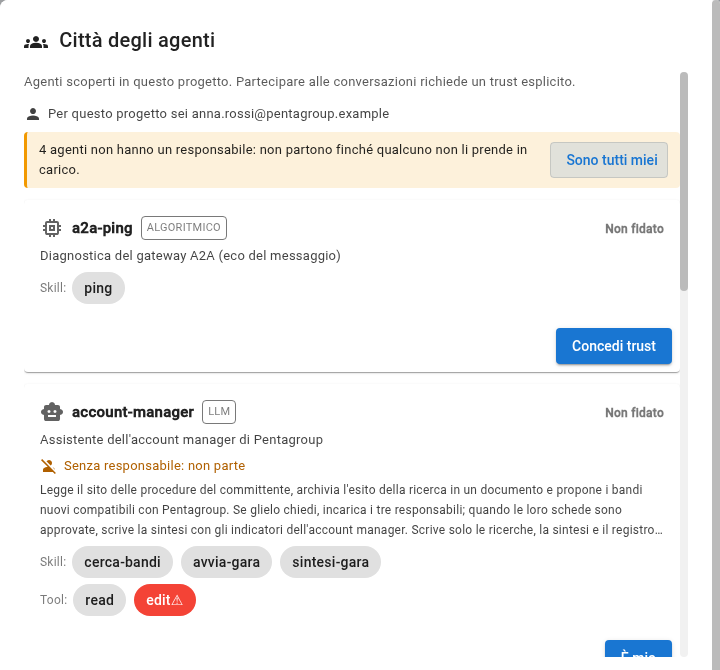

<b>An agent works for a person</b> Until it has an owner it does not start. In the registry you read «Nobody answers for it: it does not start».

<b>1. They are all mine</b> Open the registry (the two people in the bar) and click the button at the top: the four agents answer to you.

<b>2. Trust</b> Now each agent has «Trust»: read what it does and enable it. It works for your agents, not for other people's.

Note:
In a real company the four agents would belong to four people, and each of them would make this gesture from their own computer
on their own agent. Here one person plays all the parts. At the top of the registry it says who you are for the project: it is the git email.
The gesture writes four rows in the document «Who answers for which agent», which opens behind the window.

---

<!-- .slide: data-background-image="assets/citta-sfondo-chiaro.svg" -->

## The scene

You are **Pentagroup's account manager**.

Every morning someone should look at Nordica Crediti's tender site, to see if there is anything new and if it suits you.

From today <b>your assistant</b> does it. You tell it to check; it reports back to you.

Note:
Put the person in the role. Not «an agent does», but «you are the account manager and you have an assistant». The whole round
is easier to follow if the viewer feels like that person.

---

<!-- .slide: data-background-image="assets/citta-sfondo-chiaro.svg" -->

## What the assistant looks at

THE TENDER SITE

Three open procedures: <b>NC-2027-014</b> ATLANTE platform <b>NC-2027-012</b> software licences <b>NC-2027-011</b> building maintenance

tender/nordica-portal/tenders.md, with the tender documents in documents/

THE REGISTER

The calls for tenders Pentagroup <b>has already seen</b>. If a call is not here, it is new.

tender/tender-register.md

PENTAGROUP'S CRITERIA

Five criteria to decide if a call for tenders suits us: business, skills, timing, contract, <b>at least 21 days</b> to respond.

tender/pentagroup-profile.md

The site is a **project file that simulates it**. In a company it would be the real site.

Note:
Three documents, all in the project, all can be opened. The tender document of each call sits next to the site, in
`nordica-portal/documents/`: the assistant does not read it, it downloads it for the leads. It is worth opening one before launching the agent, for example the tender
site: this way the viewer knows what is inside and can judge the result. Say straight away that the site is simulated.

---

<!-- .slide: data-background-image="assets/citta-sfondo-chiaro.svg" -->

## Gesture 1: find the robot

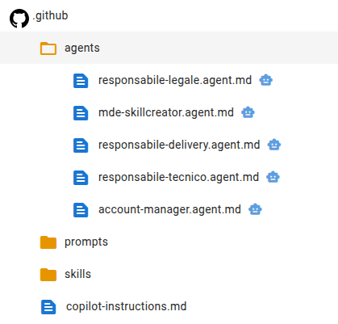

1. In the left panel open **`.github`**
2. then **`agents`**
3. on the row of **`account-manager.agent.md`** click the **robot**

You don't see the robot? The panel is narrow: <b>widen it</b> by dragging its edge.

Note:
Each agent is a file, and the robot next to the file is the way to launch it. If the panel is narrow the icon is cut off: it is
the thing people get stuck on most often.

---

<!-- .slide: data-background-image="assets/citta-sfondo-chiaro.svg" -->

## Gesture 2: say what you want and launch

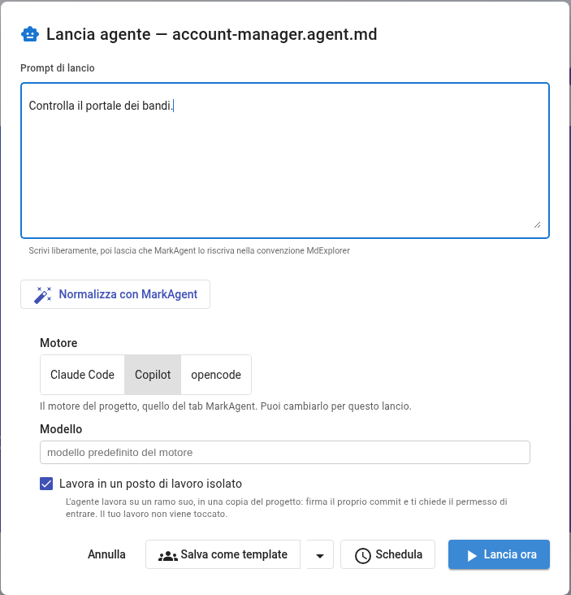

1. Write:

<b>Check the tender portal.</b>

2. **Leave the rest as it is**: engine, model and the checkbox stay as they are.
3. Click **Launch now**.

The checkbox «Work in an isolated workplace» means: work in a copy, not in your folder.

Note:
A sentence in plain English, not a command. The options below are for those who want to change engine: for the demo, leave them as they are.
The window closes and «Agent "account-manager" started in background» appears.

---

<!-- .slide: data-background-image="assets/citta-sfondo-chiaro.svg" -->

## Wait a minute

MEANWHILE IT

reads the tender site 
compares it with the register 
applies the first filter: nature and time 
writes the search and sends you the message

YOU SEE

<b>1.</b> in the bar a <b>yellow robot</b> with a spinning ring: someone is working 
<b>2.</b> a notice at the bottom: «🤖 Agent "…" completed.» 
<b>3.</b> the robot disappears and a red number appears on the <b>speech bubble</b>

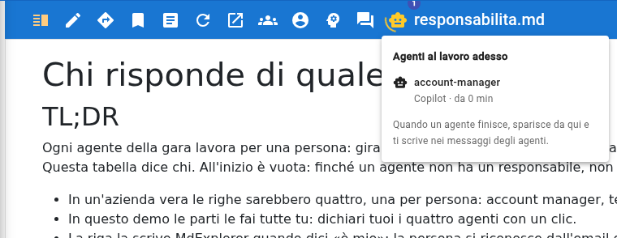

Nothing after two minutes? The AI engine is not answering: check that it is installed and that you are logged in.

Note:
About a minute. Clicking the yellow robot shows who is working, on which engine and for how many minutes. When the agent
finishes the robot disappears: if it is still there, it is still working.

---

<!-- .slide: data-background-image="assets/citta-sfondo-chiaro.svg" -->

## Open the agents' mailbox

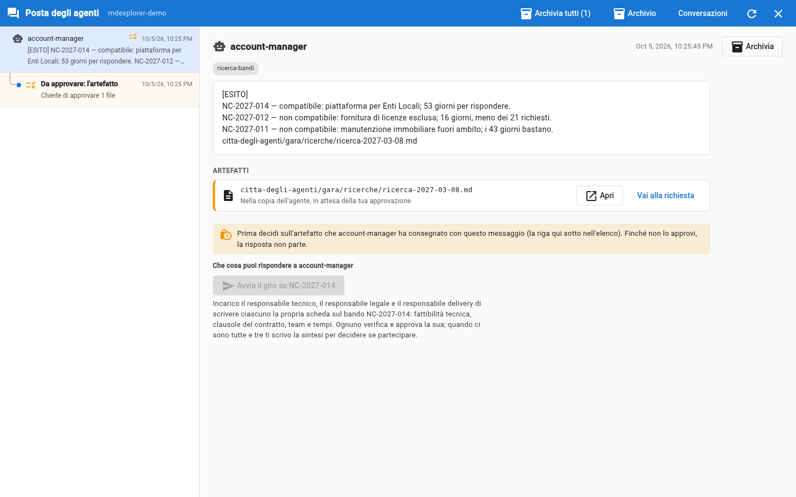

<b>Click the speech bubble</b> The mailbox opens, full screen, over the project. Close it with the ✕ at the top right.

<b>On the left: the list</b> Who wrote to you and when. The blue dot marks what you have not read; «To approve» is work waiting for you.

<b>On the right: the detail</b> The whole message, the <b>artifacts</b> it cites and the box to reply.

Note:
The mailbox is a single list: the agents' messages and the work to approve sit together. After the search there are two items,
both from the account manager: the message and its work to approve, with two files: the search and the downloaded tender
document.

---

<!-- .slide: data-background-image="assets/citta-sfondo-chiaro.svg" -->

## Read what it wrote to you

<b>One compatible</b> NC-2027-014: it passes the first filter, it deserves the round of the three leads.

<b>Two discarded, with the reason</b> Licences: outside our business and only 16 days. Buildings: outside our business.

<b>Where the document is, and a button</b> The last line is the path of the search. Below, the button «Start the round on NC-2027-014», still locked.

The assistant always produces **two things**: the message, short, and the document with the reasoning.

Note:
The words change at every trial, because there is a model behind them; the structure does not: one line per call for tenders, the verdict, the reason, the
path of the document and the button. «Compatible» here means «deserves the round», not «worth bidding»: that is what
the leads' sheets will say. The two procedures already in the register do not appear: they are not new.

---

<!-- .slide: data-background-image="assets/citta-sfondo-chiaro.svg" -->

## Gesture 3: open the document

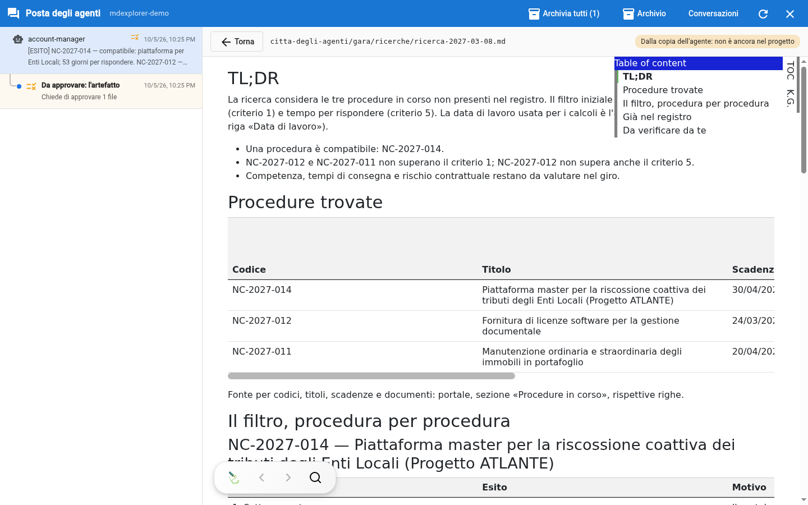

<b>1. Click «Open»</b> Under the message, in <b>Artifacts</b>, there is the search file. It opens right beside it, laid out.

<b>2. Look at the label at the top</b> «From the agent's copy: not in the project yet». You are reading it before approving it.

<b>3. Click «Back», then approve</b> Under the message there is the line «To approve: the artefact»: click it and press «Approve». Until you do, the reply is locked.

Note:
The document sits in a separate copy of the agent: it enters the project only with «Approve». Inside: the table of the procedures
with the days left, and for each procedure the five criteria. The account manager judges the two that block; the other three
say «to be assessed in the round» and by whom. The section «For the leads» leaves each one their own question. The second file to
approve is the tender document, in `tender-documents/`: a program of the project copied it unchanged, not the agent.

---

<!-- .slide: data-background-image="assets/citta-sfondo-chiaro.svg" -->

## Check it yourself: two minutes

<b>1. Are all the calls for tenders there?</b> Open the tender site: three open procedures, three lines in the message.

<b>2. Do the days add up?</b> Today, in the story, is <b>8 March 2027</b>. The licences close on 24 March: <b>16 days</b>, fewer than the 21 required.

<b>3. Why don't two calls for tenders appear?</b> Open the register: they have already been seen.

**You don't trust: you check.** It is the gesture you are asked for throughout the round.

Note:
This is the most important moment of part 1, and it is quick. Three checks that anyone can do by opening three files.
The «Working date» is in Pentagroup's company profile: it is the story's today, and it is there so the numbers add up on whatever day
you run the demo.

---

<!-- .slide: data-background-image="assets/citta-sfondo-chiaro.svg" -->

## What happened, and what did not

IT DID

✔ read three documents 
✔ discarded two calls for tenders, saying why 
✔ wrote the search in a document 
✔ downloaded the tender document, with the project's program 
✔ proposed a button, locked until you approve

IT DID NOT

✘ start anything 
✘ write to the colleagues 
✘ put anything in the project: the document waits for your approval 
✘ decide in your place

Note:
The right column is the reassuring one. The assistant writes its search, but in a separate copy: it enters the project
only when you approve it. And its card says to propose and wait: starting the round is your reply.

---

<!-- .slide: data-background-color="#0f1b2d" data-background-image="assets/citta-sfondo.svg" -->

# Part 2

**Start the round**, start the sheets and read one before approving it

Note:
Part 1 ended with the search approved and with a button under the account manager's message. Part 2 starts from that
button, goes through starting the three sheets and ends with reading a sheet. The approval is in part 3.

---

<!-- .slide: data-background-image="assets/citta-sfondo-chiaro.svg" -->

## Gesture 4: press «Start the round»

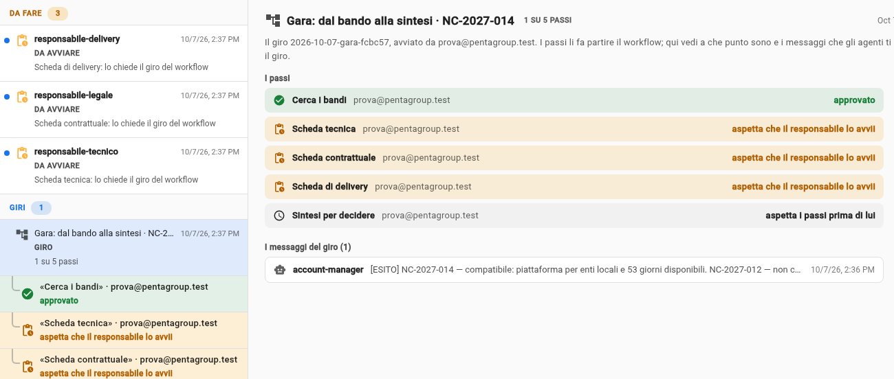

<b>1. Stay on the message</b> The account manager's one. Under the text there is «What you can reply to account-manager».

<b>2. Read what the button does</b> The three sheets receive the assignment, and each lead starts their own.

<b>3. Press «Start the round on NC-2027-014»</b> Three «To start» items appear straight away in <b>To do</b>, and the round in <b>Rounds</b>.

Note:
The possible replies are declared by the agent's card and become buttons: the person reads what happens when pressing, instead
of guessing what to write. The button stays locked until the search is approved. Pressing it does not wake the account
manager: MdExplorer reads in the tender workflow that this button starts the three sheets, and puts them «to start». If an
agent had more than one owner, «Who does it?» would appear under the button: you choose there.

---

<!-- .slide: data-background-image="assets/citta-sfondo-chiaro.svg" -->

## Gesture 5: start the three sheets

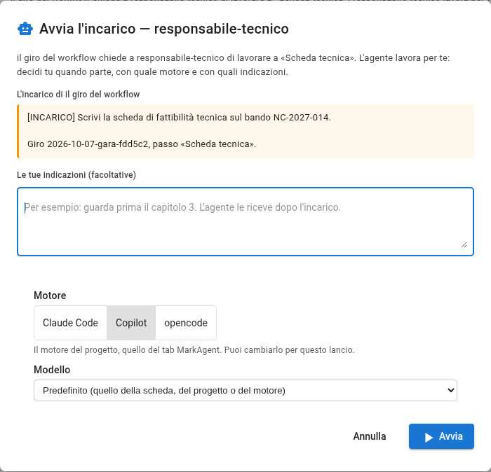

<b>1. Click a «To start» item</b> Read the assignment: which sheet, on which call for tenders, with the tender document and the search.

<b>2. «Open to start»</b> The launch window opens with the assignment inside. You can add your own instructions and choose engine and model.

<b>3. «Start»</b> If it asks to save <code>.development.yml</code> and <code>responsibilities.md</code>: «Start without saving».

<b>Repeat for the other two</b> Or «Don't start it», with the reason, if you don't need a sheet.

Note:
Each sheet is started by whoever answers for it: in the demo that is you, three times. You changed the two files the window offers to save
in trials 1 and 2 and the agent does not need them: that is why «Start without saving». In a team there is also «Pass to a colleague», to give
the sheet to someone else who answers for the same agent.

---

<!-- .slide: data-background-image="assets/citta-sfondo-chiaro.svg" -->

## Meanwhile: where the round stands

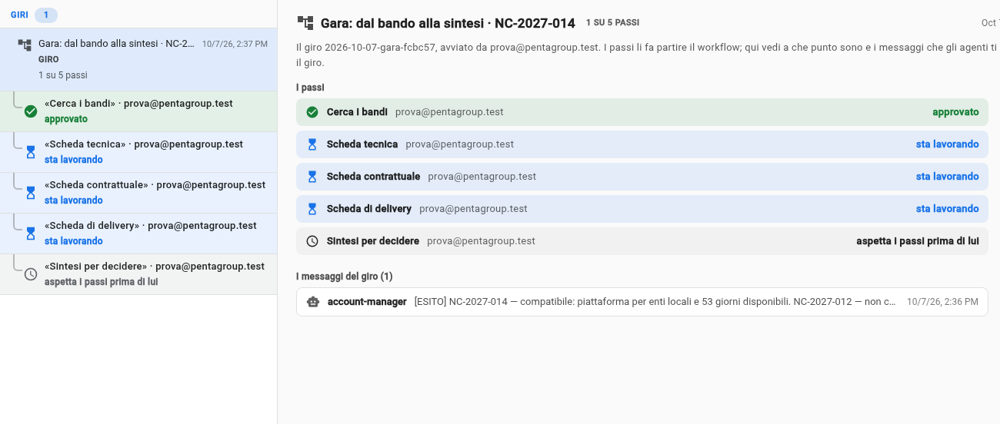

<b>The round is an item</b> In the «Rounds» section, with one line per step: title and who answers for it. Click it for the detail.

<b>The colour tells the state</b> Amber: to start or awaiting approval. Light blue: working. Green: approved. Red: rejected, stopped.

<b>The synthesis waits</b> «waits for the steps before it»: it starts by itself when the three sheets are approved.

Note:
This is what whoever started the round sees: the account manager knows where each colleague stands, without asking them. A rejected
sheet does not restart by itself: it stays stopped, in red, until whoever answers for it presses «Restart».

---

<!-- .slide: data-background-image="assets/citta-sfondo-chiaro.svg" -->

## Wait a few minutes

MEANWHILE THEY

the <b>technical</b> lead reads the requirements 
the <b>legal</b> lead reads the clauses 
the <b>delivery</b> lead reads people and dates 
each one writes <b>their own sheet</b>, without looking at the others

YOU SEE

<b>1.</b> the <b>yellow robot</b> in the bar: click it to know who is working 
<b>2.</b> the round's lines moving from «working» to «awaiting approval» 
<b>3.</b> the mailbox filling up, one item at a time

The sheets arrive **in two to five minutes**: it depends on how many the computer runs at the same time.

Note:
Each assistant reads only the tender document named in the assignment, the question the search leaves it and its chapter
of the company profile: it does not see the colleagues' sheets. This is on purpose: three independent points of
view, which the synthesis then compares.

---

<!-- .slide: data-background-image="assets/citta-sfondo-chiaro.svg" -->

## The mailbox fills up

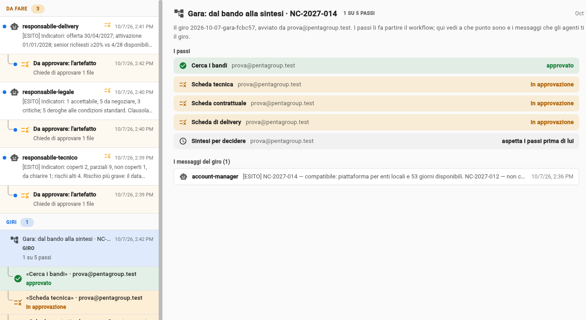

<b>Three messages</b> One per lead: the indicators, the most serious risk, the path of the sheet.

<b>Three «To approve» items</b> One per sheet, under its message. They are the real documents: they wait for your decision.

<b>And the round</b> In «Rounds»: three steps «awaiting approval», and the synthesis waiting.

Note:
Each lead produces two things, like the account manager: the message and the sheet. The message is a few lines and says where
to look; the sheet is the document. In the list they sit together, the sheet indented under its message.

---

<!-- .slide: data-background-image="assets/citta-sfondo-chiaro.svg" -->

## Gesture 6: open a sheet

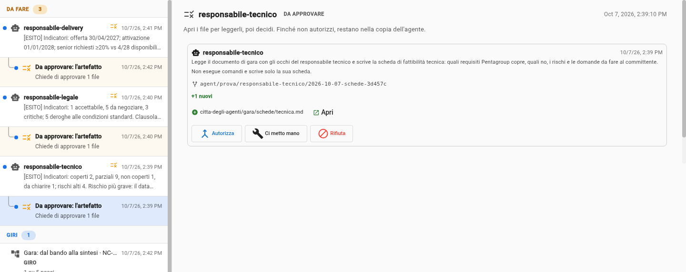

<b>1. Choose a «To approve» item</b> For example the one from <code>technical-lead</code>.

<b>2. Read who wrote it</b> At the top the agent's summary; below, the file it delivered.

<b>3. Click «Open» on the file</b> The sheet opens right beside it, as it is in the agent's delivery.

Note:
To read you don't need «Take it over»: that remains the gesture to correct the document yourself before approving it. There is no need to
choose whom to pass the work to: the workflow says who comes next.

---

<!-- .slide: data-background-image="assets/citta-sfondo-chiaro.svg" -->

## Read the sheet

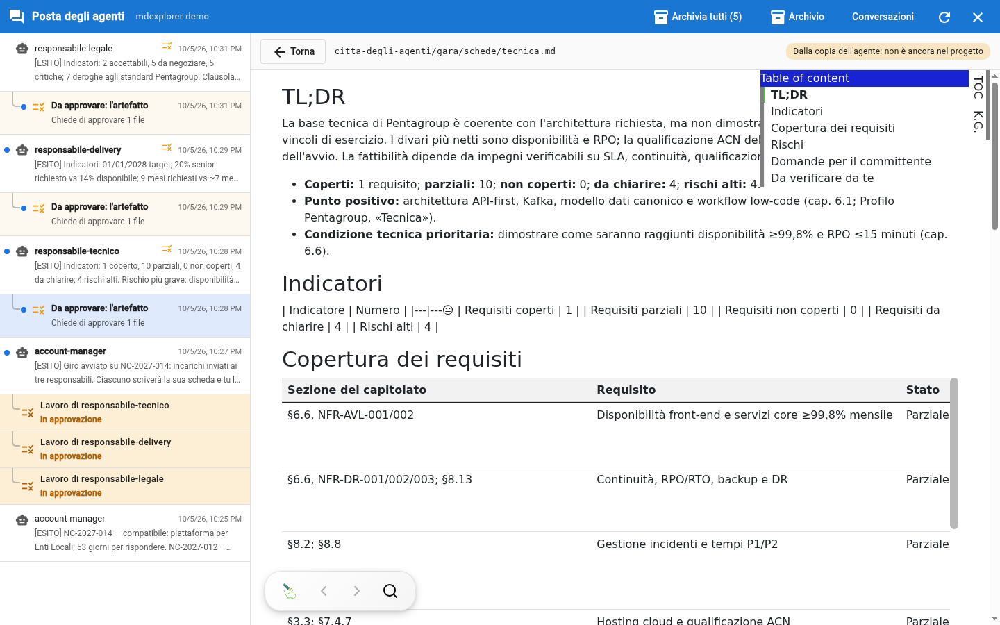

At the top: the file path and «From the agent's copy: not in the project yet». **Back** takes you back to the request.

Note:
The sheet is a real document, laid out like the others: summary, the answer to the account manager's question («Criterion
N»), indicators, table of requirements, risks, questions for the
client and, at the bottom, the three points where the agent is least sure.

---

<!-- .slide: data-background-image="assets/citta-sfondo-chiaro.svg" -->

## What to look at

<b>1. «For you to check», at the bottom.</b> The assistant says where it is least sure: start from there.

<b>2. A cited section.</b> Take a statement with «§7.4.7», open the specification and check that it says that.

<b>3. The date calculation.</b> «9 months from signing» against «go-live by 01/01/2028»: redo it by hand.

You don't have to reread the whole specification: **spot checks**, where it matters.

Note:
This is the person's work, and it is what gives the round its value. Three spot checks are enough to understand whether the sheet
is reliable. If a point does not add up, the normal way is to correct the file in the agent copy; rejecting is the exception, it asks for the reason and stops the work until someone restarts it.

---

<!-- .slide: data-background-color="#0f1b2d" data-background-image="assets/citta-sfondo.svg" -->

# Part 3

**Approve, and the round moves on. Then decide**

Note:
Part 2 ended with a sheet read. Part 3 starts from the «Approve» button and ends with the synthesis in your
folder. It is the part where you see that nobody passes the work on by hand: the workflow starts it, after your gesture.

---

<!-- .slide: data-background-image="assets/citta-sfondo-chiaro.svg" -->

## Gesture 7: «Approve» the three sheets

<b>1. You read the sheet and it holds up?</b> Click «Approve»: the sheet enters the repository.

<b>2. It doesn't fully hold up?</b> You correct it yourself in the agent copy («Take it over»), then «Approve». «Reject» is the exception: it asks for the reason and stops the work.

<b>3. You don't choose whom to pass it to</b> The workflow says who comes next. Repeat for the other two sheets.

Note:
Approving is a decision about the sheet, not about the round: the round moves on by itself, following the workflow. No agent is
woken by this click until all three sheets are approved.

---

<!-- .slide: data-background-image="assets/citta-sfondo-chiaro.svg" -->

## What that click does

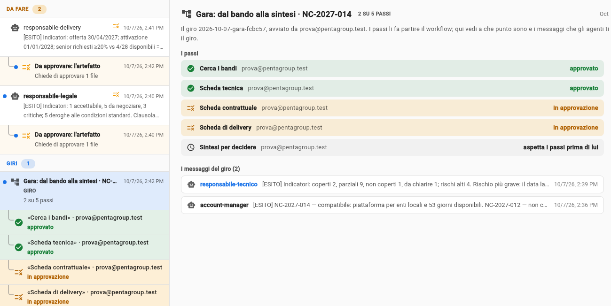

<b>1. The sheet enters</b> the main branch of the project.

<b>2. The round log records it</b> who approved and when, on the branch <code>mde/giri</code>.

<b>3. Its line turns green</b> in the round, and its message enters the round. The synthesis still waits.

Note:
The round log is what moves the work forward, even when the people are on different computers: each computer
reads it and starts the steps of its own people. An agent cannot pass the work to another one by itself.

---

<!-- .slide: data-background-image="assets/citta-sfondo-chiaro.svg" -->

## After the third: the synthesis starts by itself

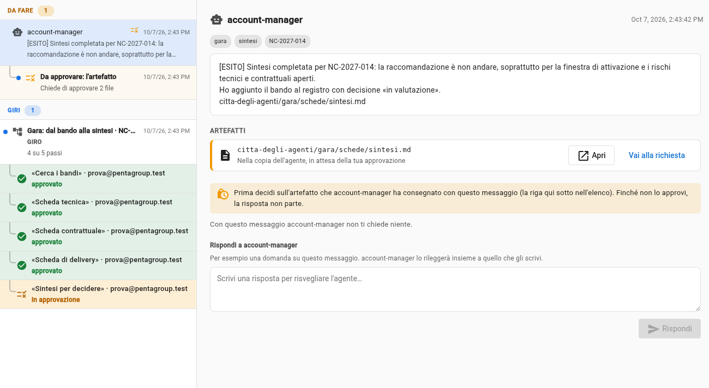

<b>Nobody starts it</b> The workflow says it starts when the three sheets are approved, on the account manager's computer.

<b>A message</b> The recommendation and the five indicators, one line each.

<b>A «To approve» item</b> With two files: the synthesis and the tender register, with the new row.

Note:
A couple of minutes after the third approval. The assignment the account manager receives lists the files of the three approved sheets:
the synthesis uses only those. The recommendation can be «bid», «bid with conditions» or «do not bid», and it changes from one trial
to the next.

---

<!-- .slide: data-background-image="assets/citta-sfondo-chiaro.svg" -->

## Read the synthesis

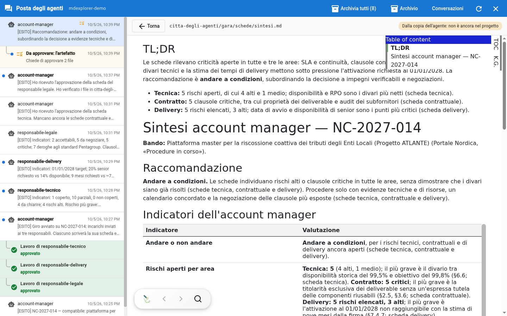

Same gesture as before: **Open** on the artifact, or on the file inside the «To approve» item.

Note:
The synthesis uses only what is in the three sheets, and every figure cites the sheet it comes from. The most valuable part is «Where the
sheets add up or contradict each other»: that is where three independent points of view become a decision.

---

<!-- .slide: data-background-image="assets/citta-sfondo-chiaro.svg" -->

## What to look at in the synthesis

<b>1. Does the recommendation hold up?</b> Read the reason and the table «The five criteria»: each result says where it comes from, the search or a sheet.

<b>2. «Where the sheets add up or contradict each other».</b> It is the part that no sheet on its own could write.

<b>3. Trace a source back.</b> The synthesis cites the sheet, the sheet cites the specification: three hops and you are at the original sentence.

<b>4. «For you to check».</b> The synthesis too says where it is least sure.

Note:
Here you see why the sheets always cite the source: the chain synthesis, sheet, specification can be traced back in a minute.
If a point does not hold up, it is a good reason not to approve.

---

<!-- .slide: data-background-image="assets/citta-sfondo-chiaro.svg" -->

## Gesture 8: approve the synthesis, or not

Approve

The synthesis and the register enter the project.

Take it over

Correct the text yourself, then «I'm done» and «Approve».

Reject

Nothing enters. The work is not lost: it stays aside.

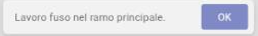

Note:
For the demo you approve. It is the last step of the round: after it, all its lines are green.

---

<!-- .slide: data-background-image="assets/citta-sfondo-chiaro.svg" -->

## Gesture 9: bring the sheets into your folder

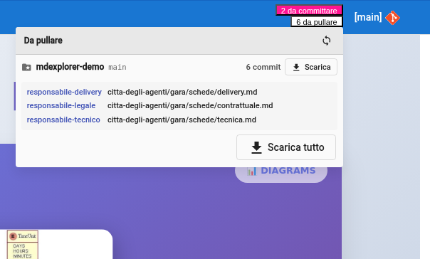

The approved sheets are in the project, but **not yet in your folder**.

1. At the top right click **«… to pull»**.
2. Click **Pull everything**.
3. In the left panel open `agent-city` → `tender` → **`sheets`**.

The panel says who wrote each file.

Note:
«Approve» publishes the work in the shared repository; your copy is updated when you pull. In a company it is the same
gesture with which each colleague receives the sheets approved by the others.

---

<!-- .slide: data-background-image="assets/citta-sfondo-chiaro.svg" -->

## The result: the synthesis, laid out

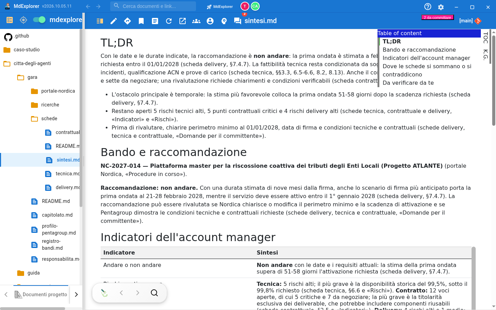

Note:
Now the synthesis is a project document like the others: on the left the four sheets, on the right the account manager's five
indicators. From here you can export it, present it or send it to colleagues.

---

<!-- .slide: data-background-image="assets/citta-sfondo-chiaro.svg" -->

## Tidy up: archive

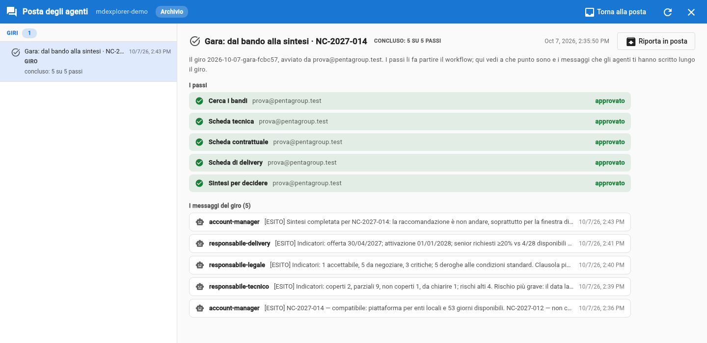

<b>Archive the round</b> In the detail of a finished round: it leaves the mailbox with all its messages.

<b>Archive read</b> In the top bar: removes the messages already read outside the rounds. The decisions stay.

<b>It deletes nothing</b> «Archive» shows archived rounds and messages; «Back to the mail» puts them back in the list.

Note:
When the round is over, the mailbox is tidied up with one gesture: the finished round is archived with all its messages. The round
log, in git, does not change: archiving only concerns your own mailbox.

---

<!-- .slide: data-background-image="assets/citta-sfondo-chiaro.svg" -->

## The decision is yours

THE ASSISTANTS HAVE

read the specification three times, with three viewpoints 
applied your company's criteria 
cross-checked the three sheets 
written what there is to decide

YOU HAVE

pressed «Start the round» and started the sheets 
read and spot-checked 
approved four times 
<b>and now you decide whether to bid</b>

«Do not bid» is a **recommendation**. If you want to bid anyway, you already have the list of conditions to obtain.

Note:
The recommendation is a line of a synthesis, not a commitment. The one who decides is the account manager, that is, the person. The «points to
clarify with the client» are the list to bring to the technical meeting.

---

<!-- .slide: data-background-image="assets/citta-sfondo-chiaro.svg" -->

## The nine gestures, in a row

PART 1 · FIND

<b>1.</b> find the robot 
<b>2.</b> write what you want and launch 
<b>3.</b> Open the search document 
then check it yourself: two minutes

PART 2 · START AND READ

<b>4.</b> press «Start the round» 
<b>5.</b> start the three sheets 
<b>6.</b> Open a sheet 
a few minutes of waiting, with the yellow robot in the bar

PART 3 · APPROVE AND DECIDE

<b>7.</b> Approve the three sheets 
<b>8.</b> Approve the synthesis (it starts by itself) 
<b>9.</b> Pull everything

Before you begin, once only: **They are all mine** and **Trust**.

Note:
Nine gestures, almost all inside the agents' mailbox. About twenty minutes, about ten of them waiting. The gestures repeat: Open
and Approve are the same for the search, for the sheets and for the synthesis.

---

<!-- .slide: data-background-color="#0a1322" data-background-image="assets/citta-sfondo.svg" -->

# The round is over

They prepared. **You checked and decided.**

Note:
Closing. To start again from scratch, just recreate the project with «Create demo project».
