# How they pass the work

## TL;DR

This document says how the people of the tender and their agents pass the work to each other: who assigns work to whom, who
starts each agent, who waits for whom, and with which documents. The plan is in [tender.workflow.json](tender.workflow.json):
MdExplorer reads it and runs it. The diagram below adds the people and the documents each agent reads: if the plan or an agent
card changes, it must be updated by hand.

- The account manager begins the round: they launch the search and press «Start the round» on the call for tenders; each
  lead starts their own sheet (if an agent has a team, whoever presses the button chooses who does it).
- The synthesis starts on its own when all three sheets are approved, on the account manager's computer.
- A rejected sheet is redone when the person presses «Restart», with no limit on the number of times.

## The round

```plantuml
@startuml
!theme plain
skinparam ArrowColor #5F6368
skinparam ArrowFontColor #5F6368
skinparam ArrowFontSize 11
skinparam actorStyle awesome
skinparam rectangle {
  BackgroundColor #F1F3F4
  BorderColor #5F6368
  RoundCorner 10
  BackgroundColor<<manual>> #E8F0FE
  BorderColor<<manual>> #1A73E8
  BackgroundColor<<askowner>> #FEF7E0
  BorderColor<<askowner>> #F29900
}
skinparam file {
  BackgroundColor #F3E8FD
  BorderColor #9334E6
  FontSize 11
  BackgroundColor<<input>> #E6F4EA
  BorderColor<<input>> #188038
}
skinparam hexagon {
  BackgroundColor #F1F3F4
  BorderColor #5F6368
}
skinparam HyperlinkUnderline false
skinparam HyperlinkColor #5F6368
hide stereotype

actor "Account manager" as am

file "nordica-portal/tenders.md\n<size:10><i>the client's calls for tenders</i></size>" <<input>> as in_portale [[mde:agent-city/tender/nordica-portal/tenders.md]]
file "tender-register.md\n<size:10><i>the calls for tenders already seen</i></size>" <<input>> as in_registro [[mde:agent-city/tender/tender-register.md]]
file "profile · Evaluation criteria\n<size:10><i>the five criteria</i></size>" <<input>> as in_criteri [[mde:agent-city/tender/pentagroup-profile.md]]

rectangle "**Find the calls for tenders**\n<size:11>account-manager</size>\n<size:10><i>launched by the account manager</i></size>" <<manual>> as s_ricerca [[mde:.github/agents/account-manager.agent.md]]

file "searches/search-YYYY-MM-DD.md\n<size:10><i>with a question for each lead</i></size>" as f_ricerca
file "tender-documents/NC-2027-014-specification.md\n<size:10><i>downloaded with the program, unchanged</i></size>" as f_capitolato

hexagon "button «Start the round»\n<size:10>pressed by the account manager</size>" as b_giro

actor "Technical\nlead" as rt
file "profile · Technical\n<size:10><i>Pentagroup's solutions</i></size>" <<input>> as in_tecnica [[mde:agent-city/tender/pentagroup-profile.md]]
file "profile · Contracts\n<size:10><i>the clauses we accept</i></size>" <<input>> as in_contratti [[mde:agent-city/tender/pentagroup-profile.md]]
actor "Legal\nlead" as rl
actor "Delivery\nlead" as rd
file "profile · Delivery and people\n<size:10><i>team and dates</i></size>" <<input>> as in_delivery [[mde:agent-city/tender/pentagroup-profile.md]]

rectangle "**Technical sheet**\n<size:11>technical-lead</size>\n<size:10><i>started by its owner</i></size>" <<askowner>> as s_tecnica [[mde:.github/agents/technical-lead.agent.md]]
rectangle "**Contract sheet**\n<size:11>legal-lead</size>\n<size:10><i>started by its owner</i></size>" <<askowner>> as s_contratto [[mde:.github/agents/legal-lead.agent.md]]
rectangle "**Delivery sheet**\n<size:11>delivery-lead</size>\n<size:10><i>started by its owner</i></size>" <<askowner>> as s_delivery [[mde:.github/agents/delivery-lead.agent.md]]

file "sheets/technical.md" as f_tecnica
file "sheets/contract.md" as f_contratto
file "sheets/delivery.md" as f_delivery

hexagon "waits for all\nthe approvals" as j_sintesi
rectangle "**Synthesis for the decision**\n<size:11>account-manager</size>\n<size:10><i>starts on its own</i></size>" as s_sintesi [[mde:.github/agents/account-manager.agent.md]]
file "sheets/synthesis.md\n<size:10><i>the five criteria, with the source</i></size>" as f_sintesi
file "tender-register.md\n<size:10><i>+ the line of the call for tenders: not proposed again</i></size>" as f_registro [[mde:agent-city/tender/tender-register.md]]
actor "Account manager" as am2

' the search
am --> s_ricerca : launches
in_portale ..> s_ricerca : reads
in_registro ..> s_ricerca : reads
in_criteri ..> s_ricerca : reads (1 and 5)
s_ricerca ..> f_ricerca : writes
s_ricerca ..> f_capitolato : downloads

' the button carries the two documents into the assignments
f_ricerca --> b_giro : approved
f_capitolato --> b_giro : approved
b_giro --> s_tecnica : assignment\ndocument + search\n(criterion 2)
b_giro --> s_contratto : assignment\ndocument + search\n(criterion 4)
b_giro --> s_delivery : assignment\ndocument + search\n(criterion 3)

' each lead starts and approves their own sheet
rt --> s_tecnica : starts\nand approves
rl --> s_contratto : starts\nand approves
rd --> s_delivery : starts\nand approves
in_tecnica ..> s_tecnica : reads
in_contratti ..> s_contratto : reads
in_delivery ..> s_delivery : reads

s_tecnica ..> f_tecnica : writes
s_contratto ..> f_contratto : writes
s_delivery ..> f_delivery : writes
s_tecnica -[#D93025,dashed]-> s_tecnica
s_contratto -[#D93025,dashed]-> s_contratto
s_delivery -[#D93025,dashed]-> s_delivery

' the synthesis
f_tecnica --> j_sintesi : approved
f_contratto --> j_sintesi : approved
f_delivery --> j_sintesi : approved
j_sintesi --> s_sintesi
s_sintesi ..> f_sintesi : writes
s_sintesi ..> f_registro : updates
am2 --> f_sintesi : approves\nand decides

legend right
  <back:#E8F0FE>   </back> launched by the person
  <back:#FEF7E0>   </back> started by the agent's owner
  <back:#F1F3F4>   </back> starts on its own
  <back:#E6F4EA>   </back> document the agent reads
  <back:#F3E8FD>   </back> document the agent writes (the person approves it)
  <color:#D93025>- - ></color> after a rejection it is redone when the person presses «Restart»
endlegend
@enduml
```

Each box is a turn of work by an agent: the name in bold is the step, below it is the agent. The figures are the people: the
account manager launches the search and presses the button; each lead starts and approves their agent's sheet. In green the
documents an agent reads, in lilac those it writes and the person approves. The tender document and the search come out of the
account manager and go, with the button, into the assignment of the three leads. A click on a box opens the agent's card.

This diagram is drawn by hand to show people and documents. MdExplorer draws the rules itself, exactly as it runs them, from
[tender.workflow.json](tender.workflow.json) in the [tender README](README.md#how-it-flows).

## Who decides and who writes

| What | Where it is |
|---|---|
| Who answers for which agent | [responsibilities.md](responsibilities.md) |
| How they pass the work (this document) | [tender.workflow.json](tender.workflow.json) |
| How each agent does its job | its card, in `.github/agents/` |
| What happened in each round | the round log, on the `mde/giri` branch of the repository |

[The tender case](README.md) · [Section index](../README.md)
