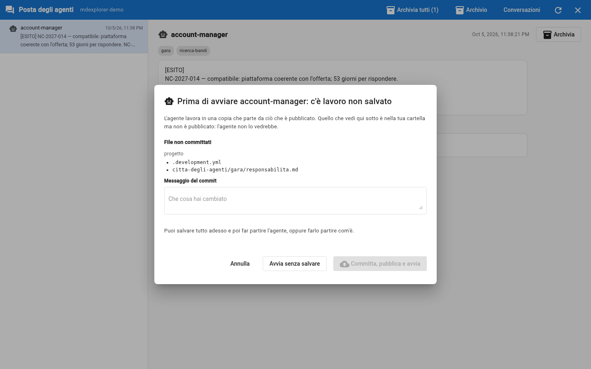
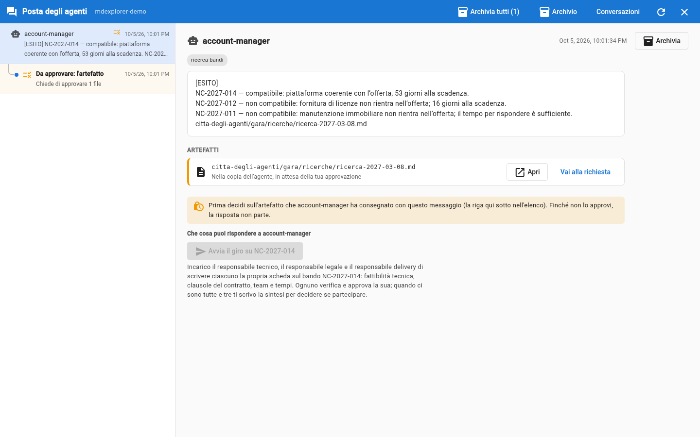

# Trial 3: the account manager finds the call for tenders

## TL;DR

You are Pentagroup's account manager and you have an agent that checks Nordica's tender site for you. You launch it, it reads
the open procedures, compares them with the ones already seen and with Pentagroup's criteria, and produces **two things**: a document
with the result of the search and a short message that tells you what it proposes. It does not start anything by itself.

- You launch it with the robot icon on its file, in the left panel.
- **The document** goes in `tender/searches/`: it is the full reasoning, and you approve it like everything written by an agent.
- **The tender document** of the compatible call for tenders is **downloaded** by the agent from the portal with a program of the project, into
  `tender/tender-documents/`: it is the specification the three leads will work on.
- **The message** arrives in the mailbox: a few lines that start with `[RESULT]`, with the path of the document.

## Launch it

1. In the left panel open `.github` and then `agents`. On the `account-manager.agent.md` row click the robot
   icon, «Launch agent». If the panel is narrow, the icon may be cut off: widen it a little.
2. In the «Launch prompt» box write:

   > Check the tender portal.

3. Leave the other options as they are (project engine, empty model, «Work in an isolated workplace»
   ticked) and click **Launch now**.

**The first time a window appears: «Before starting account-manager: there is unsaved work».** That is how it should be. By turning on
the city and assigning the agents to yourself you changed two files (`.development.yml` and `tender/responsibilities.md`), and the agent
works in a copy that starts from what is **published**: it would not see those two files. Write a message, for example
«city on», and click **Commit, publish and start**. Everything goes to your local repository, not to the demo's public one.



After about a minute «🤖 Agent "account-manager.agent.md" completed.» appears, and on the «Agent messages» speech bubble
in the toolbar a number appears.

## Read the message

Click the speech bubble: the agents' mailbox opens, full screen. In the list on the left there is a message from `account-manager`: click it. The words change, because behind it there is
a model, but the content is this:

```text
[RESULT]
NC-2027-014 — compatible: tax platform for Local Authorities, with 53 days to respond.
NC-2027-012 — not compatible: licence supply excluded; only 16 days left.
NC-2027-011 — not compatible: building maintenance, not managed services or platforms.
agent-city/tender/searches/search-2027-03-08.md
```

Under the message there is a **button**: «Start the round on NC-2027-014», with a note on what happens when you press it (who gets
the assignment, and to do what). The possible replies are declared by the agent's card: you do not have to guess what to write.
Under the button there is also a box, to write to the agent in your own words if something does not add up. For now both are
**closed**: first you have to decide on the search.



## Read the document

The message is the summary; the reasoning is in the document. Under the text of the message, in the **Artifacts** section, there are
**two files**, both «In the agent's copy, waiting for your approval»:

- `tender/searches/search-2027-03-08.md`, the search, written by the agent;
- `tender/tender-documents/NC-2027-014-specification.md`, the specification of the compatible call for tenders. The agent did not write it: it was
  copied byte for byte by the program `tender/tools/download-tender-document.mjs`, which the agent ran. An official
  document is not copied out by hand.

Click **Open** on the search: the document opens right there. Inside you find:

- the table of the procedures found, with the days left until the deadline;
- for each procedure the five criteria: the two that block (the nature of the call for tenders and the time to respond) are judged by
  the account manager; the other three say «to be assessed in the round», and by whom;
- **For the leads**: the tender document and the question it leaves to each one (criterion 2 to the technical lead, 3 to the delivery lead, 4 to the
  legal lead);
- the procedures already in the register, which it did not assess.

**Compatible** here means «worth a round of the three leads», not «worth bidding for»: that is what their sheets will say.

Click **Back**. In the list on the left, **under** the account manager's message, there is the indented row «To approve:
the artefact»: it is the approval request for the search and the specification. Click it and press **Approve**: both enter the project.

Only now does the «Start the round» button open. It is a rule of the app, not a courtesy of the agent: a piece of work does not move
on until you have approved what justifies it.

## Check it

This is the gesture you are asked for throughout the case: you **check**, you do not trust. Three checks, two minutes:

1. Open the [tender site](../tender/nordica-portal/tenders.md): are all three open procedures there? Are the codes right?
2. Open [Pentagroup's profile](../tender/pentagroup-profile.md), at the bottom: are the criteria the ones the agent quotes? The
   «Working date» is 8 March 2027: from there to the deadline of NC-2027-012 (24 March) there are **16 days**, and to that of
   NC-2027-014 (30 April) there are **53**. Do they add up?
3. Open the [register](../tender/tender-register.md): the two procedures already seen are **not** in the message. Why?

## What happened

- The agent read three files, and only those: they are its documents.
- It **discarded** two procedures with a reason you can check, and proposed one.
- It produced **two outputs**: the search document and the message. The message does not contain the document, it says where it is.
- It ended with a **question** and not with an action: you decide to start the round, with a reply.
- Nothing changed in your folder: the document is in a separate copy until you approve it.

## And if nothing happens

- **No notice after two minutes.** The AI engine does not answer: check that the command line (`copilot`, `claude` or
  `opencode`) is installed and signed in, or choose another engine in the launch window.
- **The speech bubble has no number.** Open the mailbox and click the circular arrow at the top right.
- **The agent says it cannot find the files.** Check that you opened the right folder: the agents look for the documents in
  `agent-city/tender/`.

[Trial 4: start the round](04-start-the-round.md) · [Trial 2](02-enable-the-agents.md) · [Section index](../README.md)
