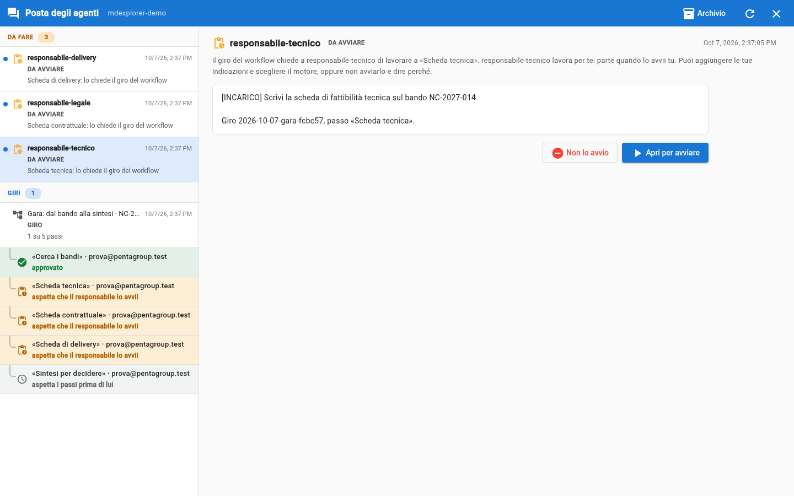
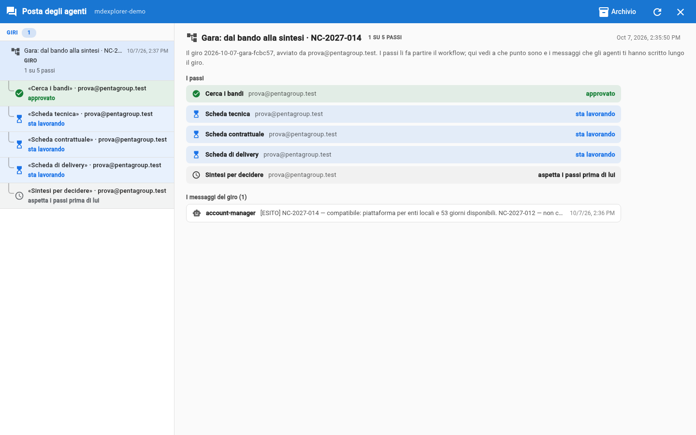
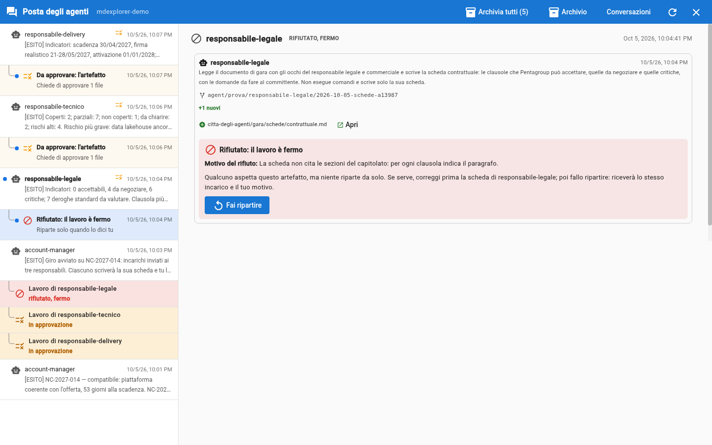

# Trial 4: start the round and read the sheets

## TL;DR

Once the search is approved, you press the «Start the round» button under the account manager's message. From there the hand-offs are done by
MdExplorer, following the [tender workflow](../tender/workflow.md): each lead finds their sheet «to
start» in the mailbox, starts it, and their agent reads the same specification through **their own** eyes. You follow the round from the message you
started it from, and you read each sheet before approving it.

- The button does not wake the account manager: it opens the round, and the three sheets appear «to start».
- In the «Rounds» section of the mailbox the round is an item, with one row per step that changes state by itself.
- The three sheets arrive in about 3-5 minutes; you read a sheet with **Open**, before approving it.

## Press «Start the round»

1. Click the speech bubble and, in the list, the `account-manager` message from trial 3.
2. Under the text there is **What you can reply to account-manager**, with the **Start the round on NC-2027-014** button and
   its description: the technical lead, the legal lead and the delivery lead each receive the assignment to write their own
   sheet **on the downloaded tender document**, with the search for the criterion that belongs to each one, and they start it whenever they
   want. The paths of the document and of the search were put in the button by the agent.
3. Press it.

If the button is closed and it says «First decide on the artefact», you have not approved the search yet: it is the final step
of trial 3. If an agent had more than one owner (a team), under the button «Who does it?» would appear with
the list of people: you choose there, before starting the round.

In the list three new rows appear right away, **To start**: one per sheet, with the assignment the workflow wrote for
that lead: the call for tenders, the **tender document** and the **search**, with the criterion that is theirs (for example «criterion
2, competence, is yours»). It is asked by «the workflow round»: no agent wrote to the others.



## Start the three sheets

For each **To start** row:

1. Click it: read the assignment.
2. **Open to start** opens the agent's launch window with the assignment inside. You can add your own directions
   («look at chapter 6 first») and choose engine and model; then **Start**.
3. If «Before starting…: there is unsaved work» appears, it is because of the two files you changed in trials 1 and 2
   (`.development.yml` and `responsibilities.md`): the agent does not need them, so choose **Start without saving**.

If you do not want to do a sheet, **Don't start it** asks you why: the step closes, and whoever follows the round reads the reason.
In a team there is also **Pass to a colleague**, to give it to someone who answers for the same agent.

## Follow the round

In the mailbox, the **Rounds** section has a new item: «Tender: from the call for tenders to the synthesis · NC-2027-014», with how many steps are
done. Below, one row per step, with its title and who answers for it; by clicking the round, on the right you see the steps and the
messages of the round. The three sheets «to start» are instead in **To do**: they are waiting for you.

| Row | What it means | Background |
|---|---|---|
| waiting for its owner to start it | the sheet is «to start» in the mailbox of whoever answers for it | amber |
| working | the agent is writing the sheet | light blue |
| awaiting approval | the sheet is there: it waits for its owner's decision | amber |
| approved | the sheet is in the project | green |
| rejected, stopped | the owner rejected it: it does not restart by itself | red |
| waits for the steps before it | the synthesis: it starts when the three sheets are approved | grey |



The rows change by themselves, and when one changes it flashes for a few seconds. This is what **whoever started the round** sees:
here, the account manager. In the demo the four people are you; in a company these rows tell them where each
colleague is, without asking, even if the colleagues work on other computers.

It takes about **3-5 minutes**. Each lead writes you a `[RESULT]` message of a few lines, for example:

```text
[RESULT]
Indicators: 2 covered, 7 partial, 0 not covered, 1 to clarify; 4 high risks.
Most serious risk: the data lakehouse does not have the ACN qualification yet (§3.3).
agent-city/tender/sheets/technical.md
```

Under each of these messages there is its «To approve: the artefact» row.

## Read a sheet before approving it

Take the `delivery-lead` message: it is the one with the easiest calculation to check.

1. Click the «To approve: the artefact» row under its message.
2. On the file `agent-city/tender/sheets/delivery.md` click **Open**: you read it laid out, as it is in the agent's delivery.
3. **Back** takes you back to the request. Do not approve yet: you do that in trial 5.

What to look at, in order:

- **«For you to check»**, at the bottom. The agent tells you where it is least sure: check there first.
- **Every statement cites the section of the specification** (for example «§7.4.7»). Open it in the [tender document](../tender/tender-documents/README.md) downloaded by the account manager
  and check that it says what the sheet says.
- **The date calculation.** The delivery sheet writes the calculation next to the result: «9 months from signing» against
  «activation by 01/01/2028». Redo it by hand.

## If a sheet does not convince you

The normal way is **to fix it yourself**: from the branch selector choose «Worktree» and the agent, and you work in its copy as after
a branch switch. You fix the sheet, go back to your work (the app asks you to commit and publish) and then approve it.
It is explained in [Working in an agent copy](../guide/working-in-an-agent-copy.md).

**Reject** is the exception, for when the sheet is so wrong that it is better to redo it. It asks you for the reason, and then it **stops**:

- the sheet stays in the mailbox as «Rejected: the work is stopped», and its row in the round turns red;
- **nothing restarts by itself**: if the mistake comes from the agent's card (the `.agent.md` file), you have time to fix it;
- when you are ready press **Restart**: the agent receives the same assignment, plus your reason. The tender workflow
  puts no limit on the number of times.



## What happened

- The button opened a **round**: MdExplorer read in the workflow that «Start the round» starts the three sheets, and put them
  «to start» in the mailbox of whoever answers for them. If the search had found two calls for tenders, there would have been two
  buttons, and each button would have opened its own round.
- The three agents read **the same specification**, but each one read **its own chapter of Pentagroup's profile**: the
  technical lead the technical one, the legal lead the contracts one, the delivery lead the people one. That is why the three sheets
  say different things.
- They each worked in **their own copy** of the project, in parallel, and delivered a different file: that is why there are three
  requests and not one.
- No sheet is in the project: they are branches to approve. The work is yours until you approve it.

## And if nothing happens

- **After the button no «To start» appears.** Check that in «Project Settings» the city has the
  workflow document (`agent-city/tender/workflow.md`): without it, the button just wakes the account manager.
- **After five minutes a row still says «working».** Wait: the robot in the top bar spins as long as
  someone is working.
- **A lead says it cannot find the documents.** It does not make up the sheet: it writes that to you. Check that you opened
  the right folder.
- **The number of indicators is different from mine.** Normal: a model never gives the same words twice. The
  words and a few counts change; the real gaps (RPO, ACN qualification, dates) do not.

[Trial 5: approve, and the round moves on](05-approve-and-pass-the-work.md) · [Trial 3](03-the-account-manager-finds-the-tender.md) · [Section index](../README.md)
