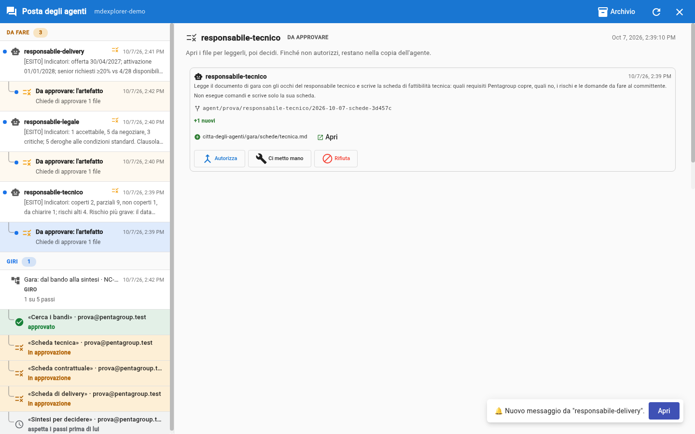
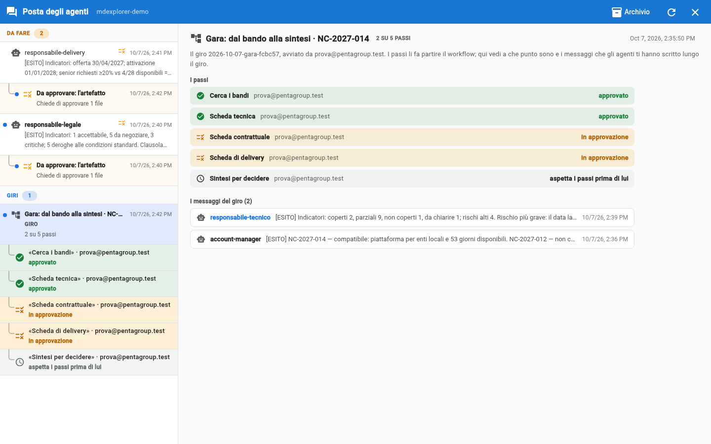

# Trial 5: approve, and the round moves on

## TL;DR

Approving a sheet brings it into the main branch and writes it in the round's log. You do not have to pass it to anyone: who comes
next is set by the workflow, and MdExplorer starts it. After the third approval the account manager's synthesis starts
by itself, with the files of the three sheets.

- In the request there are the usual three gestures: **Approve**, **Take it over**, **Reject**.
- In the round, in the «Rounds» section, the row of each approved sheet turns green, and its message enters the round.
- No agent writes to another: the synthesis is started by the round.

## Approve the first sheet

1. In the mailbox, in **To do**, under the `technical-lead` message, click the indented row **To approve: the artefact**.

   

2. Click **Approve**: the sheet enters the main branch of the repository.

Now click the round in the **Rounds** section: the «Technical sheet» row has turned **green**, approved, and the technical
lead's message has moved from «To do» into the round. The other two sheets are still awaiting approval, and the synthesis waits.

## Approve the second and the third

Repeat with `legal-lead` and with `delivery-lead`. After the third, within a minute the «Synthesis for the
decision» row goes from «waits for the steps before it» to «working»: the account manager is writing the synthesis.

## What happened, step by step

| Your gesture | What MdExplorer does |
|---|---|
| **Approve** the first and the second sheet | brings them into the main branch and writes «approved» in the round's log; the synthesis still waits |
| **Approve** the third | as above; now the workflow says the synthesis can start: MdExplorer sends the assignment to the account manager, with the paths of the three approved sheets |

The synthesis starts **on the account manager's computer**: they are the one who launched the round, and the synthesis belongs to their agent. There
is nothing to start by hand: the workflow declares it «starts by itself» (you can see it in the [diagram](../tender/workflow.md)).

The round's log is in git, on a separate branch (`mde/giri`): every gesture adds a line to it, with who did it and
when. In a company that is where the computers of the four people read how far along the round is.

## If you reject a sheet

The synthesis **does not start**: it waits for all three sheets to be approved. The rejected sheet stays stopped until its
owner presses **Restart**; when the new version is approved, the round moves on from where it was.

## And if nothing happens

- **After the third approval the synthesis stays «waits for the steps before it».** Check that the three rows are green:
  if one is still amber, that sheet is not approved. The mailbox reloads by itself; to force it, the circular arrow at the
  top right.
- **A row says «failed».** Hover over it with the mouse: the reason is in the tooltip.

[Trial 6: the synthesis and your decision](06-the-synthesis-and-your-decision.md) · [Trial 4](04-start-the-round.md) · [Section index](../README.md)
