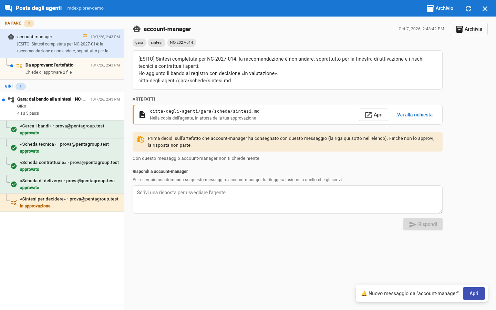

# Trial 6: the synthesis and your decision

## TL;DR

With the three sheets approved, the synthesis starts by itself: the account manager writes the five indicators that matter to them and
updates the tender register. It is a **fourth request**, and you approve it like the others. The decision to bid,
on the other hand, belongs to no agent: it is yours.

- The synthesis puts the three sheets together and says where they add up or contradict each other.
- The **The five criteria** table closes the filter of the search: 1 and 5 had been judged by the account manager, 2, 3 and
  4 were closed by the three sheets, each with the sheet it comes from.
- The recommendation is a proposal («bid», «bid with conditions», «do not bid»).
- The synthesis also has «For you to check»: the point where its author is least sure.

## Read the synthesis

1. After the third sheet is approved, wait a couple of minutes: `account-manager` writes you a message with the
   recommendation and the five indicators. In the round, the «Synthesis for the decision» row says «awaiting approval».
2. Under that message there is the row **To approve: the artefact**: it is the request of `account-manager`, with two files,
   `sheets/synthesis.md` and `tender-register.md`.
3. As in trial 4: on the file `synthesis.md` click **Open**, read, then **Back**.

   

## The five indicators

| Indicator | What it says |
|---|---|
| **Bid or do not bid** | the recommendation, with the reason in two lines |
| **Open risks by area** | how many for technical, contract and delivery, and the most serious of each |
| **Points to clarify with the client** | the list for Annex C: each point with the area and the section of the specification |
| **Deadlines** | bid, implementing decree, required activation, with the days left from 8 March 2027 |
| **What is needed from each lead** | one list per person |

## Look for where the sheets talk to each other

It is the part a single agent could not do: **«Where the sheets add up or contradict each other»**. With the three sheets
in front of you, you usually find that:

- technical and legal agree on a gap in the DORA regulation: the incident notification Pentagroup guarantees
  does not match the one the specification requires;
- the delivery lead calculated that the first wave of work needs more months than those left before the
  required activation date, even in the most favourable case. That is why the recommendation is usually **do not bid**.

**Check it yourself.** Take a point of the synthesis and trace it back: it cites the sheet, the sheet cites the specification. Three hops, and you are
at the original sentence. If a point does not hold, you have just earned the reason not to approve.

## Approve, or not

Approve the synthesis with **Approve**: it is the last step of the round, and all its rows are now green. The tender register
now contains the tender, «under evaluation».

If you do not agree, the normal way is to fix it yourself: you enter the agent copy from the branch selector («Worktree»),
fix the synthesis, go back to your work and approve it. **Reject** is the exception: it asks you for the reason and ends there. The synthesis
is the last step of the round, so nobody is waiting for it: after the rejection **Restart** has it rewritten with your reason.

## The decision is yours

The agents **prepared**: they read a long specification, applied your company's criteria,
cross-checked the skills and wrote what needs to be decided. But they did not decide, and they could not: the recommendation is one
line of a synthesis, not a commitment. If you want to bid anyway, the choice belongs to the account manager, that is to you, and the
synthesis has given you the list of conditions to obtain: the points to clarify with the client.

## Tidy up

The round is over: in the «Rounds» section it says «finished: 5 of 5 steps». Select it and press **Archive the round**: it leaves the
mailbox with all its messages. You find it again in **Archive**, in the top bar, with «Back to the mail». The round's log
does not change: archiving only concerns your mailbox.

## After the trial

The demo created a branch and some files in your clone: to read the synthesis in your folder, download the updates
with the pull from the git bar. If you want to start over from scratch, reopen the demo with «Create demo project».

## And if nothing happens

- **The message with the synthesis does not arrive.** In the round, in the «Rounds» section, the three rows of the sheets
  must be green (approved): if one is still amber, that sheet is not approved.
- **The synthesis says it cannot calculate the days.** It did not find the «Working date» in the profile: check that
  [Pentagroup's profile](../tender/pentagroup-profile.md) is intact.

[Section index](../README.md) · [Trial 5](05-approve-and-pass-the-work.md) · [Back to the start](../../README.md)
