# Come si passano il lavoro

## TL;DR

Questo documento dice come le persone della gara e i loro agenti si passano il lavoro: chi incarica chi, chi avvia ogni
agente, chi aspetta chi, e con quali documenti. Il piano sta in [gara.workflow.json](gara.workflow.json): MdExplorer lo legge e
lo esegue. Il diagramma qui sotto aggiunge le persone e i documenti che ogni agente legge: se cambia il piano o una scheda,
va aggiornato a mano.

- Il giro lo comincia l'account manager: lancia la ricerca e preme «Avvia il giro» sul bando; le tre schede le avvia
  ciascun responsabile (se un agente ha un team, chi preme il pulsante sceglie chi la fa).
- La sintesi parte da sola quando tutte e tre le schede sono approvate, sul computer dell'account manager.
- Una scheda rifiutata si rifà quando la persona preme «Fai ripartire», senza un limite di volte.

## Il giro

```plantuml
@startuml
!theme plain
skinparam ArrowColor #5F6368
skinparam ArrowFontColor #5F6368
skinparam ArrowFontSize 11
skinparam actorStyle awesome
skinparam rectangle {
  BackgroundColor #F1F3F4
  BorderColor #5F6368
  RoundCorner 10
  BackgroundColor<<manual>> #E8F0FE
  BorderColor<<manual>> #1A73E8
  BackgroundColor<<askowner>> #FEF7E0
  BorderColor<<askowner>> #F29900
}
skinparam file {
  BackgroundColor #F3E8FD
  BorderColor #9334E6
  FontSize 11
  BackgroundColor<<input>> #E6F4EA
  BorderColor<<input>> #188038
}
skinparam hexagon {
  BackgroundColor #F1F3F4
  BorderColor #5F6368
}
skinparam HyperlinkUnderline false
skinparam HyperlinkColor #5F6368
hide stereotype

actor "Account manager" as am

file "portale-nordica/bandi.md\n<size:10><i>i bandi del committente</i></size>" <<input>> as in_portale [[mde:citta-degli-agenti/gara/portale-nordica/bandi.md]]
file "registro-bandi.md\n<size:10><i>i bandi già visti</i></size>" <<input>> as in_registro [[mde:citta-degli-agenti/gara/registro-bandi.md]]
file "profilo · Criteri di valutazione\n<size:10><i>i cinque criteri</i></size>" <<input>> as in_criteri [[mde:citta-degli-agenti/gara/profilo-pentagroup.md]]

rectangle "**Cerca i bandi**\n<size:11>account-manager</size>\n<size:10><i>lo lancia l'account manager</i></size>" <<manual>> as s_ricerca [[mde:.github/agents/account-manager.agent.md]]

file "ricerche/ricerca-AAAA-MM-GG.md\n<size:10><i>con una domanda per ciascuno</i></size>" as f_ricerca
file "documenti-di-gara/NC-2027-014-capitolato.md\n<size:10><i>scaricato col programma, identico</i></size>" as f_capitolato

hexagon "pulsante «Avvia il giro»\n<size:10>lo preme l'account manager</size>" as b_giro

actor "Responsabile\ntecnico" as rt
file "profilo · Tecnica\n<size:10><i>le soluzioni di Pentagroup</i></size>" <<input>> as in_tecnica [[mde:citta-degli-agenti/gara/profilo-pentagroup.md]]
file "profilo · Contratti\n<size:10><i>le clausole che accettiamo</i></size>" <<input>> as in_contratti [[mde:citta-degli-agenti/gara/profilo-pentagroup.md]]
actor "Responsabile\nlegale" as rl
actor "Responsabile\ndelivery" as rd
file "profilo · Delivery e persone\n<size:10><i>team e date</i></size>" <<input>> as in_delivery [[mde:citta-degli-agenti/gara/profilo-pentagroup.md]]

rectangle "**Scheda tecnica**\n<size:11>responsabile-tecnico</size>\n<size:10><i>la avvia il suo responsabile</i></size>" <<askowner>> as s_tecnica [[mde:.github/agents/responsabile-tecnico.agent.md]]
rectangle "**Scheda contrattuale**\n<size:11>responsabile-legale</size>\n<size:10><i>la avvia il suo responsabile</i></size>" <<askowner>> as s_contratto [[mde:.github/agents/responsabile-legale.agent.md]]
rectangle "**Scheda di delivery**\n<size:11>responsabile-delivery</size>\n<size:10><i>la avvia il suo responsabile</i></size>" <<askowner>> as s_delivery [[mde:.github/agents/responsabile-delivery.agent.md]]

file "schede/tecnica.md" as f_tecnica
file "schede/contrattuale.md" as f_contratto
file "schede/delivery.md" as f_delivery

hexagon "attende tutte\nle approvazioni" as j_sintesi
rectangle "**Sintesi per decidere**\n<size:11>account-manager</size>\n<size:10><i>parte da sola</i></size>" as s_sintesi [[mde:.github/agents/account-manager.agent.md]]
file "schede/sintesi.md\n<size:10><i>i cinque criteri, con la fonte</i></size>" as f_sintesi
file "registro-bandi.md\n<size:10><i>+ la riga del bando: non lo ripropone più</i></size>" as f_registro [[mde:citta-degli-agenti/gara/registro-bandi.md]]
actor "Account manager" as am2

' la ricerca
am --> s_ricerca : lancia
in_portale ..> s_ricerca : legge
in_registro ..> s_ricerca : legge
in_criteri ..> s_ricerca : legge (1 e 5)
s_ricerca ..> f_ricerca : scrive
s_ricerca ..> f_capitolato : scarica

' il pulsante porta i due documenti agli incarichi
f_ricerca --> b_giro : approvata
f_capitolato --> b_giro : approvato
b_giro --> s_tecnica : incarico\ndocumento + ricerca\n(criterio 2)
b_giro --> s_contratto : incarico\ndocumento + ricerca\n(criterio 4)
b_giro --> s_delivery : incarico\ndocumento + ricerca\n(criterio 3)

' ogni responsabile avvia e approva la sua scheda
rt --> s_tecnica : avvia\ne approva
rl --> s_contratto : avvia\ne approva
rd --> s_delivery : avvia\ne approva
in_tecnica ..> s_tecnica : legge
in_contratti ..> s_contratto : legge
in_delivery ..> s_delivery : legge

s_tecnica ..> f_tecnica : scrive
s_contratto ..> f_contratto : scrive
s_delivery ..> f_delivery : scrive
s_tecnica -[#D93025,dashed]-> s_tecnica
s_contratto -[#D93025,dashed]-> s_contratto
s_delivery -[#D93025,dashed]-> s_delivery

' la sintesi
f_tecnica --> j_sintesi : approvata
f_contratto --> j_sintesi : approvata
f_delivery --> j_sintesi : approvata
j_sintesi --> s_sintesi
s_sintesi ..> f_sintesi : scrive
s_sintesi ..> f_registro : aggiorna
am2 --> f_sintesi : approva\ne decide

legend right
  <back:#E8F0FE>   </back> lo lancia la persona
  <back:#FEF7E0>   </back> lo avvia il responsabile dell'agente
  <back:#F1F3F4>   </back> parte da solo
  <back:#E6F4EA>   </back> documento che l'agente legge
  <back:#F3E8FD>   </back> documento che l'agente scrive (lo approva la persona)
  <color:#D93025>- - ></color> dopo un rifiuto si rifà quando la persona preme «Fai ripartire»
endlegend
@enduml
```

Ogni riquadro è un turno di lavoro di un agente: il nome in grassetto è il passo, sotto c'è l'agente. Gli omini sono le
persone: l'account manager lancia la ricerca e preme il pulsante; ogni responsabile avvia e approva la scheda del suo agente.
In verde i documenti che un agente legge, in lilla quelli che scrive e che la persona approva. Il documento di gara e la ricerca
escono dall'account manager ed entrano, con il pulsante, nell'incarico dei tre responsabili. Un clic sul riquadro apre la
scheda dell'agente.

Questo diagramma è disegnato a mano per far vedere persone e documenti. Le regole, così come MdExplorer le esegue, le disegna
lui stesso da [gara.workflow.json](gara.workflow.json) nel [README della gara](README.md#come-gira).

## Chi decide e chi scrive

| Cosa | Dove sta |
|---|---|
| Chi risponde di quale agente | [responsabilita.md](responsabilita.md) |
| Come si passano il lavoro (questo documento) | [gara.workflow.json](gara.workflow.json) |
| Come ogni agente fa il suo lavoro | la sua scheda, in `.github/agents/` |
| Che cosa è successo in ogni giro | il registro dei giri, sul ramo `mde/giri` del repository |

[Il caso della gara](README.md) · [Indice della sezione](../README.md)
