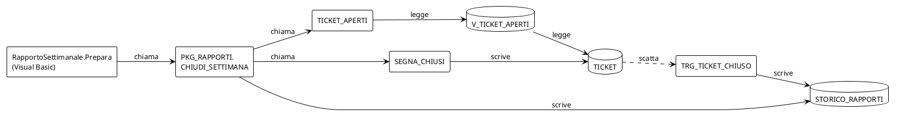

# Il database dell'help desk, in PL/SQL

## TL;DR

Questa cartella è il **database inventato** dell'help desk di Alpina Servizi, in PL/SQL di Oracle: le tabelle, una vista,
il package `PKG_RAPPORTI` che il [programma Visual Basic](../esempio-vb/README.md) chiama per chiudere la settimana, un
trigger e una funzione. Serve alla [prova 8](../prove/08-il-codice-e-il-database.md): il grafo che va dal codice alle
tabelle passando per le procedure.

- Il PL/SQL non è un linguaggio di MdExplorer: lo legge il **pacchetto di linguaggio** in `.mde-languages/plsql/`, già nel progetto.
- Non si esegue: nessun database qui, i file si leggono.
- Il package e le tabelle hanno gli stessi nomi che l'SQL del programma Visual Basic scrive nelle sue stringhe.

## Che cosa c'è

| File | Che cosa contiene |
|---|---|
| `tabelle.sql` | le tabelle `OPERATORE`, `TICKET`, `STORICO_RAPPORTI` e la vista `V_TICKET_APERTI` |
| `pkg_rapporti.pks` | la specifica del package: che cosa espone |
| `pkg_rapporti.pkb` | il corpo del package: `CHIUDI_SETTIMANA`, che il Visual Basic chiama, e le due procedure che usa |
| `trg_ticket_storico.trg` | un trigger su `TICKET` che pulisce lo storico quando un ticket si chiude |
| `operatori_attivi.fnc` | una funzione da sola, che conta gli operatori attivi |

## Perché è fatto così

- **Le forme che il pacchetto deve saper leggere**: una procedura con un blocco `BEGIN … EXCEPTION … END;` dentro, un
  `IF … END IF;`, una chiamata a un package che non c'è (`PKG_NOTIFICHE.AVVISA`, resta un nodo esterno) e una a un package
  di Oracle (`DBMS_OUTPUT`, esclusa), un `UPDATE` con la tabella sulla riga e il `SET` sotto.
- **Gli stessi nomi del Visual Basic**: `PKG_RAPPORTI.CHIUDI_SETTIMANA`, `TICKET`, `OPERATORE`, `STORICO_RAPPORTI`. Quando
  questa cartella entra nel grafo, le frecce che dal Visual Basic andavano a quei nomi passano agli oggetti veri.

[Torna alla sezione](../README.md)
