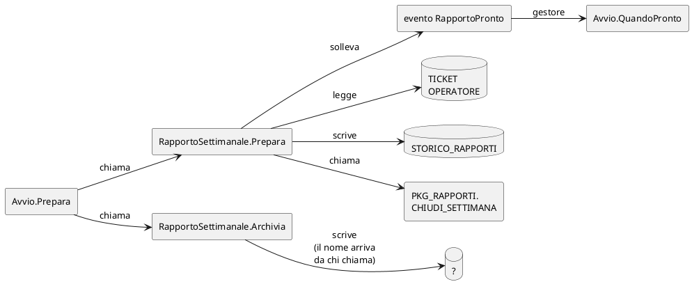

# Il rapporto settimanale, in Visual Basic

## TL;DR

Questa cartella è un secondo **programma inventato**, in **Visual Basic .NET**: il rapporto settimanale dell'help desk
di Alpina Servizi, che legge i ticket dal database, scrive lo storico e chiude la settimana con una procedura. Serve alle
[prove 6 e 7](../README.md#il-percorso): il codice VB, l'SQL scritto nelle stringhe, un evento e il suo gestore.

- Due file `.vb` e un file di progetto (`Alpina.Rapporti.vbproj`) da cui MdExplorer prende lo spazio dei nomi.
- Si compila (`dotnet build`), ma non si esegue: gli serve un database, e qui non c'è.
- Ogni stringa SQL è scritta in un modo diverso apposta: intera, a pezzi, in una costante, con il nome della tabella in una variabile.

## Cosa fa

`Avvio.Prepara` crea un `RapportoSettimanale` e gli chiede il rapporto di una settimana. `RapportoSettimanale.Prepara`
conta i ticket della settimana con i nomi degli operatori, scrive il risultato in `STORICO_RAPPORTI`, chiama la procedura
`PKG_RAPPORTI.CHIUDI_SETTIMANA` e solleva l'evento `RapportoPronto`. `Avvio` lo ascolta con `Handles` e stampa il
risultato. Poi `Archivia` toglie le righe più vecchie di un anno da una tabella che sceglie chi chiama.

## Dove sta cosa

| File | Ruolo |
|---|---|
| `Alpina.Rapporti.vbproj` | il file di progetto: dice lo spazio dei nomi (`Alpina.Rapporti`) e le opzioni del linguaggio |
| `RapportoSettimanale.vb` | la classe che parla con il database: tutto l'SQL sta qui |
| `Avvio.vb` | un `Module` con il campo `WithEvents` e il gestore dell'evento |

## Perché è fatto così

- **L'SQL in quattro forme.** In `Prepara` la query è una concatenazione su tre righe (`"SELECT … FROM TICKET T" & " JOIN
  OPERATORE O …" & …`); l'`INSERT` e il blocco `BEGIN … END;` sono passati a un altro metodo, `Esegui`; la query degli
  operatori sta in una **costante**; in `Archivia` il nome della tabella è un **parametro**. Il grafo collega l'SQL al
  metodo che lo scrive, non a quello che lo esegue: `Esegui` e `Conta` non leggono né scrivono niente, per il grafo.
- **Un evento.** `RaiseEvent RapportoPronto` in `Prepara`, `Handles _rapporto.RapportoPronto` in `Avvio`: in VB il gestore
  si lega all'evento con una parola, e nel codice non c'è nessuna chiamata a `QuandoPronto`.
- **Le forme del VB.** `_rapporto.OperatoriAttivi` senza parentesi è una chiamata; un `Module` è una classe con i membri
  condivisi; lo spazio dei nomi `Alpina.Rapporti` non è scritto in nessun file `.vb`, sta nel file di progetto.

[Torna alla sezione](../README.md)
