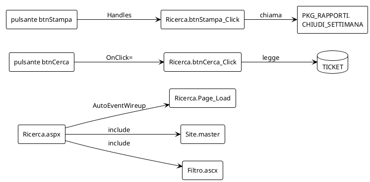

# Le pagine web dell'help desk, in Web Forms

## TL;DR

Questa cartella è la **parte web inventata** dell'help desk di Alpina Servizi, in ASP.NET Web Forms: una pagina di ricerca
dei ticket, una master page e un controllo utente, ciascuno con il suo **code-behind** in Visual Basic. Serve alla
[prova 9](../prove/09-le-pagine-web.md): il percorso dal pulsante della pagina al metodo che risponde, fino al database.

- Le pagine (`.aspx`, `.ascx`, `.master`) le legge il **pacchetto di linguaggio** in `.mde-languages/webforms/`; il code-behind (`.vb`) il Visual Basic di MdExplorer.
- I pulsanti della pagina sono agganciati in due modi diversi apposta: `OnClick=` nella pagina e `Handles` nel Visual Basic.
- Il code-behind usa lo stesso database della [prova 8](../prove/08-il-codice-e-il-database.md): la tabella `TICKET` e la procedura `PKG_RAPPORTI.CHIUDI_SETTIMANA`.

## Che cosa c'è

| File | Che cosa contiene |
|---|---|
| `Ricerca.aspx` | la pagina: un filtro, una casella, i pulsanti Cerca e Stampa, una griglia di ticket |
| `Ricerca.aspx.vb` | il suo code-behind: `Page_Load`, `btnCerca_Click` (legge `TICKET`), `btnStampa_Click` (chiama la procedura), il gestore della griglia |
| `Ricerca.aspx.designer.vb` | i campi `WithEvents` dei controlli, come li scrive Visual Studio |
| `Site.master`, `Site.master.vb` | la master page, con il suo `Page_Load` |
| `Controlli/Filtro.ascx`, `Filtro.ascx.vb` | un controllo utente con un elenco a discesa |
| `Alpina.Web.vbproj` | il progetto: dà lo spazio dei nomi `Alpina.Web` al code-behind |

## Perché è fatto così

- **Due modi di agganciare un pulsante.** `btnCerca` ha `OnClick="btnCerca_Click"` nella pagina: lo collega il pacchetto
  Web Forms. `btnStampa` non ha niente nella pagina: il suo gestore dice `Handles btnStampa.Click` nel Visual Basic, e lo
  collega il Visual Basic attraverso il campo `WithEvents` del file `.designer`.
- **Una convenzione.** `Page_Load` non lo chiama nessuno nel codice: ASP.NET lo chiama per nome perché la pagina ha
  `AutoEventWireup="true"`.
- **Il code-behind parla col database**: con l'SQL scritto nelle stringhe, come il programma della prova 6.

[Torna alla sezione](../README.md)
