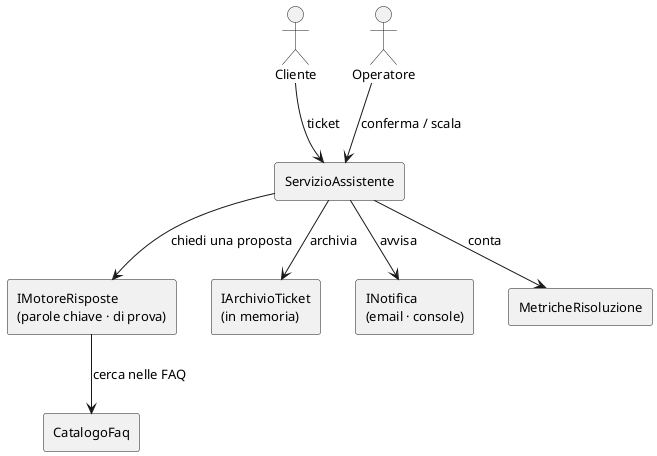

# Il programma d'esempio: l'help desk di Alpina Servizi

## TL;DR

Questa cartella è un **programma C# inventato**, piccolo apposta: il pilota dell'assistente AI per l'help desk di
Alpina Servizi, lo stesso del [caso di studio](../../caso-studio/README.md). Serve a provare il grafo del codice
senza installare niente: C# lo analizza Roslyn, che MdExplorer si porta dietro.

- Quindici file, quattro cartelle, due interfacce con due implementazioni ciascuna: abbastanza da avere domande vere.
- Non si compila né si esegue da MdExplorer: si **legge**, come un documento, e si interroga attraverso il grafo.
- È il bersaglio delle [cinque prove](../README.md#il-percorso) della sezione.

## Cosa fa

Un ticket arriva all'help desk. L'assistente cerca nelle FAQ una risposta e la **propone**; un operatore la
**conferma** e la risposta parte verso il cliente, oppure il ticket viene **scalato** al secondo livello. Le metriche
contano quanti ticket si chiudono al primo contatto: è il numero che il comitato del caso di studio vuole vedere.

## Dove sta cosa

| Cartella | File | Ruolo |
|---|---|---|
| `.` | `Program.cs` | mette insieme i pezzi e gestisce un ticket di prova |
| `Tickets/` | `Ticket.cs`, `IArchivioTicket.cs`, `ArchivioTicketInMemoria.cs` | il ticket, i suoi stati, dove si tengono |
| `Assistente/` | `ServizioAssistente.cs`, `IMotoreRisposte.cs`, `MotoreRisposteParoleChiave.cs`, `MotoreRisposteDiProva.cs`, `Risposta.cs` | il cuore: propone, conferma, scala |
| `Conoscenza/` | `CatalogoFaq.cs`, `VoceFaq.cs` | le domande frequenti con la risposta approvata |
| `Notifiche/` | `INotifica.cs`, `NotificaEmail.cs`, `NotificaConsole.cs` | come si avvisa un cliente o un collega |
| `Metriche/` | `MetricheRisoluzione.cs` | il tasso di risoluzione al primo contatto |

## Perché è fatto così

- **Due interfacce con due implementazioni**: `IMotoreRisposte` e `INotifica`. Quando `ServizioAssistente` chiama
  `_motore.Proponi(...)`, il grafo non sa quale delle due implementazioni risponderà: segna l'arco verso ciascuna come
  **inferito**. È il modo onesto di dire «dipende da chi lo costruisce».
- **Una costante con un significato**: `SogliaFiducia` in `ServizioAssistente`. Chiedere a Mark «cosa succede se la
  alzo?» è una domanda d'impatto.
- **Un numero che il comitato guarda**: `TassoPrimoContatto()` in `MetricheRisoluzione`. Il cammino da `Program.Main`
  a quel metodo attraversa tutto il programma.

Il codice è volutamente senza framework e senza pacchetti: ogni simbolo che vedi nel grafo è scritto qui, tranne
quelli del runtime .NET (`Console`, `Dictionary`, `Math`…), che il grafo segna come **esterni**.

[Torna alla sezione](../README.md)
