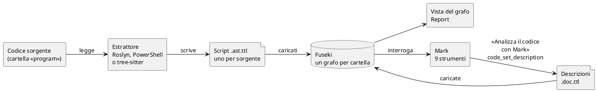

# Come funziona il grafo del codice

## TL;DR

Il grafo del codice nasce in due tempi: un **programma** legge il codice e scrive, per ogni file sorgente, un elenco di
simboli e relazioni, con la riga e con quanto è sicuro di ciascuna; poi **Mark**, l'agente AI, ragiona su quel grafo e,
se glielo chiedi, scrive a che cosa serve ogni file e ogni simbolo, e lo corregge quando gli dici che è sbagliato.
Niente viene inventato: ciò che è nel grafo è stato letto nel codice, e ogni fatto dice da dove viene.

- Il grafo è **deterministico**: stesso codice, stesso grafo. L'AI entra solo dove si ragiona.
- La fonte di verità sono **file di testo nel progetto** (`.mde-code/`), che viaggiano con Git; il database è un indice.
- Ogni relazione ha un **grado di fiducia**: certa, dedotta o ambigua. Mark lo dice quando risponde.

## Due tempi: il parser e Mark

1. **Il parser.** Quando una cartella è segnata come «ambiente di sviluppo» e ha un linguaggio scelto, MdExplorer
   legge i file di quel linguaggio con un estrattore: **Roslyn** per il C# (il compilatore stesso, che MdExplorer si
   porta dietro: niente SDK da installare), il **parser ufficiale di PowerShell** per gli script `.ps1`, anche lui nel
   pacchetto, **tree-sitter** per TypeScript, JavaScript, Python e Java, con una grammatica per linguaggio scaricata al
   primo uso. L'estrattore scrive uno **script** per ogni sorgente, in **Turtle** (il formato standard dei grafi RDF): i
   simboli (classi, interfacce, metodi, proprietà, campi, con i parametri), le relazioni fra loro e la riga in cui stanno.
2. **Il database.** Gli script vengono caricati in **Apache Jena Fuseki**, un database a grafo che MdExplorer avvia
   da sé, sul tuo computer, senza che tu veda niente. Ogni cartella «program» ha il suo grafo. Da lì leggono la pagina
   «Grafo del codice», il report e gli strumenti di Mark.
3. **Mark.** Nel tab «Mark Agent» l'agente ha nove strumenti per il grafo: otto lo leggono (trova un simbolo,
   descrivilo, l'outline di un file, i vicini, l'impatto, il cammino, la panoramica, dove sta il codice) e uno scrive le
   descrizioni. Li usa da solo quando la domanda riguarda il codice; dalla pagina del grafo gli si chiede con il tasto
   destro. Con «Analizza il codice con Mark» legge ogni sorgente e scrive a che cosa serve il file e, per ogni simbolo,
   una **descrizione** con il significato dei parametri e del ritorno: finiscono in un secondo script accanto al primo,
   e nel grafo.

## Cosa c'è nel grafo

| Nodi | Relazioni | Fiducia |
|---|---|---|
| file, classe, interfaccia, record, struct, enum, metodo, costruttore, proprietà, campo, parametro | `contains` (il file contiene la classe, la classe il metodo) · `inherits` · `implements` · `references` (il tipo di un campo, di un parametro, di un ritorno) · `calls` · `instantiates` · `imports` | **extracted**: letto nel codice, senza dubbi · **inferred**: dedotto, per esempio la chiamata su un'interfaccia verso ogni classe che la implementa · **ambiguous**: più candidati e la sola sintassi non sa scegliere |

Un simbolo che non sta nella cartella, come `Console` o `Dictionary`, diventa un nodo **esterno** con il suo nome:
il grafo sa che è usato, ma non lo descrive.

### Perché la fiducia conta

Prendi `ServizioAssistente.Gestisci` nel [programma d'esempio](../esempio/README.md): chiama `_motore.Proponi(ticket)`
su un'interfaccia, `IMotoreRisposte`, che ha due implementazioni. Quale parta davvero lo decide chi costruisce il
servizio, e il codice del metodo non lo dice. Il grafo non sceglie: segna **due** archi `calls`, uno per implementazione,
entrambi **inferred**. Quando Mark risponde «lo chiama solo `Gestisci`, ma quale motore parta dipende dal costruttore»,
sta leggendo esattamente quello.

## Dove stanno le cose

| Cosa | Dove | Va su Git? |
|---|---|---|
| la scelta dei linguaggi per cartella | `.development.yml`, voce `folders` | sì: vale per tutto il gruppo di lavoro |
| gli script dell'estrattore | `.mde-code/<cartella>/<file>.ast.ttl` | sì: chi fa `git pull` ha il grafo senza rianalizzare |
| le descrizioni scritte da Mark | `.mde-code/<cartella>/<file>.doc.ttl` | sì, come sopra |
| il report | `.md/codegraph/report.md` | no: si rigenera |
| il database Fuseki | nella cartella dati di MdExplorer, fuori dal progetto | no: è un indice, si ricostruisce dagli script |

Gli script sono la **verità**: il database si può cancellare e ricostruire da loro. È anche il motivo per cui vanno
committati: un collega che scarica il progetto trova il grafo già pronto, e chi non usa MdExplorer trova comunque un
file di testo leggibile per ogni sorgente, che qualsiasi strumento RDF (Apache Jena, un altro Fuseki) sa caricare.

## Che cosa si rilegge, e quando

L'analisi non riparte mai da zero. Se la cartella sta in un repository Git, MdExplorer chiede a Git **quali file sono
cambiati** dall'ultima analisi e riparsa solo quelli; fuori da Git confronta l'impronta di ogni file. Un sorgente
cancellato porta via il suo script e le sue righe nel grafo. Un estrattore nuovo, cioè una versione nuova di MdExplorer
che legge meglio, non rifà gli script in silenzio: la pagina del grafo dice quanti file sono stati letti con la versione
precedente e offre «Aggiorna l'analisi».

Le descrizioni di Mark seguono la stessa regola: «Analizza il codice con Mark» chiede all'AI solo i simboli **senza
descrizione o con la firma cambiata**, e a che cosa serve il file solo quando manca. Rinominare un parametro fa riscrivere
la descrizione di quel metodo, non delle altre cento.

## Le descrizioni: chi le scrive e chi le corregge

| Cosa | Chi la scrive | Dove si vede |
|---|---|---|
| a che cosa serve un **file**, in una o due frasi | Mark, con «Analizza il codice con Mark» o dal tasto destro sul file | sotto il file nella pagina del grafo («Utilità dei file»), nel report, negli strumenti `code_outline` e `code_overview` |
| che cosa fa un **simbolo**, che cosa restituisce, le avvertenze | Mark, come sopra, o dal tasto destro sul simbolo | nella scheda del simbolo, in `code_describe`, nella ricerca a testo |
| che cosa rappresenta ogni **parametro** | Mark, come sopra | in `code_describe` |

Una descrizione sbagliata o incompleta la **corregge Mark parlando con te**: «la descrizione di `Gestisci` non dice
che…, sistemala». Mark rilegge il sorgente e usa `code_set_description`; MdExplorer controlla la richiesta (un parametro
che non esiste, una firma vecchia: rifiutati, con il motivo), aggiorna lo script `.doc.ttl` e il grafo. Nessuno scrive a
mano gli script: si rigenerano, e una modifica a mano si perderebbe alla prossima analisi.

Ogni descrizione dice chi l'ha scritta (`writtenBy`) e per quale firma (`signatureHash`). Un limite di oggi: l'autore è
uno per script, l'ultimo che l'ha toccato; la storia completa la tiene Git.

## Cosa il grafo non sa, oggi

- **Il significato, da solo.** Il grafo dice *che* `Gestisci` chiama `Scala`, non *perché*. Il perché lo aggiunge Mark
  con le descrizioni, o lo legge nel sorgente quando risponde.
- **Le letture di un campo dentro un metodo.** `SogliaFiducia` è usata in `Gestisci`, ma l'arco non c'è: il grafo
  registra i tipi dei campi, non chi li legge. Mark lo compensa aprendo il file (lo vedi nella [prova 3](../prove/03-chiedi-a-mark.md)).
- **I template HTML di Angular**, i linguaggi senza estrattore (Go e Rust sono in arrivo), le dipendenze esterne
  (pacchetti NuGet, npm): restano nodi esterni, senza struttura.
- **Quali relazioni valgono.** Su un progetto grande (PlantUML: 3.662 file Java) un terzo degli archi è ambiguo e il
  cammino più corto fra due classi lontane può passare per un `import` comune, che non dice niente. Decidere che cosa
  è conoscenza e che cosa è rumore è il prossimo passo di MdExplorer.

[Torna alla sezione](../README.md)
