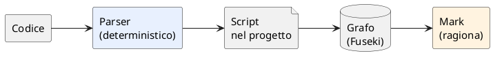
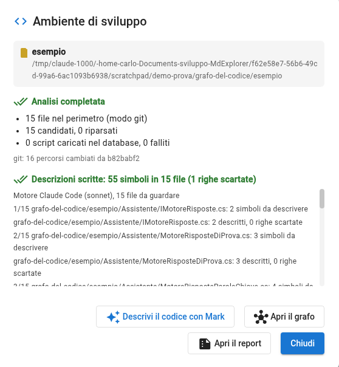

<!-- .slide: data-background-color="#0f1b2d" -->

# Il codice, spiegato dal codice

<p style="color:#cfd8e3; font-size:.8em">MdExplorer legge un programma e ne fa un grafo. Mark lo interroga, e risponde con le righe.</p>

Note:
Cosa vedremo: come MdExplorer trasforma una cartella di codice in un grafo di simboli e relazioni, senza AI, e come
poi l'agente Mark usa quel grafo per rispondere con fatti e righe, non a memoria. Il caso è il piccolo programma
dell'help desk di Alpina Servizi, lo stesso del caso di studio. Quindici slide, poi le cinque prove.

---

## Il problema

<div class="r-hstack" style="gap:30px; align-items:stretch">
<div style="flex:1; background:#fff3e0; border-radius:14px; padding:18px 22px; text-align:left">

**Un programma che non conosci**

- la documentazione è vecchia
- chi lo ha scritto non c'è più
- «chi chiama questa cosa?» costa un pomeriggio

</div>
<div style="flex:1; background:#e8f0fe; border-radius:14px; padding:18px 22px; text-align:left">

**Un'AI che legge file a caso**

- apre dieci file, ne cita tre
- «probabilmente viene chiamato da…»
- nessuna riga da controllare

</div>
</div>

Note:
Due facce dello stesso problema: capire un programma costa, e un'AI senza una mappa indovina. La risposta non è un'AI
più grande: è dare all'AI una mappa fatta da un programma, che non indovina.

---

## L'idea: due tempi



**Algoritmo dove è deterministico. AI dove si ragiona.**

Note:
Primo tempo: un parser legge il codice e scrive, per ogni file, un elenco di simboli e relazioni con la riga. Stesso
codice, stesso risultato, sempre. Secondo tempo: Mark, l'agente, interroga quel grafo e ragiona sopra. L'AI non
costruisce la mappa, la usa.

---

## Cosa c'è nel grafo

| Nodi | Relazioni | Fiducia |
|---|---|---|
| file, classe, interfaccia, metodo, costruttore, proprietà, campo, parametro | `contains` · `inherits` · `implements` · `references` · `calls` · `instantiates` · `imports` | **extracted** letto nel codice · **inferred** dedotto · **ambiguous** più candidati |

<p class="fragment">Ogni arco porta la <b>riga</b> in cui sta.</p>

Note:
I nodi sono i simboli del linguaggio; le relazioni sono sette; e ogni relazione ha un grado di fiducia. È la parte
più importante: il grafo dice se una cosa l'ha letta o l'ha dedotta. E ogni arco sa in quale riga sta, così si può
controllare.

---

## Perché la fiducia conta

```csharp [1-2|4-5]
private readonly IMotoreRisposte _motore; // un'interfaccia
public void Gestisci(Ticket ticket)
{
    _archivio.Aggiungi(ticket);
    var proposta = _motore.Proponi(ticket); // quale motore? lo sa il costruttore
```

<div class="fragment" style="margin-top:14px">

`Gestisci` **calls** `MotoreRisposteParoleChiave.Proponi` · *inferred*<br>
`Gestisci` **calls** `MotoreRisposteDiProva.Proponi` · *inferred*

</div>

Note:
Il servizio chiama Proponi su un'interfaccia che ha due implementazioni. Quale parte davvero lo decide il costruttore,
e il metodo non lo sa. Il grafo non sceglie: segna due archi, entrambi dedotti. Quando Mark risponde «lo chiama solo
Gestisci, ma quale motore parta dipende dal costruttore», sta leggendo esattamente questo.

---

## Dove sta

| Cosa | Dove | Su Git? |
|---|---|---|
| i linguaggi scelti | `.development.yml` | **sì** |
| gli script del parser | `.mde-code/…/File.cs.ast.jsonl` | **sì** |
| le descrizioni di Mark | `.mde-code/…/File.cs.doc.jsonl` | **sì** |
| il grafo (Fuseki) | la cartella dati di MdExplorer | no: si ricostruisce |

Note:
Gli script sono la verità e vanno su Git: chi scarica il progetto ha il grafo pronto senza rianalizzare, e chi non usa
MdExplorer trova comunque un file di testo leggibile per ogni sorgente. Il database è un indice: si può cancellare.

---

## Come si accende

1. Tasto destro sulla cartella → **«Segna come ambiente di sviluppo»**
2. La finestra dice i linguaggi trovati; tu scegli
3. **«Salva e analizza»**


Note:
Un gesto. La finestra riconosce i linguaggi nella cartella e dice se l'estrattore è pronto. Per il C# lo è sempre:
è Roslyn, il compilatore, dentro MdExplorer. Per gli altri si scarica una grammatica, una volta.

---

## I linguaggi

| Linguaggio | Come | Cosa serve |
|---|---|---|
| **C#** | Roslyn, il compilatore, senza SDK | niente |
| TypeScript, JavaScript | tree-sitter, con i metadati Angular | una grammatica (1,5 MB) |
| Python | tree-sitter | una grammatica (0,5 MB) |
| Java | tree-sitter, Spring riconosciuto | una grammatica (0,5 MB) |
| Go, Rust | in arrivo | |

Note:
Il C# è il caso migliore: il compilatore risolve davvero tipi, overload e dispatch. Gli altri linguaggi usano
tree-sitter, un parser di sintassi: risolve per nome, e quando il nome non basta lo dice (ambiguous). Le grammatiche
arrivano da mdexplorer.net, una volta per linguaggio.

---

## Il grafo, a vista


Note:
La pagina «Grafo del codice»: prima i file, colorati per cartella; con il più si aprono i simboli di un file. Un
colore per relazione, un tratto per fiducia: continuo è letto, tratteggiato è dedotto. Qui ServizioAssistente con
Gestisci, Conferma, Scala e il costruttore.

---

## Il report

<div class="r-hstack" style="gap:30px">
<div style="flex:1; text-align:left">

Un documento markdown, riscritto a ogni analisi:

- simboli e archi, per relazione e per fiducia
- i **più connessi**: da chi dipende tutto
- i file più grossi
- chi è **senza descrizione**, chi è **da rivedere**

</div>
<div style="flex:1; background:#f1f3f4; border-radius:14px; padding:16px 20px; text-align:left; font-size:.6em">

**Il programma d'esempio**<br>
15 file · 73 simboli · 152 archi<br>
9 dedotti · 0 ambigui<br>
più connesso: `Ticket` (12 archi)<br>
55 simboli descritti, 1 da completare

</div>
</div>

Note:
Il report è per le persone, o da incollare in una conversazione. Dice la salute del grafo: quanti archi sono incerti,
quali simboli nessuno ha ancora descritto, quali descrizioni sono vecchie perché la firma è cambiata.

---

## Mark con sette strumenti

<div style="font-size:.8em">

| Strumento | La domanda |
|---|---|
| `code_find_symbol` | «chi calcola la quota di ticket chiusi al primo contatto?» |
| `code_describe` | «descrivimi `Conferma` con i parametri» |
| `code_outline` | «cosa c'è in `CatalogoFaq.cs`?» |
| `code_neighbors` | «chi implementa `IMotoreRisposte`?» |
| `code_impact` | «cosa si rompe se cambio `INotifica.Invia`?» |
| `code_path` | «come si arriva da `Main` a `TassoPrimoContatto`?» |
| `code_overview` | «fammi una panoramica» |

</div>

Note:
Sette strumenti di sola lettura, circa millecinquecento token in tutto. Mark li sceglie da solo: nella prova, alla
domanda «chi implementa, chi chiama» ha usato find e neighbors senza che nessuno glieli nominasse.

---

## Come risponde

<div style="text-align:left; background:#f8f9fa; border-left:8px solid #1a73e8; border-radius:10px; padding:14px 22px; font-size:.72em">

«`Proponi` lo chiama solo **`ServizioAssistente.Gestisci`**, in `Assistente/ServizioAssistente.cs`, **riga 32**.<br>
La chiamata è scritta sull'interfaccia: quale motore parta dipende da quello passato al costruttore. Per questo il
grafo segna la chiamata verso le due classi concrete come **dedotta**, non certa.»

</div>

<div class="r-hstack" style="gap:20px; margin-top:18px; font-size:.7em">
<div class="fragment" style="flex:1; background:#e8f0fe; border-radius:12px; padding:12px"><b>il fatto</b><br>con file e riga</div>
<div class="fragment" style="flex:1; background:#e6f4ea; border-radius:12px; padding:12px"><b>la fiducia</b><br>letto o dedotto</div>
<div class="fragment" style="flex:1; background:#fff3e0; border-radius:12px; padding:12px"><b>il limite</b><br>«qui leggo il sorgente»</div>
</div>

Note:
Una risposta buona ha tre ingredienti: il fatto con la riga, da controllare; la fiducia, perché il grafo distingue
letto e dedotto; e il limite. Alla domanda sulla soglia, il grafo non copriva la lettura di un campo dentro un
metodo: Mark lo ha detto e ha aperto il file. Nessuna supposizione al posto del vuoto.

---

## «Descrivi il codice con Mark»

<div class="r-hstack" style="gap:30px">
<div style="flex:1; text-align:left">

- un pulsante nella finestra «Ambiente di sviluppo»
- una chiamata AI per file, **solo** per chi non ha descrizione o ha cambiato firma
- descrizione del simbolo, del ritorno, di ogni parametro
- in uno script accanto al primo, e nel grafo
- ciò che non ha la forma giusta viene **scartato e contato**

</div>
<div style="flex:1">

</div>
</div>

Note:
Il grafo sa chi chiama chi, non a che cosa serve. Qui entra l'AI, nel posto giusto: legge ogni sorgente e scrive le
descrizioni. Il programma le prende solo se hanno la forma giusta, e ricorda chi le ha scritte e con quale firma.
Nella prova: 55 simboli in 15 file, una riga scartata e detta.

---

## Cercare per significato

> «Quale metodo calcola la quota di ticket chiusi al primo contatto?»

<div class="fragment" style="text-align:left; background:#f8f9fa; border-left:8px solid #188038; border-radius:10px; padding:14px 22px; font-size:.72em; margin-top:16px">

`MetricheRisoluzione.TassoPrimoContatto()`, righe 28-32.<br>
**Valore restituito:** un numero tra 0 e 1, i risolti al primo contatto divisi per risolti più scalati; zero se non c'è ancora niente.<br>
**L'ha scritta:** `mde-code-doc 1 / Claude Code (sonnet)` · descrizione aggiornata.

</div>

Note:
Nessuna di quelle parole è nel nome del metodo. Dopo le descrizioni la ricerca a testo pieno del grafo le indicizza, e
Mark trova il metodo giusto, riporta la descrizione e dice chi l'ha scritta. Poi chiude il cerchio con la domanda
sulla soglia: ora ha la formula.

---

## Su un programma vero

<div class="r-hstack" style="gap:24px; font-size:.75em">
<div style="flex:1; background:#e8f0fe; border-radius:14px; padding:16px"><div style="font-size:1.9em; font-weight:800; color:#1a73e8">3.662</div>file Java di PlantUML</div>
<div style="flex:1; background:#e6f4ea; border-radius:14px; padding:16px"><div style="font-size:1.9em; font-weight:800; color:#188038">202 s</div>analisi, carico e compattazione</div>
<div style="flex:1; background:#fff3e0; border-radius:14px; padding:16px"><div style="font-size:1.9em; font-weight:800; color:#f29900">210.791</div>relazioni fra 40.002 simboli</div>
<div style="flex:1; background:#f3e8fd; border-radius:14px; padding:16px"><div style="font-size:1.9em; font-weight:800; color:#7b61ff">20 s</div>una risposta di Mark</div>
</div>

<p style="font-size:.7em; margin-top:18px">E un terzo degli archi è ambiguo: decidere che cosa è conoscenza e che cosa è rumore è il prossimo passo.</p>

Note:
Non solo quindici file. PlantUML, tremilaseicento file Java, in poco più di tre minuti; le domande rispondono in
decine di millisecondi e Mark in venti secondi. E un dato onesto: un terzo degli archi è ambiguo. Il prossimo lavoro
è lì: capire quali relazioni valgono per la conoscenza e quali sono rumore.

---

## Prova tu

| # | Prova | Tempo |
|---|---|---|
| 1 | Segna la cartella | 3 min |
| 2 | Guarda il grafo | 5 min |
| 3 | Chiedi a Mark | 8 min |
| 4 | Fai scrivere le descrizioni | 8 min |
| 5 | Il grafo va su Git | 5 min |

[Le cinque prove, nel progetto demo](../README.md)

Note:
Mezz'ora, sul programma dell'help desk. Serve Java 21, lo stesso di PlantUML, e un motore AI per le prove 3 e 4. Tutto
il resto è già nel progetto.
