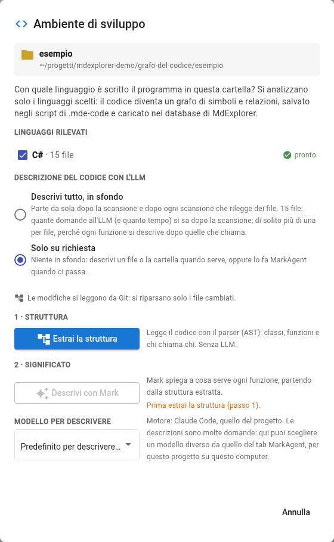
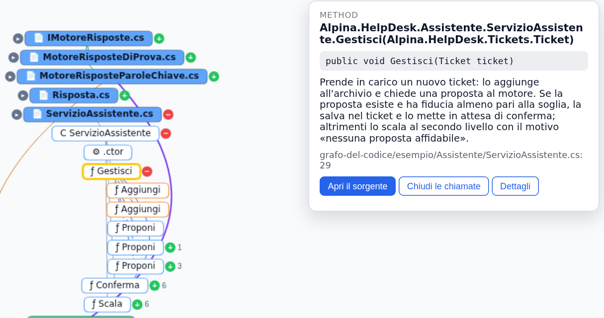
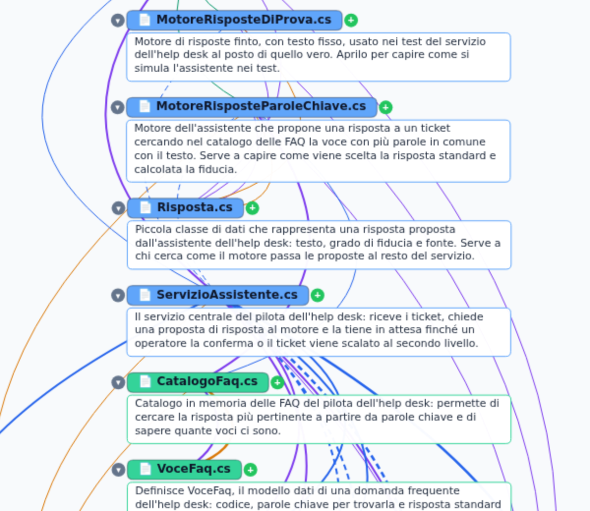
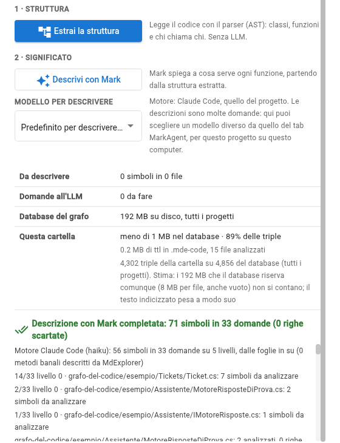
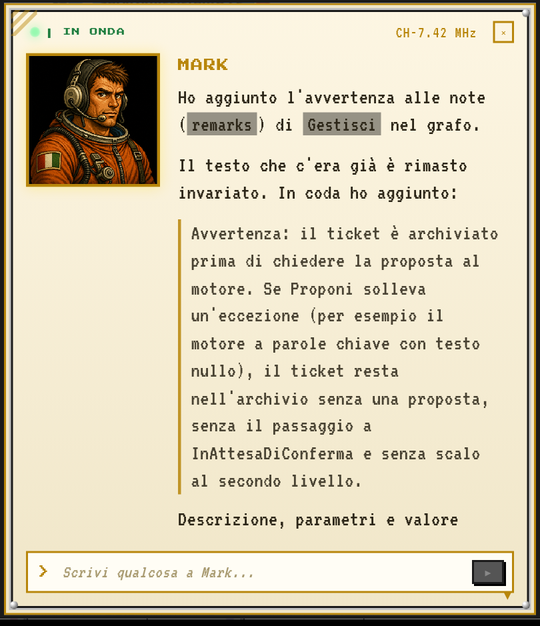

<!-- .slide: data-background-color="#0a1322" data-background-image="assets/grafo-sfondo.svg" -->


# Il codice, spiegato dal codice <!-- .element: style="font-size:1.75em; margin-top:10px" -->

<p style="color:#cfd8e3; font-size:.8em">MdExplorer legge un programma e ne fa un grafo.<br><b style="color:#ffe08a">Mark lo interroga, e risponde con le righe.</b></p>

Note:
Cosa vedremo: come MdExplorer trasforma una cartella di codice in un grafo di simboli e relazioni, senza AI, e come
poi l'agente Mark usa quel grafo per rispondere con fatti e righe, non a memoria; e come Mark scrive, e corregge, che
cosa fa ogni pezzo. Il caso è il piccolo programma dell'help desk di Alpina Servizi, lo stesso del caso di studio.
Diciotto slide, poi le cinque prove.

---

<!-- .slide: data-background-image="assets/grafo-sfondo-chiaro.svg" -->

## Il problema

<div style="display:flex; gap:26px; justify-content:center; margin-top:10px; text-align:left">

<div class="fragment fade-up" style="flex:1; background:#fff; border-top:8px solid #f29900; border-radius:14px; padding:18px 24px; box-shadow:0 8px 24px rgba(15,27,45,.12)">
<div style="font-size:.55em; color:#f29900; font-weight:800; letter-spacing:.08em">UN PROGRAMMA CHE NON CONOSCI</div>
<div style="font-size:.66em; line-height:1.55; margin-top:8px">
la documentazione è vecchia<br>
chi lo ha scritto non c'è più<br>
«chi chiama questa cosa?» costa un pomeriggio
</div>
</div>

<div class="fragment fade-up" style="flex:1; background:#fff; border-top:8px solid #1a73e8; border-radius:14px; padding:18px 24px; box-shadow:0 8px 24px rgba(15,27,45,.12)">
<div style="font-size:.55em; color:#1a73e8; font-weight:800; letter-spacing:.08em">UN'AI CHE LEGGE FILE A CASO</div>
<div style="font-size:.66em; line-height:1.55; margin-top:8px">
apre dieci file, ne cita tre<br>
«probabilmente viene chiamato da…»<br>
nessuna riga da controllare
</div>
</div>

</div>

<div class="fragment fade-up" style="margin-top:30px; font-size:.9em">

Non serve un'AI più grande. **Serve una mappa che non indovina.**

</div>

Note:
Due facce dello stesso problema: capire un programma costa, e un'AI senza una mappa indovina. La risposta non è un'AI
più grande: è dare all'AI una mappa fatta da un programma, che non indovina.

---

<!-- .slide: data-background-image="assets/grafo-sfondo-chiaro.svg" -->

## L'idea: due tempi

<div style="display:flex; align-items:stretch; justify-content:center; gap:14px; margin-top:22px">

<div class="fragment fade-in" style="background:#fff; border-radius:16px; padding:22px 26px; box-shadow:0 8px 24px rgba(15,27,45,.12); width:270px">
<div style="font-size:.5em; color:#5f6368; font-weight:800; letter-spacing:.08em">IL PARSER</div>
<div style="font-size:1.35em; font-weight:800; color:#1a73e8; margin:6px 0">LEGGE</div>
<div style="font-size:.6em; line-height:1.3">simboli, chiamate, righe.<br><b>Stesso codice, stesso grafo.</b></div>
</div>

<div style="font-size:1.6em; color:#8a99ad; align-self:center">→</div>

<div class="fragment fade-in" style="background:#fff; border-radius:16px; padding:22px 26px; box-shadow:0 8px 24px rgba(15,27,45,.12); width:270px">
<div style="font-size:.5em; color:#5f6368; font-weight:800; letter-spacing:.08em">IL GRAFO</div>
<div style="font-size:1.35em; font-weight:800; color:#188038; margin:6px 0">RICORDA</div>
<div style="font-size:.6em; line-height:1.3">script in Turtle nel progetto, su Git;<br>un indice in Fuseki</div>
</div>

<div style="font-size:1.6em; color:#8a99ad; align-self:center">→</div>

<div class="fragment fade-in" style="background:#fff; border-radius:16px; padding:22px 26px; box-shadow:0 8px 24px rgba(15,27,45,.12); width:270px">
<div style="font-size:.5em; color:#5f6368; font-weight:800; letter-spacing:.08em">MARK</div>
<div style="font-size:1.35em; font-weight:800; color:#f29900; margin:6px 0">RAGIONA</div>
<div style="font-size:.6em; line-height:1.3">risponde con file e riga,<br>scrive a che cosa serve ogni pezzo</div>
</div>

</div>

<div class="fragment fade-up" style="margin-top:34px; font-size:.9em">

**Algoritmo dove è deterministico. AI dove si ragiona.**

</div>

Note:
Primo tempo: un parser legge il codice e scrive, per ogni file, un elenco di simboli e relazioni con la riga. Stesso
codice, stesso risultato, sempre. Poi quei fatti stanno in file di testo nel progetto, e un database li indicizza.
Infine Mark, l'agente, interroga il grafo e ragiona sopra. L'AI non costruisce la mappa: la usa, e la arricchisce
dove serve un giudizio, cioè nel dire a che cosa serve un pezzo di codice.

---

<!-- .slide: data-background-image="assets/grafo-sfondo-chiaro.svg" -->

## Cosa c'è nel grafo

<div style="display:flex; gap:20px; justify-content:center; margin-top:6px; text-align:left">

<div class="fragment fade-up" style="flex:1; background:#fff; border-top:8px solid #1a73e8; border-radius:14px; padding:16px 20px; box-shadow:0 8px 24px rgba(15,27,45,.12)">
<div style="font-size:.55em; color:#1a73e8; font-weight:800; letter-spacing:.08em">NODI</div>
<div style="font-size:.58em; line-height:1.5; margin-top:8px">file · classe · interfaccia · metodo · costruttore · proprietà · campo · parametro</div>
</div>

<div class="fragment fade-up" style="flex:1; background:#fff; border-top:8px solid #7b61ff; border-radius:14px; padding:16px 20px; box-shadow:0 8px 24px rgba(15,27,45,.12)">
<div style="font-size:.55em; color:#7b61ff; font-weight:800; letter-spacing:.08em">RELAZIONI</div>
<div style="font-size:.58em; line-height:1.5; margin-top:8px"><code>contains</code> · <code>inherits</code> · <code>implements</code> · <code>references</code> · <code>calls</code> · <code>instantiates</code> · <code>imports</code></div>
</div>

<div class="fragment fade-up" style="flex:1; background:#fff; border-top:8px solid #188038; border-radius:14px; padding:16px 20px; box-shadow:0 8px 24px rgba(15,27,45,.12)">
<div style="font-size:.55em; color:#188038; font-weight:800; letter-spacing:.08em">FIDUCIA</div>
<div style="font-size:.58em; line-height:1.5; margin-top:8px"><b>extracted</b> letto nel codice<br><b>inferred</b> dedotto<br><b>ambiguous</b> più candidati</div>
</div>

</div>

<div class="fragment fade-up" style="margin-top:28px; font-size:.85em">

Ogni arco porta la **riga** in cui sta. E sopra, scritte da Mark: **a che cosa serve** ogni file e ogni simbolo.

</div>

Note:
I nodi sono i simboli del linguaggio; le relazioni sono sette; e ogni relazione ha un grado di fiducia. È la parte
più importante: il grafo dice se una cosa l'ha letta o l'ha dedotta. E ogni arco sa in quale riga sta, così si può
controllare. Sopra i fatti, le descrizioni: quelle le scrive Mark, e il grafo ricorda chi le ha scritte.

---

<!-- .slide: data-background-image="assets/grafo-sfondo-chiaro.svg" -->

## Perché la fiducia conta

```csharp [1-2|4-5]
private readonly IMotoreRisposte _motore; // un'interfaccia
public void Gestisci(Ticket ticket)
{
    _archivio.Aggiungi(ticket);
    var proposta = _motore.Proponi(ticket); // quale motore? lo sa il costruttore
```

<div class="fragment fade-up" style="display:flex; gap:18px; justify-content:center; margin-top:16px; font-size:.6em; text-align:left">
<div style="background:#fff; border-left:8px solid #1a73e8; border-radius:10px; padding:12px 18px; box-shadow:0 6px 18px rgba(15,27,45,.12)"><code>Gestisci</code> <b>calls</b> <code>MotoreRisposteParoleChiave.Proponi</code> · <i>inferred</i></div>
<div style="background:#fff; border-left:8px solid #1a73e8; border-radius:10px; padding:12px 18px; box-shadow:0 6px 18px rgba(15,27,45,.12)"><code>Gestisci</code> <b>calls</b> <code>MotoreRisposteDiProva.Proponi</code> · <i>inferred</i></div>
</div>

<div class="fragment fade-up" style="margin-top:18px; font-size:.8em">

Il grafo **non sceglie**: segna due archi, tutti e due dedotti.

</div>

Note:
Il servizio chiama Proponi su un'interfaccia che ha due implementazioni. Quale parte davvero lo decide il costruttore,
e il metodo non lo sa. Il grafo non sceglie: segna due archi, entrambi dedotti. Quando Mark risponde «quale motore
parta lo decide Main», sta leggendo esattamente questo.

---

<!-- .slide: data-background-image="assets/grafo-sfondo-chiaro.svg" -->

## Dove sta

<div style="display:flex; gap:26px; justify-content:center; margin-top:4px; text-align:left">

<div style="flex:1.3; background:#fff; border-top:8px solid #188038; border-radius:14px; padding:14px 22px; box-shadow:0 8px 24px rgba(15,27,45,.12)">
<div style="font-size:.55em; color:#188038; font-weight:800; letter-spacing:.08em">NEL PROGETTO, SU GIT</div>
<div style="font-size:.56em; line-height:1.6; margin-top:6px">
<code>.development.yml</code> i linguaggi scelti<br>
<code>.mde-code/…/File.cs.ast.ttl</code> ciò che il parser ha letto<br>
<code>.mde-code/…/File.cs.doc.ttl</code> ciò che Mark ha scritto
</div>
</div>

<div style="flex:1; background:#fff; border-top:8px solid #8a99ad; border-radius:14px; padding:14px 22px; box-shadow:0 8px 24px rgba(15,27,45,.12)">
<div style="font-size:.55em; color:#5f6368; font-weight:800; letter-spacing:.08em">SUL TUO COMPUTER</div>
<div style="font-size:.56em; line-height:1.6; margin-top:6px">
il grafo in <b>Fuseki</b>: un indice<br>
il report: si riscrive<br>
<b>si ricostruiscono dagli script</b>
</div>
</div>

</div>

<div class="fragment fade-up" style="margin-top:22px; text-align:left; background:#0f1b2d; color:#dbe6f5; border-radius:12px; padding:12px 18px; font-size:.42em; font-family:monospace; line-height:1.5; box-shadow:0 8px 24px rgba(15,27,45,.2)">
&lt;urn:mde:doc:5230…&gt; a code:Description ; code:describes &lt;urn:mde:sym:5230…&gt; ;<br>
&nbsp;&nbsp;code:summary "Calcola la quota di ticket chiusi al primo contatto…" ;<br>
&nbsp;&nbsp;code:writtenBy "mde-code-doc 5 / Claude Code (sonnet)" ; code:signatureHash "d70c…" .
</div>

Note:
Gli script sono la verità e vanno su Git: chi scarica il progetto ha il grafo pronto senza rianalizzare. Sono in Turtle,
il formato standard dei grafi RDF: li legge MdExplorer, ma anche qualsiasi strumento di Apache Jena. Il database è un
indice: si può cancellare. Sotto, una riga vera: la descrizione di TassoPrimoContatto, con chi l'ha scritta e
l'impronta della firma.

---

<!-- .slide: data-background-image="assets/grafo-sfondo-chiaro.svg" -->

## Come si accende

<div style="display:flex; gap:34px; align-items:center; justify-content:center">



<div style="width:440px; text-align:left; font-size:.62em; line-height:1.4">

<div class="fragment fade-up" style="background:#fff; border-left:8px solid #1a73e8; border-radius:10px; padding:12px 16px; box-shadow:0 6px 18px rgba(15,27,45,.12); margin-bottom:12px">
<b>1 · Tasto destro sulla cartella</b><br>«Segna come ambiente di sviluppo».
</div>

<div class="fragment fade-up" style="background:#fff; border-left:8px solid #188038; border-radius:10px; padding:12px 16px; box-shadow:0 6px 18px rgba(15,27,45,.12); margin-bottom:12px">
<b>2 · La finestra dice cosa ha trovato</b><br>C#, 15 file, <i>pronto</i>: il compilatore è già dentro MdExplorer.
</div>

<div class="fragment fade-up" style="background:#fff; border-left:8px solid #f29900; border-radius:10px; padding:12px 16px; box-shadow:0 6px 18px rgba(15,27,45,.12)">
<b>3 · «Estrai la struttura»</b><br>In un paio di secondi il programma è un grafo, senza AI, e Mark ha gli strumenti per leggerlo.
</div>

</div>

</div>

Note:
Un gesto. La finestra riconosce i linguaggi nella cartella e dice se l'estrattore è pronto. Per il C# lo è sempre: è
Roslyn, il compilatore, dentro MdExplorer. Per altri linguaggi si scarica una grammatica, una volta. Appena finita
l'analisi Mark ha gli strumenti del grafo; con Claude Code anche nella conversazione già aperta, con gli altri motori
da una conversazione nuova.

---

<!-- .slide: data-background-image="assets/grafo-sfondo-chiaro.svg" -->

## I linguaggi

<div style="display:flex; flex-wrap:wrap; gap:16px; justify-content:center; margin-top:8px; text-align:left; font-size:.56em">

<div style="width:330px; background:#fff; border-top:8px solid #188038; border-radius:14px; padding:12px 18px; box-shadow:0 8px 24px rgba(15,27,45,.12)">
<div style="font-size:1.25em; font-weight:800">C#</div>
Roslyn, il compilatore: risolve tipi e overload. <b>Niente da installare.</b>
</div>

<div style="width:330px; background:#fff; border-top:8px solid #188038; border-radius:14px; padding:12px 18px; box-shadow:0 8px 24px rgba(15,27,45,.12)">
<div style="font-size:1.25em; font-weight:800">PowerShell</div>
Il parser ufficiale del linguaggio. <b>Niente da installare.</b>
</div>

<div style="width:330px; background:#fff; border-top:8px solid #1a73e8; border-radius:14px; padding:12px 18px; box-shadow:0 8px 24px rgba(15,27,45,.12)">
<div style="font-size:1.25em; font-weight:800">TypeScript · JavaScript</div>
tree-sitter, con i metadati Angular. Una grammatica, 1,5 MB.
</div>

<div style="width:330px; background:#fff; border-top:8px solid #1a73e8; border-radius:14px; padding:12px 18px; box-shadow:0 8px 24px rgba(15,27,45,.12)">
<div style="font-size:1.25em; font-weight:800">Python</div>
tree-sitter. Una grammatica, 0,5 MB.
</div>

<div style="width:330px; background:#fff; border-top:8px solid #1a73e8; border-radius:14px; padding:12px 18px; box-shadow:0 8px 24px rgba(15,27,45,.12)">
<div style="font-size:1.25em; font-weight:800">Java</div>
tree-sitter, Spring riconosciuto. Una grammatica, 0,5 MB.
</div>

<div style="width:330px; background:#f1f3f4; border-top:8px solid #8a99ad; border-radius:14px; padding:12px 18px">
<div style="font-size:1.25em; font-weight:800; color:#5f6368">Go · Rust</div>
<span style="color:#5f6368">in arrivo</span>
</div>

</div>

Note:
Il C# e il PowerShell sono i casi migliori: lì MdExplorer usa il parser vero del linguaggio, già nel pacchetto. Gli
altri linguaggi usano tree-sitter, un parser di sintassi: risolve per nome, e quando il nome non basta lo dice
(ambiguous). Le grammatiche arrivano da mdexplorer.net, una volta per linguaggio.

---

<!-- .slide: data-background-image="assets/grafo-sfondo-chiaro.svg" -->

## Il grafo, a cascata

<div style="display:flex; gap:30px; align-items:center; justify-content:center">



<div style="width:420px; text-align:left; font-size:.6em; line-height:1.4">

<div class="fragment fade-up" style="background:#fff; border-left:8px solid #1a73e8; border-radius:10px; padding:12px 16px; box-shadow:0 6px 18px rgba(15,27,45,.12); margin-bottom:12px">
<b>Si parte dai file</b><br>Un file aperto mostra solo i suoi punti d'ingresso.
</div>

<div class="fragment fade-up" style="background:#fff; border-left:8px solid #188038; border-radius:10px; padding:12px 16px; box-shadow:0 6px 18px rgba(15,27,45,.12); margin-bottom:12px">
<b>Il + segue le chiamate</b><br>Anche negli altri file, una riga sotto l'altra, a scaletta.
</div>

<div class="fragment fade-up" style="background:#fff; border-left:8px solid #f29900; border-radius:10px; padding:12px 16px; box-shadow:0 6px 18px rgba(15,27,45,.12)">
<b>Il bordo arancione</b><br>Un metodo che nessuno chiama salta all'occhio. Quello che disturba si nasconde col tasto destro.
</div>

</div>

</div>

Note:
La pagina «Grafo del codice». Prima i file, colorati per cartella; un file aperto mostra i punti d'ingresso, e il più
segue le chiamate in cascata, anche fra file diversi. Un colore per relazione, un tratto per fiducia: continuo è letto,
tratteggiato è dedotto. Qui ServizioAssistente: Gestisci aggiunge all'archivio e chiede tre volte Proponi, una per
l'interfaccia e una per ciascuna implementazione. La scheda a destra porta la descrizione scritta da Mark.

---

<!-- .slide: data-background-image="assets/grafo-sfondo-chiaro.svg" -->

## A che cosa serve ogni file

<div style="display:flex; gap:30px; align-items:center; justify-content:center">



<div style="width:460px; text-align:left; font-size:.6em; line-height:1.4">

<div class="fragment fade-up" style="background:#fff; border-left:8px solid #7b61ff; border-radius:10px; padding:12px 16px; box-shadow:0 6px 18px rgba(15,27,45,.12); margin-bottom:12px">
<b>Una o due frasi per file</b><br>Non l'elenco delle funzioni: perché lo apriresti.
</div>

<div class="fragment fade-up" style="background:#fff; border-left:8px solid #1a73e8; border-radius:10px; padding:12px 16px; box-shadow:0 6px 18px rgba(15,27,45,.12); margin-bottom:12px">
<b>«Utilità dei file»</b><br>Le apre tutte insieme; la freccia sul box ne apre una.
</div>

<div class="fragment fade-up" style="background:#fff; border-left:8px solid #188038; border-radius:10px; padding:12px 16px; box-shadow:0 6px 18px rgba(15,27,45,.12)">
<b>Anche per Mark</b><br>Le vede nell'outline e nella panoramica, senza aprire i file.
</div>

</div>

</div>

Note:
Sopra la mappa dei simboli serve un colpo d'occhio: questo file a che cosa serve? Mark lo scrive una volta, in una
frase, e il grafo lo tiene come voce a sé. Lo vedi sotto ogni file, e lo vede Mark quando chiede la struttura di un
file o la panoramica del programma.

---

<!-- .slide: data-background-image="assets/grafo-sfondo-chiaro.svg" -->

## Il report

<div style="display:flex; gap:30px; align-items:center; justify-content:center; margin-top:4px">

<div style="flex:1; text-align:left; font-size:.68em; line-height:1.5">

Un documento markdown, riscritto a ogni analisi:

- simboli e archi, per relazione e per fiducia
- i **più connessi**: da chi dipende tutto
- i file più grossi, **con la loro utilità**
- chi è **senza descrizione**, chi è **da rivedere**

</div>

<div style="flex:1; display:grid; grid-template-columns:1fr 1fr; gap:12px; font-size:.55em">
<div class="fragment fade-up" style="background:#fff; border-radius:12px; padding:12px; box-shadow:0 6px 18px rgba(15,27,45,.12)"><div style="font-size:2em; font-weight:800; color:#1a73e8">73</div>simboli in 15 file</div>
<div class="fragment fade-up" style="background:#fff; border-radius:12px; padding:12px; box-shadow:0 6px 18px rgba(15,27,45,.12)"><div style="font-size:2em; font-weight:800; color:#7b61ff">152</div>archi, 9 dedotti, 0 ambigui</div>
<div class="fragment fade-up" style="background:#fff; border-radius:12px; padding:12px; box-shadow:0 6px 18px rgba(15,27,45,.12)"><div style="font-size:2em; font-weight:800; color:#f29900">12</div>archi su <code>Ticket</code>, il più connesso</div>
<div class="fragment fade-up" style="background:#fff; border-radius:12px; padding:12px; box-shadow:0 6px 18px rgba(15,27,45,.12)"><div style="font-size:2em; font-weight:800; color:#188038">56 + 15</div>simboli descritti e file con l'utilità</div>
</div>

</div>

Note:
Il report è per le persone, o da incollare in una conversazione. Dice la salute del grafo: quanti archi sono incerti,
quali simboli nessuno ha ancora descritto, quali descrizioni sono vecchie perché la firma è cambiata. I numeri sono
quelli del programma d'esempio dopo la descrizione con Mark.

---

<!-- .slide: data-background-image="assets/grafo-sfondo-chiaro.svg" -->

## Mark con dieci strumenti

<div style="display:flex; gap:22px; justify-content:center; margin-top:4px; text-align:left">

<div style="flex:2; background:#fff; border-top:8px solid #1a73e8; border-radius:14px; padding:12px 20px; box-shadow:0 8px 24px rgba(15,27,45,.12); font-size:.5em; line-height:1.55">
<div style="font-size:1.05em; color:#1a73e8; font-weight:800; letter-spacing:.08em">LEGGONO</div>
<code>code_find_symbol</code> «chi calcola la quota di ticket chiusi al primo contatto?»<br>
<code>code_describe</code> «descrivimi <code>Conferma</code> con i parametri»<br>
<code>code_outline</code> «a che cosa serve <code>CatalogoFaq.cs</code>, e che cosa c'è?»<br>
<code>code_neighbors</code> «chi implementa <code>IMotoreRisposte</code>?»<br>
<code>code_impact</code> «cosa si rompe se cambio <code>INotifica.Invia</code>?»<br>
<code>code_path</code> «come si arriva da <code>Main</code> a <code>TassoPrimoContatto</code>?»<br>
<code>code_overview</code> «fammi una panoramica»<br>
<code>code_inventory</code> «a che punto è la descrizione?»<br>
<code>code_roots</code> «dove sta il codice su questo computer?»
</div>

<div class="fragment fade-up" style="flex:1; background:#fff; border-top:8px solid #f29900; border-radius:14px; padding:12px 20px; box-shadow:0 8px 24px rgba(15,27,45,.12); font-size:.5em; line-height:1.55">
<div style="font-size:1.05em; color:#f29900; font-weight:800; letter-spacing:.08em">SCRIVE</div>
<code>code_set_description</code><br>«la descrizione di <code>Gestisci</code> è incompleta, sistemala»<br><br>
<span style="color:#5f6368">L'unico che scrive, e solo le descrizioni: il codice e il grafo dei fatti non li tocca.</span>
</div>

</div>

Note:
Nove strumenti di sola lettura e uno che scrive, circa duemilacinquecento token in tutto. Mark li sceglie da solo:
nella prova, alla domanda «chi implementa, chi chiama» ha usato find e neighbors senza che nessuno glieli nominasse.
L'unico che scrive corregge le descrizioni, mai i fatti letti dal parser.

---

<!-- .slide: data-background-image="assets/grafo-sfondo-chiaro.svg" -->

## Tasto destro: chiedi a Mark

<div style="display:flex; gap:28px; align-items:center; justify-content:center">

<div style="display:flex; flex-direction:column; gap:14px; align-items:center">

<div class="fragment fade-up" style="width:330px; text-align:left; font-size:.52em; line-height:1.4; background:#fff; border-left:8px solid #f29900; border-radius:10px; padding:10px 14px; box-shadow:0 6px 18px rgba(15,27,45,.12)">
Anche su un <b>file</b> («spiega il file e i suoi legami») e su un <b>arco</b> («che cosa vuol dire questo legame»).
</div>
</div>


<div style="width:300px; text-align:left; font-size:.56em; line-height:1.4">
<div class="fragment fade-up" style="background:#fff; border-left:8px solid #1a73e8; border-radius:10px; padding:10px 14px; box-shadow:0 6px 18px rgba(15,27,45,.12); margin-bottom:12px"><b>il fatto</b><br>chi la chiama: <code>Program.cs:25</code></div>
<div class="fragment fade-up" style="background:#fff; border-left:8px solid #188038; border-radius:10px; padding:10px 14px; box-shadow:0 6px 18px rgba(15,27,45,.12); margin-bottom:12px"><b>la fiducia</b><br>«certa; dedotta verso le due classi concrete»</div>
<div class="fragment fade-up" style="background:#fff; border-left:8px solid #d93025; border-radius:10px; padding:10px 14px; box-shadow:0 6px 18px rgba(15,27,45,.12)"><b>il limite</b><br>«dipende da <code>INotifica</code>, che non ho aperto»</div>
</div>

</div>

Note:
Dal grafo si chiede a Mark senza scrivere niente: tasto destro su un simbolo, su un file o su un arco. La risposta
arriva nella finestra di Mark, nella stessa conversazione del tab. Una risposta buona ha tre ingredienti: il fatto con
la riga, da controllare; la fiducia, perché il grafo distingue letto e dedotto; e il limite, detto. In questa risposta
Mark ha trovato anche un punto delicato: il ticket viene archiviato prima della proposta.

---

<!-- .slide: data-background-image="assets/grafo-sfondo-chiaro.svg" -->

## «Descrivi con Mark»

<div style="display:flex; gap:30px; align-items:center; justify-content:center">

<div style="width:500px; text-align:left; font-size:.6em; line-height:1.4">

<div class="fragment fade-up" style="background:#fff; border-left:8px solid #1a73e8; border-radius:10px; padding:12px 16px; box-shadow:0 6px 18px rgba(15,27,45,.12); margin-bottom:12px">
<b>Dalle foglie in su</b><br>Prima chi non chiama nessuno, poi chi chiama funzioni già descritte. <b>Solo</b> ciò che manca o è cambiato: la seconda volta non fa niente.
</div>

<div class="fragment fade-up" style="background:#fff; border-left:8px solid #7b61ff; border-radius:10px; padding:12px 16px; box-shadow:0 6px 18px rgba(15,27,45,.12); margin-bottom:12px">
<b>Che cosa scrive</b><br>Il simbolo, il ritorno, ogni parametro; e a che cosa serve il file.
</div>

<div class="fragment fade-up" style="background:#fff; border-left:8px solid #188038; border-radius:10px; padding:12px 16px; box-shadow:0 6px 18px rgba(15,27,45,.12)">
<b>La forma la controlla il programma</b><br>Una riga sbagliata si scarta e si conta; una domanda fallita ferma chi dipende da lei. Nel nostro giro: <b>71 voci in 33 domande, 0 scartate</b>.
</div>

</div>



</div>

Note:
Il grafo sa chi chiama chi, non a che cosa serve. Qui entra l'AI, nel posto giusto: è il secondo passo della finestra,
dopo «Estrai la struttura». Mark descrive dalle foglie in su, così chi chiama una funzione la trova già descritta. Il
programma prende le descrizioni solo se hanno la forma giusta, e ricorda chi le ha scritte, con quale modello, per quale
firma e quale corpo. Nella prova: 56 simboli e 15 file, cioè 71 voci, in 33 domande su 5 livelli, nessuna riga
scartata. Il modello per descrivere si sceglie a parte: con Claude Code il predefinito è haiku.

---

<!-- .slide: data-background-image="assets/grafo-sfondo-chiaro.svg" -->

## Mark corregge, parlando con te

<div style="display:flex; gap:30px; align-items:center; justify-content:center">



<div style="width:520px; text-align:left; font-size:.6em; line-height:1.4">

<div style="background:#f8f9fa; border-left:8px solid #8a99ad; border-radius:10px; padding:12px 16px; margin-bottom:12px; font-style:italic">
«Aggiungi alla descrizione di <code>Gestisci</code>, come avvertenza, il punto delicato che hai trovato. Non toccare il resto.»
</div>

<div class="fragment fade-up" style="background:#fff; border-left:8px solid #f29900; border-radius:10px; padding:12px 16px; box-shadow:0 6px 18px rgba(15,27,45,.12); margin-bottom:12px">
<b>Mark scrive, MdExplorer controlla</b><br>Parametri che non esistono, firme vecchie: rifiutati, con il motivo.
</div>

<div class="fragment fade-up" style="background:#fff; border-left:8px solid #188038; border-radius:10px; padding:12px 16px; box-shadow:0 6px 18px rgba(15,27,45,.12)">
<b>Lo script <code>.doc.ttl</code> si aggiorna</b><br>e va su Git come il resto. Il prossimo giro di analisi non la riscrive.
</div>

</div>

</div>

Note:
Le descrizioni non sono scolpite. Se una è sbagliata o incompleta lo dici a Mark, che rilegge il codice e la corregge
con lo strumento apposito. Non scrive lui il file: lo chiede a MdExplorer, che controlla la forma, aggiorna lo script
e il grafo. Un limite onesto: il file ricorda un solo autore, l'ultimo che l'ha toccato.

---

<!-- .slide: data-background-image="assets/grafo-sfondo-chiaro.svg" -->

## Cercare per significato

<div style="background:#fff; border-radius:12px; padding:12px 22px; box-shadow:0 6px 18px rgba(15,27,45,.12); font-size:.8em; display:inline-block; margin-top:6px">

«Quale metodo calcola la quota di ticket chiusi al primo contatto?»

</div>

<div class="fragment fade-up" style="text-align:left; background:#fff; border-left:8px solid #188038; border-radius:10px; padding:14px 22px; font-size:.64em; margin-top:22px; box-shadow:0 8px 24px rgba(15,27,45,.12); line-height:1.5">

<code>MetricheRisoluzione.TassoPrimoContatto()</code><br>
**Valore restituito:** un numero tra 0 e 1, i risolti al primo contatto divisi per risolti più scalati; 0 se non c'è ancora niente.<br>
**L'ha scritta:** `mde-code-doc 5 / Claude Code (sonnet)` · descrizione aggiornata.

</div>

<div class="fragment fade-up" style="margin-top:20px; font-size:.75em">

Nessuna di quelle parole è nel nome del metodo.

</div>

Note:
Dopo le descrizioni la ricerca a testo pieno del grafo le indicizza, e Mark trova il metodo giusto, riporta la
descrizione e dice chi l'ha scritta. Poi chiude il cerchio con la domanda sulla soglia: ora ha la formula.

---

<!-- .slide: data-background-image="assets/grafo-sfondo-chiaro.svg" -->

## Su un programma vero

<div style="display:flex; gap:20px; justify-content:center; margin-top:10px; font-size:.7em">
<div class="fragment fade-up" style="flex:1; background:#fff; border-top:8px solid #1a73e8; border-radius:14px; padding:16px; box-shadow:0 8px 24px rgba(15,27,45,.12)"><div style="font-size:1.9em; font-weight:800; color:#1a73e8">3.662</div>file Java di PlantUML</div>
<div class="fragment fade-up" style="flex:1; background:#fff; border-top:8px solid #188038; border-radius:14px; padding:16px; box-shadow:0 8px 24px rgba(15,27,45,.12)"><div style="font-size:1.9em; font-weight:800; color:#188038">202 s</div>analisi, carico e compattazione</div>
<div class="fragment fade-up" style="flex:1; background:#fff; border-top:8px solid #f29900; border-radius:14px; padding:16px; box-shadow:0 8px 24px rgba(15,27,45,.12)"><div style="font-size:1.9em; font-weight:800; color:#f29900">210.791</div>relazioni fra 40.002 simboli</div>
<div class="fragment fade-up" style="flex:1; background:#fff; border-top:8px solid #7b61ff; border-radius:14px; padding:16px; box-shadow:0 8px 24px rgba(15,27,45,.12)"><div style="font-size:1.9em; font-weight:800; color:#7b61ff">20 s</div>una risposta di Mark</div>
</div>

<div class="fragment fade-up" style="margin-top:26px; background:#fdecea; border-radius:12px; padding:12px 18px; color:#8c1d18; font-size:.62em; display:inline-block">

Un terzo degli archi è ambiguo: decidere che cosa è conoscenza e che cosa è rumore è il prossimo passo.

</div>

Note:
Non solo quindici file. PlantUML, tremilaseicento file Java, in poco più di tre minuti; le domande rispondono in
decine di millisecondi e Mark in venti secondi. E un dato onesto: un terzo degli archi è ambiguo. Il prossimo lavoro
è lì: capire quali relazioni valgono per la conoscenza e quali sono rumore.

---

<!-- .slide: data-background-color="#0a1322" data-background-image="assets/grafo-sfondo.svg" -->

# Provalo con le tue mani

<p style="color:#cfd8e3; font-size:.75em">Cinque prove, mezz'ora: <b style="color:#ffe08a">segni, guardi, chiedi, fai descrivere, committi.</b></p>

<div style="display:flex; gap:12px; justify-content:center; margin-top:18px; font-size:.5em">
<div style="background:rgba(255,255,255,.08); border:1px solid #5f86bf; border-radius:12px; padding:10px 14px; color:#dbe6f5"><b style="color:#8fb3e6">1</b> Segna la cartella</div>
<div style="background:rgba(255,255,255,.08); border:1px solid #5f86bf; border-radius:12px; padding:10px 14px; color:#dbe6f5"><b style="color:#8fb3e6">2</b> Guarda il grafo</div>
<div style="background:rgba(255,255,255,.08); border:1px solid #5f86bf; border-radius:12px; padding:10px 14px; color:#dbe6f5"><b style="color:#8fb3e6">3</b> Chiedi a Mark</div>
<div style="background:rgba(255,255,255,.08); border:1px solid #5f86bf; border-radius:12px; padding:10px 14px; color:#dbe6f5"><b style="color:#8fb3e6">4</b> Fai descrivere il codice</div>
<div style="background:rgba(255,255,255,.08); border:1px solid #5f86bf; border-radius:12px; padding:10px 14px; color:#dbe6f5"><b style="color:#8fb3e6">5</b> Il grafo va su Git</div>
</div>

<p style="margin-top:22px; font-size:.6em"><a href="../README.md" style="color:#ffe08a">Le cinque prove, nel progetto demo →</a></p>

Note:
Mezz'ora, sul programma dell'help desk. Serve Java 21, lo stesso di PlantUML, e un motore AI per le prove 3 e 4. Tutto
il resto è già nel progetto.
