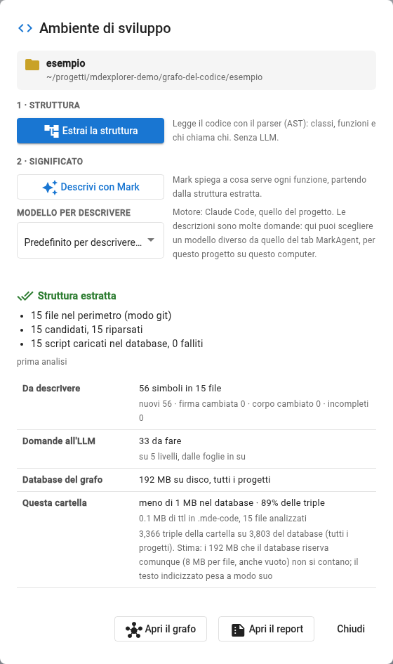

# Prova 1: segna la cartella

## TL;DR

Una cartella diventa un «ambiente di sviluppo» con una voce del menu. MdExplorer riconosce i linguaggi che ci sono
dentro, tu scegli quali leggere, e «Estrai la struttura» lo fa: in pochi secondi il programma d'esempio è un grafo.

- Un gesto: tasto destro sulla cartella `esempio`, «Segna come ambiente di sviluppo».
- La finestra «Ambiente di sviluppo» dice cosa ha trovato (C#, 15 file) e cosa farà.
- «Estrai la struttura» scrive gli script in `.mde-code/` e li carica nel database. Senza AI: il significato è il passo 2, nella prova 4.

## Cosa fare

1. Nell'albero dei documenti apri `grafo-del-codice` e fai **clic con il tasto destro** su `esempio`.
2. Nel menu scegli **«Segna come ambiente di sviluppo»**. La cartella cambia icona, e si apre la finestra
   **«Ambiente di sviluppo»**.

   

3. Leggi la finestra. Sotto «Linguaggi rilevati» c'è **C# · 15 file · pronto**: *pronto* vuol dire che l'estrattore c'è
   già (per il C# è Roslyn, dentro MdExplorer; per il PowerShell è il parser ufficiale del linguaggio). Per un progetto
   TypeScript, Python o Java vedresti invece un pulsante «Scarica la grammatica»: una volta sola, da 0,5 a 1,5 MB.
   La riga «Le modifiche si leggono da Git» dice come MdExplorer capirà, la prossima volta, cosa riparsare.
4. Sotto **«Descrizione del codice con l'LLM»** scegli **«Solo su richiesta»**. L'altra voce, «Descrivi tutto, in
   sfondo», fa partire Mark da solo dopo ogni lettura del codice: comodo nel lavoro di tutti i giorni, ma qui vuoi
   vedere un passo alla volta. La scelta si cambia quando vuoi, nella stessa finestra.
5. Guarda i due passi in fondo. **«1 · Struttura»**, «Estrai la struttura»: legge il codice con il parser, classi,
   funzioni e chi chiama chi, senza AI. **«2 · Significato»**, «Descrivi con Mark»: per ora è spento, con la scritta
   «Prima estrai la struttura (passo 1)».
6. Premi **«Estrai la struttura»**.

## Cosa succede

In un paio di secondi la finestra mostra **«Struttura estratta»**:



- **15 file nel perimetro (modo git)**: i file C# della cartella, letti dall'elenco di Git.
- **15 candidati, 15 riparsati**: la prima volta si legge tutto. Se la rifai senza toccare il codice, vedrai «0 riparsati».
- **15 script caricati nel database, 0 falliti**: quanti script sono finiti nel grafo.

Sotto compare una tabella: **56 simboli da descrivere in 15 file**, **33 domande all'LLM** su 5 livelli, quanto
occupa il database e quanto ne occupa questa cartella. È il preventivo del passo 2, che fai nella
[prova 4](04-analizza-il-codice.md): ora «Descrivi con Mark» è acceso. In fondo, **«Apri il grafo»**
([prova 2](02-guarda-il-grafo.md)) e **«Apri il report»**. Per adesso premi **«Apri il grafo»**.

Da questo momento Mark ha gli strumenti del grafo: MdExplorer li accende da solo dopo «Estrai la struttura». Con Claude
Code valgono anche nella conversazione già aperta; con GitHub Copilot e opencode, da una conversazione nuova.

## Cosa è cambiato nel progetto

Apri la scheda **«Differenze»** in fondo al pannello di sinistra: ci sono file nuovi.

| File | Che cos'è |
|---|---|
| `.development.yml` | la cartella `esempio` con il tag `program` e `codeGraph.languages: [csharp]` |
| `.mde-code/grafo-del-codice/esempio/**/*.ast.ttl` | uno script per sorgente: i simboli e le relazioni che l'estrattore ha letto |

Apri uno script, per esempio `.mde-code/grafo-del-codice/esempio/Assistente/ServizioAssistente.cs.ast.ttl`: è un file
di testo in **Turtle**, il formato standard dei grafi RDF, una riga per fatto. Ci trovi il file, la classe, i suoi metodi
con i parametri, e gli archi con la relazione, la fiducia e la riga:

```turtle
<urn:mde:edge:86360773…:contains:a6549e2e…:14> a code:Edge ;
    code:relation "contains" ; code:confidence "extracted" ; code:line 14 .
```

È questo che va su Git, nella [prova 5](05-il-grafo-va-su-git.md). Essendo Turtle lo legge anche chi non usa MdExplorer:
qualsiasi strumento di Apache Jena, o un altro database RDF.

## Se qualcosa non va

- **La cartella `esempio` non si vede**: l'albero mostra le cartelle che contengono un documento markdown; `esempio` ha un
  README apposta. In un progetto tuo, metti un README nella cartella del programma.
- **Dopo un aggiornamento dell'albero la cartella ha perso l'icona** e il menu non mostra più «Grafo del codice»:
  riapri il progetto dalla pagina dei progetti. Il tag è salvato; è l'albero che non lo ha riletto.
- **«N file analizzati con una versione precedente dell'estrattore»**, in arancione in cima alla finestra: dopo un
  aggiornamento, MdExplorer legge il codice meglio di prima, ma non rifà gli script da solo. Premi **«Aggiorna la
  struttura»**. Se premi «Descrivi con Mark» senza farlo, la finestra te lo chiede prima di partire: Mark descriverebbe
  il grafo vecchio.
- **«Nessun file di un linguaggio conosciuto»**: la cartella non contiene sorgenti dei linguaggi che MdExplorer sa leggere
  (C#, PowerShell, TypeScript, JavaScript, Python, Java).

[Prova 2: guarda il grafo →](02-guarda-il-grafo.md) · [Torna alla sezione](../README.md)
