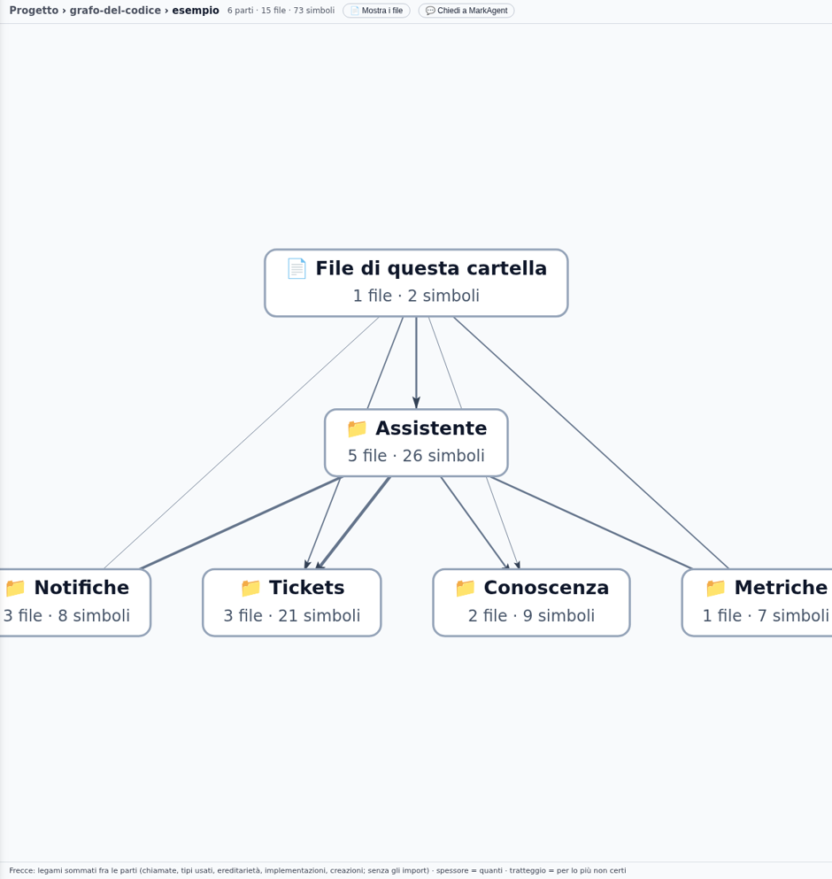
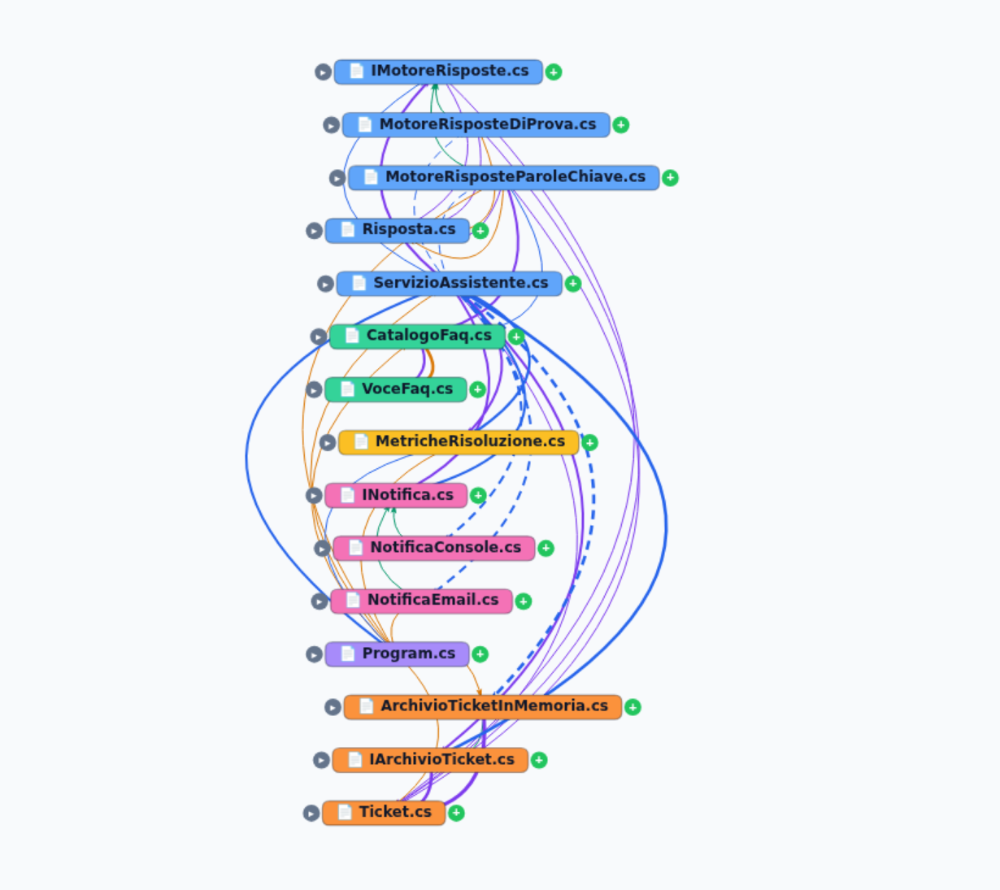
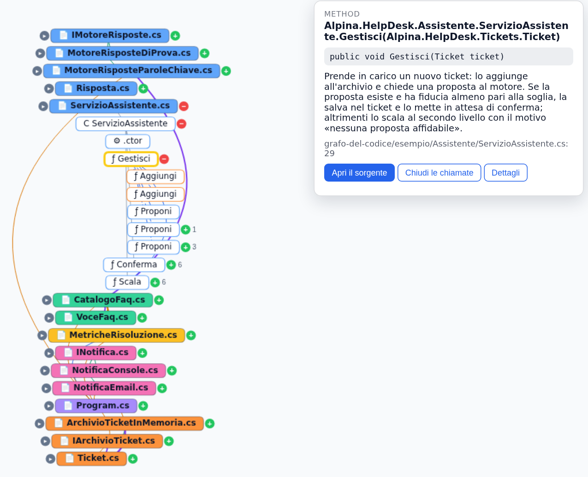

# Prova 2: guarda il grafo

## TL;DR

La pagina «Grafo del codice» si apre su una **mappa**: le parti del programma, una per sottocartella, con le frecce
sommate fra loro. Da lì si scende nei **file** e poi, a richiesta, nei simboli di un file e nelle chiamate che partono
da lì, in cascata, una riga sotto l'altra. Ogni arco ha un colore per relazione e un tratto per fiducia. Il report, un
documento markdown, dice gli stessi fatti in numeri.

- Si apre dal menu della cartella («Grafo del codice») o dalla finestra «Ambiente di sviluppo», sulla mappa delle parti.
- Il **+** su un file apre i suoi punti d'ingresso; il **+** su un metodo segue le sue chiamate, anche negli altri file.
- Il tasto destro su un file, un simbolo o un arco chiede a Mark (lo provi nella [prova 3](03-chiedi-a-mark.md)).

## Cosa fare

1. Tasto destro su `esempio` → **«Grafo del codice»** (oppure «Apri il grafo» dalla finestra della prova 1). La pagina
   si apre sulla **mappa**: una scatola per sottocartella (`Assistente`, `Tickets`, `Notifiche`, `Conoscenza`,
   `Metriche`) più «File di questa cartella», con quanti file e simboli ha ciascuna. Una freccia somma tutti i legami
   fra due parti, chiamate, tipi usati, implementazioni; più è spessa, più legami. In alto chi usa, in basso chi è
   usato: `Assistente` usa le altre.

   

   La prima volta si apre anche la finestra di **Mark**, con quattro domande pronte («A che cosa serve?», «Da dove si
   entra?»…). Le provi nella [prova 3](03-chiedi-a-mark.md); per ora chiudila. Su un programma grande la mappa è il
   modo di non perdersi: un clic su una parte ci entra, il percorso in alto riporta su.
2. Premi **«📄 Mostra i file»** in alto. La vista diventa quella per file, e «🗺 Mappa» riporta alla mappa.

   

3. Leggi l'intestazione: **15 file, 0 simboli mostrati, 42 archi**. All'inizio il grafo è **per file**: ogni riquadro è
   un sorgente, colorato per cartella (`Assistente`, `Tickets`, `Notifiche`…), uno per riga, e un arco fra due file
   riassume le relazioni fra i loro simboli.
4. Guarda la **legenda** in basso. Le relazioni hanno un colore: *chiama*, *usa il tipo*, *eredita da*, *implementa*,
   *crea*, *importa*. La fiducia ha un tratto: **continuo** per ciò che è scritto nel codice, **tratteggiato** per ciò
   che è dedotto dal nome, **punteggiato** per l'ambiguo, con più candidati, e **punto-linea** per una chiamata ambigua
   in cui Mark, descrivendo il codice, ha scelto il candidato giusto. Trova le linee tratteggiate che partono da
   `ServizioAssistente.cs`: sono le chiamate sulle interfacce, verso le due implementazioni.
5. Fai clic su `ServizioAssistente.cs`: si apre una **scheda** con il percorso, a che cosa serve il file e due pulsanti.
   **«Mostra i simboli»** (è lo stesso del **+** accanto al nome) apre il **punto d'ingresso** del file: la classe
   `ServizioAssistente`, con accanto il numero dei simboli che si aprirebbero.
6. Fai clic sulla classe e poi su **«Segui le chiamate (4)»** (o sul **+** accanto): compaiono il costruttore e i metodi `Gestisci`, `Conferma`,
   `Scala`. Ancora: clic su `Gestisci` → **«Segui le chiamate (5)»**. Sotto `Gestisci` compaiono, rientrati, i metodi
   che chiama: `Aggiungi` e `Proponi`, anche se stanno in altri file, uno per riga.

   

   `Proponi` compare tre volte: una per l'interfaccia `IMotoreRisposte`, su cui la chiamata è scritta, e una per
   ciascuna delle due classi che la implementano, con l'arco tratteggiato. Il grafo non sceglie quale motore parta: lo
   decide chi costruisce il servizio.
7. Il **−** richiude. Un metodo che non serve vederlo (in un programma vero, una funzione di log chiamata da tutti) si
   toglie con il tasto destro, **«Nascondi … dal grafo»**: in alto compare «Nascosti: 1», da cui lo rimetti.

## A che cosa serve ogni file

Dopo la [prova 4](04-analizza-il-codice.md) ogni file ha una frase che dice a che cosa serve. Il pulsante **«Utilità dei
file»** in alto a destra le apre tutte, la freccia a sinistra di un file apre solo la sua:

Se la fai prima della prova 4, la pagina te lo dice: lo stato in alto conta i file senza descrizione.

## Il report

Dal menu della cartella scegli **«Ambiente di sviluppo…»** e poi **«Apri il report»**: si apre `.md/codegraph/report.md`,
un documento markdown come gli altri, che MdExplorer riscrive a ogni analisi. Ci trovi:

- quanti simboli e quanti archi, divisi per relazione e per fiducia (qui 73 simboli e 152 archi, di cui 9 dedotti e nessuno ambiguo);
- i simboli **più connessi**, quelli da cui dipende tutto (qui `Ticket`, con dodici archi, e `Program.Main`, che costruisce tutto);
- i file più grossi, con accanto a che cosa servono;
- i simboli **senza descrizione** e le descrizioni **da rivedere**: tutti senza, finché non fai la [prova 4](04-analizza-il-codice.md).

Il report è pensato per essere letto da una persona o incollato in una conversazione; il grafo vero resta nel database,
dove Mark lo interroga nella [prova 3](03-chiedi-a-mark.md).

## Per capire cosa stai guardando

- Un arco **file → file** non esiste nel grafo: la pagina lo disegna per non mostrare subito centinaia di simboli. Appena
  apri i file, gli archi diventano quelli veri, simbolo a simbolo.
- Un file aperto mostra solo i **punti d'ingresso**: i simboli che nessun altro simbolo dello stesso file chiama o
  contiene. Il resto arriva seguendo le chiamate. Su un file grosso è la differenza fra una mappa e un gomitolo.
- Un metodo che **nessuno chiama** ha il bordo arancione tratteggiato: in un programma vero è spesso codice morto, o un
  punto d'ingresso chiamato da fuori.
- Gli **esterni** (`Console`, `Dictionary`, `Math`…) non si disegnano: la scheda di ogni simbolo li elenca. Mark li vede.
- Su un progetto grande la vista per file è l'unica leggibile: il grafo di PlantUML ha 40.000 simboli.

[← Prova 1](01-segna-la-cartella.md) · [Prova 3: chiedi a Mark →](03-chiedi-a-mark.md) · [Torna alla sezione](../README.md)
