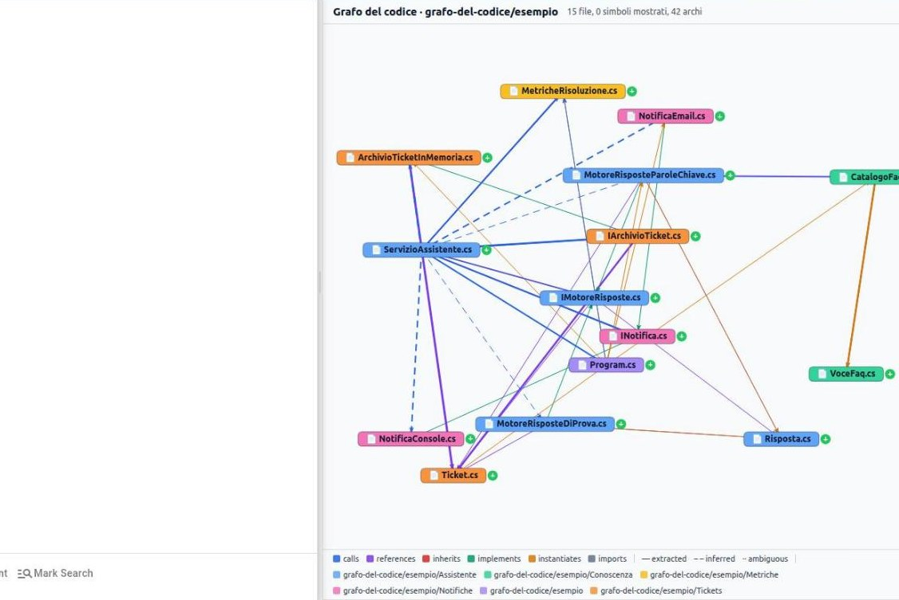
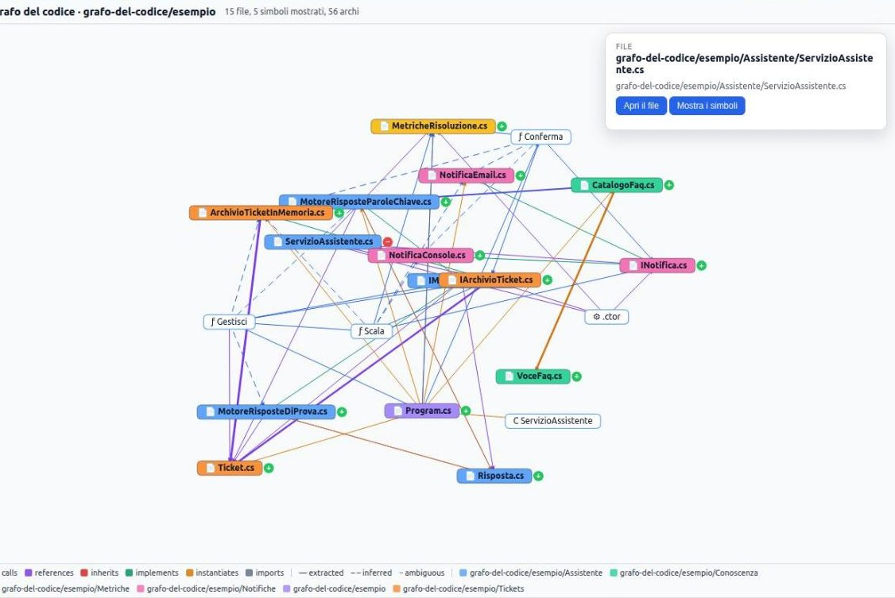

# Prova 2: guarda il grafo

## TL;DR

La pagina «Grafo del codice» mostra la cartella come una rete: prima i file, poi, a richiesta, i simboli dentro
ciascuno. Ogni arco ha un colore per relazione e un tratto per fiducia. Il report, un documento markdown, dice gli
stessi fatti in numeri.

- Si apre dal menu della cartella («Grafo del codice») o dalla finestra «Ambiente di sviluppo».
- Il **+** su un file apre i suoi simboli; un clic su un nodo apre una scheda con «Apri il file».
- La legenda in basso è la chiave di lettura: relazioni, fiducia, cartelle.

## Cosa fare

1. Tasto destro su `esempio` → **«Grafo del codice»** (oppure «Apri il grafo» dalla finestra della prova 1).

   

2. Leggi l'intestazione: **15 file, 0 simboli mostrati, 42 archi**. All'inizio il grafo è **per file**: ogni riquadro è
   un sorgente, colorato per cartella (`Assistente`, `Tickets`, `Notifiche`…), e un arco fra due file riassume le
   relazioni fra i loro simboli.
3. Guarda la **legenda** in basso. Le relazioni hanno un colore: `calls`, `references`, `inherits`, `implements`,
   `instantiates`, `imports`. La fiducia ha un tratto: **continuo** per *extracted*, **tratteggiato** per *inferred*,
   **punteggiato** per *ambiguous*. Trova le linee tratteggiate che partono da `ServizioAssistente.cs`: sono le
   chiamate sulle interfacce, verso le due implementazioni.
4. Fai clic su `ServizioAssistente.cs`: si apre una **scheda** con il percorso e due pulsanti. **«Mostra i simboli»**
   (è lo stesso del **+** accanto al nome) apre la classe, il costruttore e i metodi `Gestisci`, `Conferma`, `Scala`.
   **«Apri il file»** porta al sorgente.

   

5. Apri anche `IMotoreRisposte.cs` e le due implementazioni, e segui gli archi `implements`. Il **−** richiude un file.

## Il report

Dal menu della cartella scegli **«Ambiente di sviluppo…»** e poi **«Apri il report»**: si apre `.md/codegraph/report.md`,
un documento markdown come gli altri, che MdExplorer riscrive a ogni analisi. Ci trovi:

- quanti simboli e quanti archi, divisi per relazione e per fiducia (qui 73 simboli e 152 archi, di cui 9 dedotti e nessuno ambiguo);
- i simboli **più connessi**, quelli da cui dipende tutto (qui `Ticket`, con dodici archi, e `Program.Main`, che costruisce tutto);
- i file più grossi e i simboli **senza descrizione**: tutti, finché non fai la [prova 4](04-descrivi-il-codice.md).

Il report è pensato per essere letto da una persona o incollato in una conversazione; il grafo vero resta nel database,
dove Mark lo interroga nella [prova 3](03-chiedi-a-mark.md).

## Per capire cosa stai guardando

- Un arco **file → file** non esiste nel grafo: la pagina lo disegna per non mostrare subito centinaia di simboli. Appena
  apri i file, gli archi diventano quelli veri, simbolo a simbolo.
- Gli **esterni** (`Console`, `Dictionary`, `Math`…) non compaiono nella vista: sono nodi senza cartella. Mark li vede.
- Su un progetto grande la vista per file è l'unica leggibile: il grafo di PlantUML ha 40.000 simboli.

[← Prova 1](01-segna-la-cartella.md) · [Prova 3: chiedi a Mark →](03-chiedi-a-mark.md) · [Torna alla sezione](../README.md)
