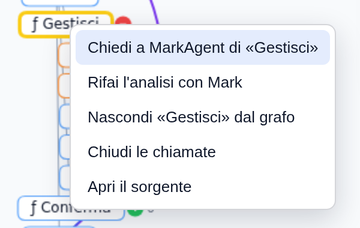
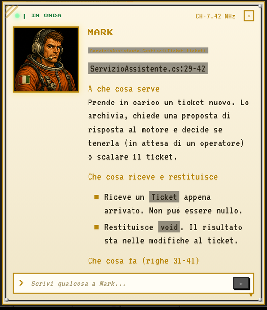
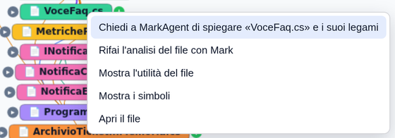

# Prova 3: chiedi a Mark

## TL;DR

Con il grafo caricato, Mark ha nove strumenti per interrogarlo e li usa da solo quando la domanda riguarda il codice.
Le risposte citano file e riga, distinguono ciò che è certo da ciò che è dedotto, e quando il grafo non basta Mark lo
dice e apre il sorgente. Le domande si scrivono nel tab, o si fanno dal grafo con il tasto destro.

- Tre domande da copiare: chi implementa, cosa cambia se tocco una soglia, qual è il cammino fra due punti; e una dal grafo.
- Ogni risposta arriva in una ventina di secondi e costa una frazione di centesimo.
- Serve il motore AI del progetto; con Claude Code o Copilot funziona così com'è.

## Prima di cominciare

Apri la scheda **«Mark Agent»** in fondo al pannello di sinistra. Con Claude Code gli strumenti del grafo arrivano da
soli anche in una conversazione già aperta. Con GitHub Copilot e opencode, se l'avevi aperta prima di segnare la
cartella, premi **«Nuova sessione chat»** (l'icona con il +): per loro gli strumenti si accendono all'inizio di una
conversazione.

## Domanda 1: chi implementa, chi chiama

> Nel programma in grafo-del-codice/esempio: chi implementa IMotoreRisposte, e da chi viene chiamato il metodo Proponi?

Mark risponde con due elenchi. `IMotoreRisposte` la implementano `MotoreRisposteDiProva` e `MotoreRisposteParoleChiave`,
con il file e la riga; `Proponi` lo chiama solo `ServizioAssistente.Gestisci`, alla riga 32. E aggiunge una precisazione
che vale la prova: *la chiamata è scritta sull'interfaccia, quale motore parta davvero dipende da quello passato al
costruttore; per questo il grafo segna la chiamata verso le due classi concrete come dedotta, non certa.*

Quello che ha fatto, senza che tu glielo chiedessi: `code_find_symbol` per trovare i due simboli, `code_neighbors` con la
relazione `implements` e con `calls` all'indietro. Se glielo chiedi («cita gli strumenti che hai usato»), te lo elenca.

## Domanda 2: l'impatto di una soglia

> Se alzo SogliaFiducia in ServizioAssistente, che cosa ne risente?

Qui il grafo **non basta**, e Mark lo dice: `code_impact` sulla costante trova solo chi costruisce la classe, perché il
grafo registra i tipi dei campi ma non chi li legge dentro un metodo. Allora apre `ServizioAssistente.cs` e ricostruisce
la catena a mano: la riga `if (proposta != null && proposta.Fiducia >= SogliaFiducia)` in `Gestisci`, il ramo `else`
che chiama `Scala`, `RegistraScalato` che cresce, `RegistraRisolto` che scatta meno, `TassoPrimoContatto` che scende e
`Program.Main` che lo stampa. Conclusione: *più rigore sulla fiducia significa più carico per il secondo livello e un
tasso di primo contatto più basso.*

È il modo giusto di usare il grafo: dove è certo lo si usa, dove manca si legge il sorgente, e lo si dice.

## Domanda 3: il cammino

> Qual è il cammino da Program.Main a MetricheRisoluzione.TassoPrimoContatto?

`code_path` trova il cammino più corto: **uno** solo passo, `Main` chiama `TassoPrimoContatto()` alla riga 28. Mark
aggiunge il cammino lungo, quello dei dati: `Main` passa l'oggetto `metriche` a `ServizioAssistente`, che lo aggiorna
con `RegistraRisolto` e `RegistraScalato`, e alla fine `Main` legge il tasso.

## Domanda 4: dal grafo, con il tasto destro

Torna alla pagina del grafo della [prova 2](02-guarda-il-grafo.md), con la cascata di `Gestisci` aperta. Tasto destro su
`Gestisci`:

Scegli **«Chiedi a MarkAgent di «Gestisci»»**. Non scrivi niente: la pagina dice a Mark quale simbolo, con il file, la
riga, la firma e la descrizione che ha già, e gli chiede di spiegarlo usando il grafo e il sorgente. La risposta arriva
nella finestra di Mark, nella stessa conversazione del tab:

Nel nostro giro la risposta aveva tutti e tre gli ingredienti. **Il fatto**: «Solo `Program.Main` (`Program.cs:25`), con
relazione certa»; le chiamate con la riga, `Aggiungi` alla 31, `Proponi` alla 32, `Scala` alla 40. **La fiducia**:
«certa; dedotta verso `MotoreRisposteDiProva` e `MotoreRisposteParoleChiave`… quale implementazione giri davvero lo
decide `Main`». **Il limite**: «la notifica potrebbe usare la rete, ma dipende dall'implementazione di `INotifica`, che
non ho aperto». E in più i punti delicati che nessuno aveva chiesto: il ticket viene archiviato *prima* di chiedere la
proposta, quindi se `Proponi` solleva un'eccezione resta in archivio senza stato coerente. Lo userai nella
[prova 4](04-analizza-il-codice.md).

Lo stesso tasto destro funziona su un **file** («Chiedi a MarkAgent di spiegare «…» e i suoi legami») e su un **arco**
(«Chiedi a MarkAgent: che cosa vuol dire «A → B»?»: utile sugli archi dedotti, quando non è chiaro perché due file sono
collegati).

## Altre domande da provare

| Domanda | Strumento che Mark userà |
|---|---|
| «Cosa c'è in Conoscenza/CatalogoFaq.cs?» | `code_outline`: a che cosa serve il file e i suoi simboli, in ordine di riga |
| «Descrivimi ServizioAssistente.Conferma con i parametri» | `code_describe`: firma, parametri, descrizioni se ci sono |
| «Cosa si rompe se cambio la firma di INotifica.Invia?» | `code_impact` a tre salti all'indietro |
| «Fammi una panoramica del programma» | `code_overview`: quanti simboli, i più connessi, i file più grossi |
| «Quale metodo calcola la quota di ticket chiusi al primo contatto?» | `code_find_symbol` sul testo: funziona davvero dopo la [prova 4](04-analizza-il-codice.md) |
| «La descrizione di CatalogoFaq.Cerca è troppo vaga: riscrivila» | `code_set_description`: lo provi nella [prova 4](04-analizza-il-codice.md) |

L'elenco completo, con un esempio per ciascuno, è in [Le domande che Mark sa fare](../guida/le-domande-di-mark.md).

## Se qualcosa non va

- **Mark legge i file invece di usare il grafo**: con Copilot o opencode, la conversazione è cominciata prima che la
  cartella fosse segnata. «Nuova sessione chat» e riprova.
- **«Il progetto non ha un grafo»**: l'analisi della prova 1 non è stata fatta, o il database di MdExplorer non è
  partito (serve Java 21: vedi la [nota tecnica](../guida/nota-tecnica.md)).
- **Un nome ambiguo**: se chiedi di `Invia` e ce ne sono tre, Mark ti propone gli id fra cui scegliere. È il grafo che
  non indovina al posto tuo.

[← Prova 2](02-guarda-il-grafo.md) · [Prova 4: fai analizzare il codice →](04-analizza-il-codice.md) · [Torna alla sezione](../README.md)
