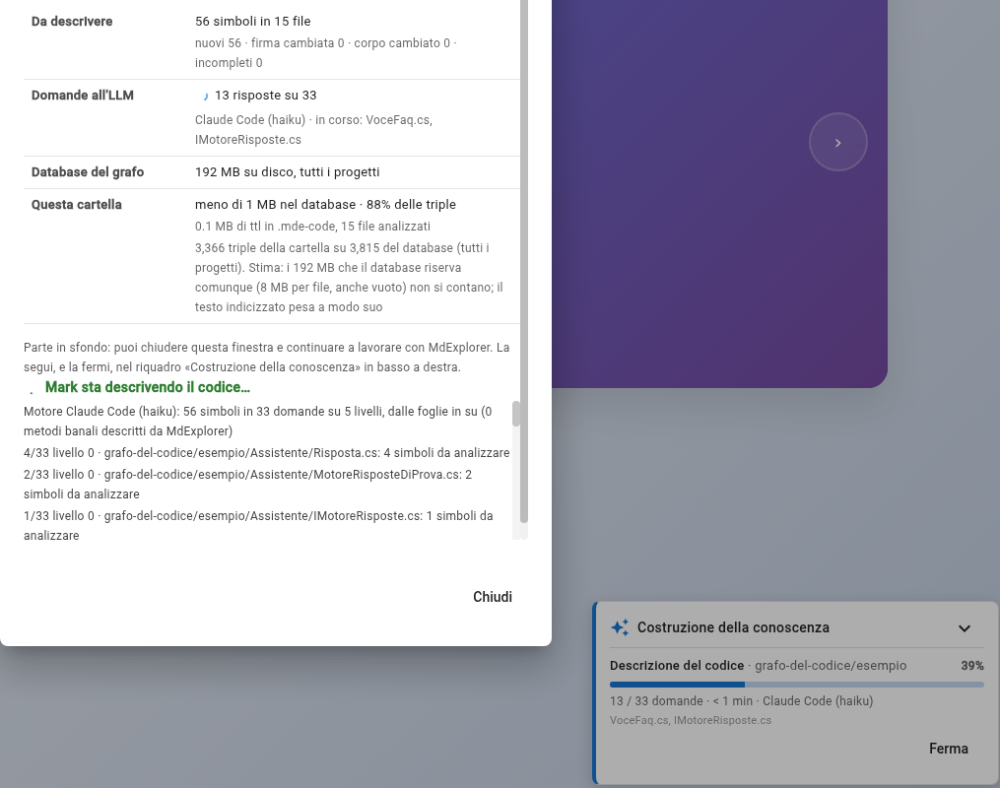

# Prova 4: fai descrivere il codice a Mark

## TL;DR

Il grafo sa *chi chiama chi*, non *a che cosa serve*. «Descrivi con Mark» è il secondo passo della finestra «Ambiente
di sviluppo»: Mark legge il codice e scrive a che cosa serve ogni file e, per ogni simbolo, una descrizione con il
significato dei parametri e del valore restituito. Comincia dalle funzioni che non chiamano nessuno e sale: chi
chiama una funzione la trova già descritta. Le descrizioni finiscono nel grafo, da lì si cerca **per significato**, e
se una non va bene la fai correggere a Mark parlandogli.

- Un pulsante, **«Descrivi con Mark»**. Il lavoro va avanti da solo e lo segui in una tabella e nel riquadro «Costruzione della conoscenza».
- Il modello si sceglie a parte: per descrivere ne basta uno leggero (con Claude Code, `haiku`).
- Mark descrive solo ciò che manca o è cambiato: la seconda volta non fa niente.
- Le righe che non rispettano lo schema vengono **scartate e contate**. Se una domanda non riesce, chi dipende da lei non parte e il giro te lo dice.

## Cosa fare

1. Tasto destro su `esempio` → **«Ambiente di sviluppo…»**. La finestra ha due passi, uno sotto l'altro:
   **«1 · Struttura»** con «Estrai la struttura», che hai già fatto nella [prova 1](01-segna-la-cartella.md), e
   **«2 · Significato»** con **«Descrivi con Mark»**. Il primo legge il codice con il parser, senza AI; il secondo
   chiede a Mark.
2. Guarda la tabella sotto i passi. Dice che cosa c'è da fare prima di spendere una sola domanda:

   | Riga | Nel nostro giro |
   |---|---|
   | **Da descrivere** | 56 simboli in 15 file, tutti nuovi |
   | **Domande all'LLM** | 33 da fare, su 5 livelli, dalle foglie in su |
   | **Database del grafo** | quanto occupa su disco, per tutti i progetti |
   | **Questa cartella** | quanto pesa nel database e quanto pesano i suoi script in `.mde-code` |

   Una **domanda** è un gruppo di simboli dello stesso file allo stesso livello: 33 domande per 56 simboli.
3. Sotto «Descrivi con Mark» c'è **«Modello per descrivere»**. Il motore è quello del progetto; il modello puoi
   cambiarlo solo per questo lavoro, perché le descrizioni sono molte domande. Senza una scelta vale il predefinito
   per descrivere: `haiku` con Claude Code, `gpt-6-luna` con GitHub Copilot. Il tab Mark Agent resta con il suo modello.
4. Premi **«Descrivi con Mark»**. Il lavoro parte **in sfondo**: puoi chiudere la finestra e continuare a lavorare. La
   riga «Domande all'LLM» conta le risposte, e in basso a destra il riquadro **«Costruzione della conoscenza»** mostra
   lo stesso avanzamento, con «Ferma».

   

5. Aspetta la riga finale: **«Descrizione con Mark completata: 71 simboli in 33 domande (0 righe scartate)»**. Sono i 56
   simboli più i 15 file: anche ogni file riceve la sua frase. Ora la tabella dice «0 simboli in 0 file» da descrivere.

   

6. Apri il grafo e premi **«Utilità dei file»**: sotto ogni file c'è ora una frase che dice a che cosa serve. Un clic su
   un metodo mostra la sua descrizione nella scheda.

## Dalle foglie in su

Il registro della finestra comincia così:

```text
Motore Claude Code (haiku): 56 simboli in 33 domande su 5 livelli, dalle foglie in su (0 metodi banali descritti da MdExplorer)
1/33 livello 0 · grafo-del-codice/esempio/Assistente/IMotoreRisposte.cs: 1 simboli da analizzare
2/33 livello 0 · grafo-del-codice/esempio/Assistente/MotoreRisposteDiProva.cs: 2 simboli da analizzare
…
```

Il **livello 0** sono le funzioni che non chiamano niente del programma. Una funzione di livello 1 chiama solo funzioni
di livello 0, e così via. Quando Mark descrive `ServizioAssistente.Gestisci`, nella domanda trova già la descrizione di
`Proponi`, `Aggiungi` e `Scala`, appena scritte: spiega che cosa fa `Gestisci` sapendo che cosa fanno le funzioni che
chiama, senza indovinarlo dal nome. Le domande dello stesso livello partono insieme, qualcuna in parallelo, e ognuna
parte appena sono finite quelle da cui dipende.

`Program.Main` chiama quasi tutto: è l'ultima, al livello 4.

## Se una domanda non riesce

MdExplorer non si fida dell'AI sulla forma. Una riga con un campo che lo schema non prevede, o un parametro che il
metodo non ha, viene **buttata e contata**, mai corretta o indovinata. Nel nostro giro non ne è stata scartata nessuna.

Se invece una domanda non ha risposta, o lascia simboli senza descrizione, le domande che **dipendono** da lei non
partono: descriverebbero una funzione senza sapere che cosa fanno quelle che chiama, e lo farebbero male senza dirlo.
A fine giro la finestra lo scrive in arancione: *«Non tutto descritto: 1 domande senza risposta, 0 con simboli senza
descrizione, 4 non partite perché dipendono da quelle»*. Nel riquadro «Costruzione della conoscenza» premi
**«Riprendi»**: rifà solo quelle rimaste indietro, il resto è già scritto.

Per un simbolo solo c'è il tasto destro sul grafo: **«Descrivi con Mark»**, o **«Rifai la descrizione con Mark»** se
ne ha già una; per un file, **«Descrivi il file con Mark»** o **«Rifai la descrizione del file con Mark»**.

## Dove sono finite

Apri la scheda «Differenze»: accanto a ogni `.ast.ttl` c'è ora un **`.doc.ttl`**. Aprine uno, per esempio
`.mde-code/grafo-del-codice/esempio/Metriche/MetricheRisoluzione.cs.doc.ttl`. La descrizione di `TassoPrimoContatto` è
fatta così:

```turtle
<urn:mde:doc:2de96d4134a5f466ae880efe> a code:Description ;
    code:describes <urn:mde:sym:2de96d4134a5f466ae880efe> ;
    code:summary "Calcola la quota di ticket chiusi al primo contatto sul totale dei ticket gestiti, cioè risolti più scalati. Non modifica lo stato." ;
    code:returnsDescription "Un numero tra 0 e 1: i ticket risolti al primo contatto divisi per risolti più scalati. Torna 0 se non è stato ancora registrato nessun ticket, senza sollevare eccezioni." ;
    code:writtenBy "mde-code-doc 10 / Claude Code (haiku)" ;
    code:signatureHash "d70c1a02…" ; code:bodyHash "52972cf4…" ; code:contextHash "e3b0c442…" ; code:promptVersion "10" .
```

Ogni descrizione dice **chi l'ha scritta** (la versione delle istruzioni, il motore e il modello) e porta tre
**impronte** del momento in cui è stata scritta:

| Impronta | Se cambia | Che cosa succede |
|---|---|---|
| della **firma** (`signatureHash`) | il metodo cambia parametri o tipo | la descrizione si rifà al prossimo «Descrivi con Mark» |
| del **corpo** (`bodyHash`) | il codice dentro il metodo cambia | si rifà anche lei; gli spazi non contano, i commenti sì |
| del **contesto** (`contextHash`) | cambia la descrizione di una funzione chiamata | diventa **«da rivedere»**: non si rifà da sola |

Le descrizioni «da rivedere» compaiono in una riga della tabella e in un pulsante a parte, **«Rivedi anche le N da
rivedere»**. Non partono da sole perché mentre si lavora sul codice cambiano spesso, e rifarle tutte a cascata
costerebbe molte domande per poco. Lo stesso vale quando cambia la versione delle istruzioni di Mark (`promptVersion`).

A che cosa serve il file sta in una voce a parte, `code:FileDescription`, nello stesso script.

## Cercare per significato

Torna al tab «Mark Agent» e chiedi:

> Quale metodo calcola la quota di ticket chiusi al primo contatto? Cerca per significato nel grafo e dimmi cosa dice la descrizione.

Nessuna di quelle parole è nel nome del metodo. Mark lo trova lo stesso, `MetricheRisoluzione.TassoPrimoContatto()`,
perché la ricerca a testo pieno del grafo indicizza anche le descrizioni; e riporta la sintesi, il valore restituito
(«un numero tra 0 e 1… torna 0 se non è stato ancora registrato nessun ticket») e chi l'ha scritta. Poi chiude il
cerchio con la domanda della prova 3: *ora ho la formula: alzando la soglia salgono gli scalati e scendono i risolti, il
tasso cala.*

Un dettaglio, se fai domande mentre Mark sta ancora descrivendo: le descrizioni entrano nel database a gruppi, ogni 200
domande o ogni cinque minuti. Su un programma grande, nel tab Mark può non vedere ancora le ultime. Nel programma
d'esempio il giro è così corto che non te ne accorgi.

## Fai correggere una descrizione

Le descrizioni non sono scolpite. Nella [prova 3](03-chiedi-a-mark.md) Mark ha trovato un punto delicato di `Gestisci`:
il ticket viene archiviato prima di chiedere la proposta. La descrizione scritta nel giro non lo dice. Chiedi a Mark,
nella sua finestra o nel tab:

> Aggiungi alla descrizione di Gestisci nel grafo, come avvertenza, il punto delicato che hai trovato sul ticket archiviato prima della proposta. Non toccare il resto.


Mark usa lo strumento `code_set_description`, l'unico del grafo che scrive. Non apre lo script e non lo scrive lui:
chiede a MdExplorer di aggiornare la descrizione, e MdExplorer controlla la richiesta come controlla le risposte del
giro. Un parametro che il metodo non ha viene rifiutato con l'elenco di quelli veri; una descrizione scritta per una
firma vecchia non si ritocca senza riscriverla tutta. Poi aggiorna lo script `.doc.ttl` e il grafo, con le impronte di
oggi.

Nel nostro giro, in `ServizioAssistente.cs.doc.ttl` le note di `Gestisci` finiscono così:

> … **Avvertenza:** il ticket è archiviato prima di chiedere la proposta al motore. Se Proponi solleva un'eccezione (per
> esempio il motore a parole chiave con testo nullo), il ticket resta nell'archivio senza una proposta, senza il
> passaggio a InAttesaDiConferma e senza scalo al secondo livello.

Quella descrizione ora dice `writtenBy "code_set_description"`; le altre dello script tengono il loro autore. Una
correzione fatta così non diventa mai «da rivedere» e il prossimo «Descrivi con Mark» non la riscrive: si rifà solo se
cambiano la firma o il corpo del metodo.

## Quanto costa e quando rifarlo

- Una domanda all'LLM per gruppo di simboli. Per il programma d'esempio, 33 domande; con il modello leggero, pochi
  centesimi. Prima di partire la tabella ti dice quante sono: su un progetto di mille file, una scelta da fare con
  calma, cartella per cartella.
- Si rifà quando la tabella mostra qualcosa «da descrivere»: un simbolo nuovo, o con la firma o il corpo cambiati.
  Quello che è già descritto e non è cambiato non si tocca.
- I getter, i setter e i metodi vuoti del Java li descrive MdExplorer da solo, con una frase fissa: non costano domande.
  Il registro li conta («metodi banali descritti da MdExplorer»); nel C# d'esempio sono zero.
- Una correzione con `code_set_description` non chiama nessuna AI in più: il testo lo scrive Mark nella conversazione.
- Le descrizioni vanno su Git con gli script: le scrive uno, le leggono tutti ([prova 5](05-il-grafo-va-su-git.md)).

[← Prova 3](03-chiedi-a-mark.md) · [Prova 5: il grafo va su Git →](05-il-grafo-va-su-git.md) · [Torna alla sezione](../README.md)
