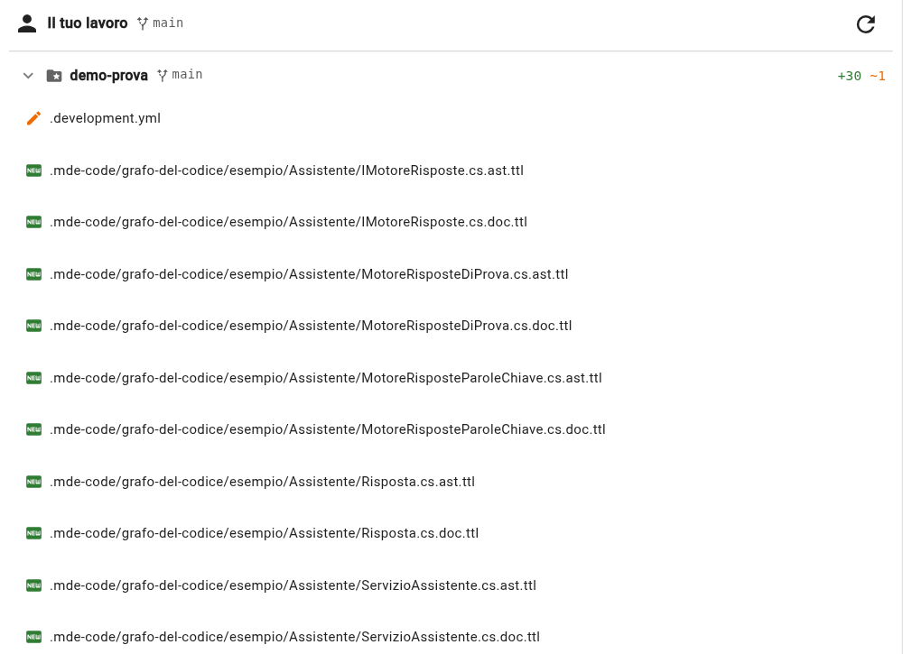

# Prova 5: il grafo va su Git

## TL;DR

Il grafo non vive nel database di chi lo ha fatto: vive negli **script** scritti nel progetto, uno per sorgente, e
quelli vanno su Git come un documento. Chi scarica il progetto ha il grafo pronto, con le descrizioni, senza
rianalizzare e senza spendere una chiamata AI.

- Nella scheda «Differenze» ci sono `.development.yml` e la cartella `.mde-code/`: si committano come tutto il resto.
- Un collega che apre il progetto trova il grafo caricato alla prima apertura; riparsa solo ciò che cambia dopo.
- Il database di MdExplorer si può cancellare: dagli script si ricostruisce.

## Cosa fare

1. Apri la scheda **«Differenze»** in fondo al pannello di sinistra.

   

   Se vedi solo `.development.yml`, premi il pulsante per rileggere da Git, in alto a destra nella scheda: i file nuovi
   compaiono.

2. Leggi l'elenco. `.development.yml` è **modificato** (la cartella `esempio` con il tag e il linguaggio); sotto
   `.mde-code/grafo-del-codice/esempio/` ci sono i file **nuovi**: un `.ast.ttl` e un `.doc.ttl` per ogni sorgente, 30 in
   tutto.
3. Committa come fai per un documento (la [prova 6 del tour](../../tour/06-git.md) dice come). Un messaggio che dice
   la verità: «grafo del codice dell'help desk, con le descrizioni».

## Cosa trova un collega

Quando un collega fa pull e apre il progetto in MdExplorer:

- l'albero mostra `esempio` già segnata come ambiente di sviluppo, perché il tag è in `.development.yml`;
- all'apertura MdExplorer carica gli script di `.mde-code/` nel **suo** Fuseki: il grafo c'è, con le descrizioni,
  prima ancora di aprire la finestra «Ambiente di sviluppo»;
- nel tab Mark Agent gli strumenti del grafo sono accesi, perché la cartella ha un linguaggio scelto;
- se tocca un sorgente, la prossima analisi riparsa **solo quello**, e se cambia una firma il report gli dice che la
  descrizione è da rivedere.

Chi non usa MdExplorer trova comunque, accanto a ogni sorgente, un file di testo leggibile che dice che cosa c'è
dentro e a cosa serve. È l'esito del parsing, consegnato con il codice, in **Turtle**: un formato standard, che si
carica in qualsiasi database RDF e si interroga in SPARQL anche senza MdExplorer.

## Perché gli script e non il database

| | Script in `.mde-code/` | Database Fuseki |
|---|---|---|
| dove sta | nel progetto, su Git | sul computer di chi lo usa |
| chi lo scrive | l'estrattore; Mark, con le descrizioni e le correzioni | MdExplorer, dagli script |
| se si perde | si rifà la struttura (e si rifanno le descrizioni con Mark, a pagamento) | si ricostruisce dagli script, gratis |
| a cosa serve | verità, cronologia, revisione | domande veloci, ricerca, vista |

La cronologia di Git vale anche per il grafo: un `git diff` su uno script dice quali simboli e quali relazioni ha
aggiunto o tolto un commit, e `git blame` su un `.doc.ttl` dice quando è stata scritta, o corretta, una descrizione.
Lo script dice chi ha scritto ogni descrizione oggi ([prova 4](04-analizza-il-codice.md)); Git ricorda anche le versioni
di prima e chi le aveva scritte.

## E se tolgo il tag?

Togliendo «Segna come ambiente di sviluppo» la cartella smette di essere analizzata; gli script restano finché non li
cancelli, e il grafo con loro. È una scelta aperta di MdExplorer: la verità segue la tua decisione, non la indovina.

[← Prova 4](04-analizza-il-codice.md) · [Torna alla sezione](../README.md) · [Torna all'inizio](../../README.md)
