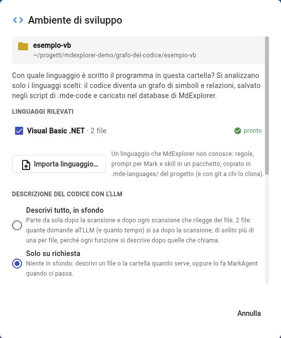
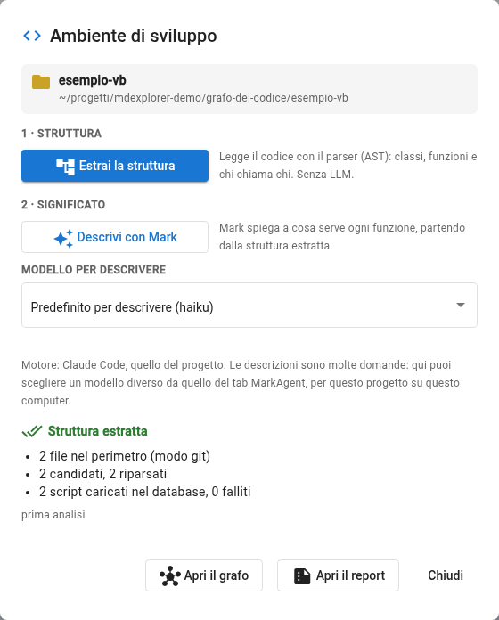
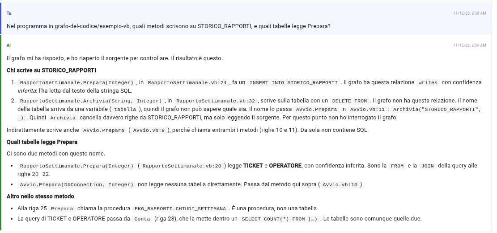
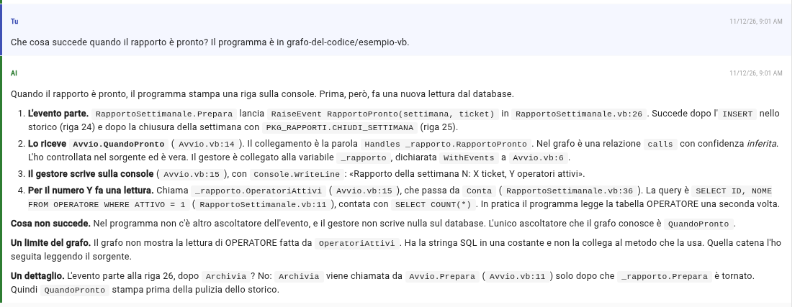

# Prova 6: Visual Basic e l'SQL nel codice

## TL;DR

MdExplorer legge anche il **Visual Basic .NET**, con il suo file di progetto, e riconosce l'**SQL scritto nelle stringhe**:
il metodo che scrive una query viene collegato alle tabelle che legge e scrive e alle procedure che chiama. Così «chi scrive
su questa tabella?» ha una risposta nel grafo, anche quando la query è costruita a pezzi.

- Segni la cartella `esempio-vb` come nella prova 1, con il linguaggio **Visual Basic .NET**.
- Nel grafo compaiono le tabelle `TICKET`, `OPERATORE`, `STORICO_RAPPORTI` e la procedura `PKG_RAPPORTI.CHIUDI_SETTIMANA`, con le relazioni `reads`, `writes` e `calls`.
- Dove il nome della tabella arriva da una variabile il grafo non indovina: c'è un nodo `?`, e lo dice.

## Cosa fare

1. Nell'albero apri `grafo-del-codice`, tasto destro su **`esempio-vb`**, **«Segna come ambiente di sviluppo»**.
2. Nella finestra «Ambiente di sviluppo» c'è **Visual Basic .NET · 2 file · pronto**, già spuntato. Come per il C#, non
   serve installare niente: il Visual Basic lo legge Roslyn, lo stesso compilatore che MdExplorer si porta dietro. Sotto
   «Descrizione del codice con l'LLM» scegli **«Solo su richiesta»**, come nella prova 1.

   

3. Premi **«Estrai la struttura»**. In un paio di secondi la finestra dice **«Struttura estratta»**: 2 file, 2 script
   caricati nel database, 0 falliti.

   

4. Apri il tab **«Mark Agent»** e fai le domande qui sotto. Se la conversazione era già aperta prima del passo 3 e usi
   Copilot o opencode, premi **«Nuova sessione chat»**. Le schermate di questa pagina sono di Claude Code con Sonnet, con
   la conversazione allargata (l'icona accanto al motore).

## Che cosa c'è nel grafo

Il programma ha due file `.vb`. Il grafo ha due classi, `RapportoSettimanale` e il modulo `Avvio`, con lo spazio dei nomi
`Alpina.Rapporti` preso dal file di progetto; i loro metodi, l'evento e il campo `WithEvents`. Le relazioni nuove sono queste:

| Riga | Da | Relazione | A | Fiducia |
|---|---|---|---|---|
| 11 | la costante `SqlOperatoriAttivi` | `reads` | `OPERATORE` | dedotta |
| 20 | `RapportoSettimanale.Prepara` | `reads` | `TICKET`, `OPERATORE` | dedotta |
| 24 | `RapportoSettimanale.Prepara` | `writes` | `STORICO_RAPPORTI` | dedotta |
| 25 | `RapportoSettimanale.Prepara` | `calls` | `PKG_RAPPORTI.CHIUDI_SETTIMANA` | dedotta |
| 26 | `RapportoSettimanale.Prepara` | `calls` | l'evento `RapportoPronto` | certa |
| 14 | l'evento `RapportoPronto` e il campo `_rapporto` | `calls` | `Avvio.QuandoPronto` | dedotta |
| 32 | `RapportoSettimanale.Archivia` | `writes` | `?` | ambigua |

Tabelle e procedure sono **nodi esterni**: il grafo ne conosce il nome, non la struttura, perché lo schema del database
non è fra i file analizzati. Le relazioni con l'SQL sono **dedotte**: vengono dal testo della stringa, non da un
interprete SQL. La pagina «Grafo del codice» disegna i simboli del programma, non i nodi esterni: le tabelle le trovi
chiedendo a Mark.

## Domanda 1: chi scrive su una tabella

> Nel programma in grafo-del-codice/esempio-vb, quali metodi scrivono su STORICO_RAPPORTI, e quali tabelle legge Prepara?

Il grafo ha la risposta senza aprire il codice: `Prepara` scrive su `STORICO_RAPPORTI` alla riga 24 e legge `TICKET` e
`OPERATORE` alla riga 20. La query di `Prepara` è scritta su tre righe con `&`: MdExplorer la legge come una frase sola.

Mark cita file, riga e fiducia di ogni relazione, e trova da solo anche `Archivia`, aprendo il sorgente. Guarda però il
punto 2: dice che il grafo *non ha* la scrittura di `Archivia`, e non è vero, la ha verso il nodo `?`. Se ne accorge da
solo alla domanda 1 della [prova 7](07-mark-controlla-il-grafo.md), quando legge com'è fatto il grafo: è la ragione per cui
quella prova esiste.

C'è un dettaglio da notare. La query parte da `Prepara` ma la esegue `Conta`, e l'`INSERT` lo esegue `Esegui`. Il grafo
collega l'SQL a **dove è scritto**, non a dove viene eseguito: è la domanda che conta in un'analisi («quale funzione
tocca questa tabella?»), e funziona anche quando la query passa per una variabile o un parametro.

## Domanda 2: la tabella che il grafo non sa

> Archivia scrive su quale tabella?

Nel grafo `Archivia` scrive su `?`: la frase è `"DELETE FROM " & tabella & …`, e il nome arriva dal parametro. Il grafo
non indovina, e marca la relazione come **ambigua**. Per rispondere bisogna guardare chi chiama `Archivia`: `Avvio.Prepara`,
alla riga 11, con la stringa `"STORICO_RAPPORTI"`. Mark lo può ricostruire con `code_neighbors` e la lettura del sorgente;
la risposta giusta dice che oggi è `STORICO_RAPPORTI` perché lo decide il chiamante, non `Archivia`.

## Domanda 3: chi gestisce l'evento

> Che cosa succede quando il rapporto è pronto?

Nel codice nessuno chiama `QuandoPronto`: il legame è la parola `Handles` sulla sua dichiarazione. Il grafo lo rende una
relazione: `Prepara` solleva `RapportoPronto` (certa), l'evento porta a `QuandoPronto` (dedotta). Anche il campo
`WithEvents` `_rapporto` porta allo stesso gestore: in un form o in una pagina è il **controllo** (il pulsante, la
griglia), ed è la strada per seguire «clic sul pulsante → gestore → logica».

Mark segue la catena fino in fondo, e nota anche l'ordine: il gestore stampa prima che `Archivia` pulisca lo storico.

## Che cosa il grafo non vede

- L'SQL che sta **fuori dal codice**: in un file XML, in una configurazione, in una tabella del database.
- **Viste e sinonimi**: `OPERATORE` può essere una vista sopra altre tabelle; il grafo vede il nome scritto.
- Lo **schema**: `OPERATORE` e `GEST.OPERATORE` sono due nodi diversi.
- Le letture di un campo dentro un metodo, come per il C#: `OperatoriAttivi` usa la costante `SqlOperatoriAttivi`, ma
  l'arco va dalla costante alla tabella, non dal metodo.

## Il prossimo passo

La [prova 7](07-mark-controlla-il-grafo.md): chiedere a Mark se quello che il grafo dice è vero.

[Torna alla sezione](../README.md)
