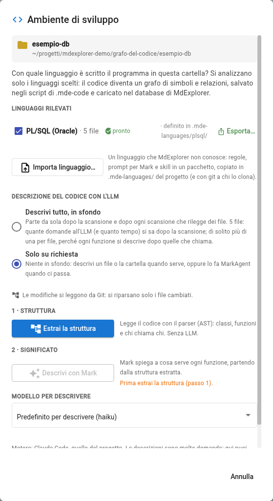
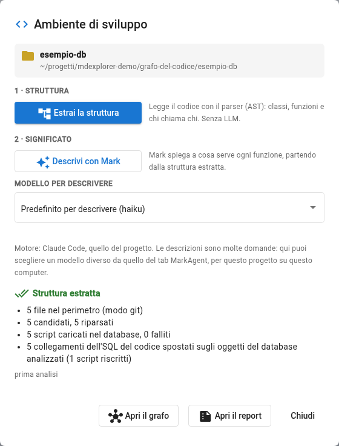
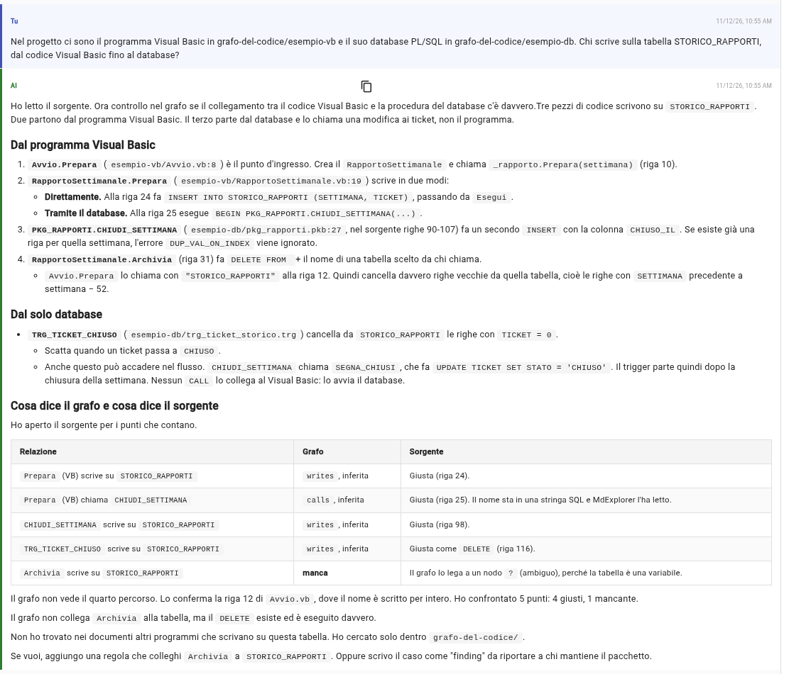

# Prova 8: il codice e il database

## TL;DR

Il PL/SQL non è un linguaggio di MdExplorer: lo legge un **pacchetto di linguaggio**, già nel progetto. Quando la cartella
del database entra nel grafo, le frecce che dal programma Visual Basic andavano ai *nomi* delle tabelle e della procedura
passano agli **oggetti veri**: MdExplorer lo fa da solo e lo dice. Così una domanda come «chi scrive su questa tabella?»
attraversa il codice e il database in una volta.

- Prima la [prova 6](06-visual-basic-e-sql.md) (il programma Visual Basic nel grafo), poi qui segni `esempio-db` con il linguaggio **PL/SQL (Oracle)**.
- La finestra dice «5 collegamenti dell'SQL del codice spostati sugli oggetti del database analizzati»: niente da rifare sul Visual Basic.
- Mark risponde dal grafo e controlla sul sorgente; anche qui, le righe che cita si verificano.

## Il pacchetto PL/SQL

È nella cartella `.mde-languages/plsql/` del progetto. Dentro ci sono le regole (`language.yml`), il prompt che Mark usa
per descrivere il PL/SQL, la skill `plsql-pacchetto` con cui MarkAgent lo mette a punto sul codice vero di un progetto, e
il `tbox.ttl` che dice che cosa le regole scrivono nel grafo. Una riga di `language.yml` conta più delle altre:
`database: true`. Dice che i simboli di questo linguaggio sono oggetti di un database, e che l'SQL scritto nel codice C# o
Visual Basic che li nomina si ricollega a loro.

| Nel PL/SQL | Nel grafo |
|---|---|
| la specifica di un package | un'interfaccia, con le firme delle procedure che dichiara |
| il corpo di un package | una classe, con le sue procedure e funzioni (`PKG_RAPPORTI.CHIUDI_SETTIMANA`) |
| `CREATE PROCEDURE`, `CREATE FUNCTION`, un trigger | una funzione |
| `CREATE TABLE`, `CREATE VIEW`, `CREATE TYPE` | una tabella, una vista, un tipo |
| `FROM`, `JOIN` | `reads` |
| `INSERT`, `UPDATE`, `DELETE`, `MERGE`, `TRUNCATE` | `writes` |
| `PKG.PROC(…)` e le chiamate dentro il package | `calls` |

Dentro una procedura il pacchetto non crea nodi: legge solo le chiamate, le tabelle lette e quelle scritte, e ne fa
frecce che partono dalla procedura. Il resto (variabili, cursori, condizioni) sta nel sorgente e nelle descrizioni di
Mark. Se di un package ci sono specifica e corpo, chi lo chiama arriva alla procedura del corpo; se c'è solo la
specifica, alla firma.

In un progetto tuo il pacchetto si aggiunge con **«Importa linguaggio…»**, nella finestra «Ambiente di sviluppo», da uno
zip; si porta altrove con **«Esporta…»** sulla sua riga.

## Cosa fare

1. Fai la [prova 6](06-visual-basic-e-sql.md), se non l'hai già fatta: il programma Visual Basic deve essere nel grafo.
2. Tasto destro su `grafo-del-codice/esempio-db`, **«Segna come ambiente di sviluppo»**. La finestra trova
   **PL/SQL (Oracle) · 5 file · pronto**, «definito in .mde-languages/plsql/». Scegli **«Solo su richiesta»**.

   

3. Premi **«Estrai la struttura»**. Sotto «Struttura estratta», oltre ai numeri di sempre, c'è una riga nuova: **5
   collegamenti dell'SQL del codice spostati sugli oggetti del database analizzati**.

   

## Che cosa è successo

Nella prova 6 `RapportoSettimanale.Prepara` leggeva `TICKET` e `OPERATORE`, scriveva `STORICO_RAPPORTI` e chiamava
`PKG_RAPPORTI.CHIUDI_SETTIMANA`: cinque frecce verso **nodi esterni**, nomi scritti nelle stringhe e niente di più. Ora
quei nomi esistono nel grafo, letti da `tabelle.sql` e da `pkg_rapporti.pkb`, e le cinque frecce vanno a loro. Lo script
del Visual Basic in `.mde-code` è stato riscritto: lo vedi in «Differenze», da salvare su Git come il resto.

Non conta l'ordine. Se il database fosse entrato nel grafo prima del Visual Basic, le frecce sarebbero andate subito agli
oggetti veri; se un collega analizza il database e tu fai pull, il ricollegamento avviene all'apertura del progetto, e un
avviso dice quali script sono cambiati. Se un oggetto sparisce (il file del package tolto dal progetto), la freccia torna
al nodo esterno con il suo nome.

Il nome si confronta senza badare alle maiuscole e, se serve, senza lo schema davanti (`GEST.TICKET` trova `TICKET`). Se
porta a due oggetti diversi, la freccia resta sul nodo esterno: il grafo non sceglie a caso.

## La domanda

> Nel progetto ci sono il programma Visual Basic in grafo-del-codice/esempio-vb e il suo database PL/SQL in grafo-del-codice/esempio-db. Chi scrive sulla tabella STORICO_RAPPORTI, dal codice Visual Basic fino al database?

Mark trova le strade che arrivano alla tabella: l'`INSERT` scritto nel Visual Basic, la procedura `CHIUDI_SETTIMANA`
chiamata dal Visual Basic, il trigger `TRG_TICKET_CHIUSO` che scatta quando `SEGNA_CHIUSI` chiude i ticket, e `Archivia`,
dove il nome della tabella arriva da chi chiama. Alla fine confronta grafo e sorgente: quattro relazioni giuste, una che il
grafo segna come ambigua (`Archivia`, il nodo `?` della prova 6).

Il trigger non ha una freccia dal Visual Basic, ed è giusto: non lo chiama nessuno, lo fa scattare il database quando la
tabella `TICKET` cambia. Mark lo ricostruisce leggendo il sorgente, e lo dice.

Guarda anche i numeri di riga. Quelli che vengono dal grafo sono giusti (`pkg_rapporti.pkb:27`, `RapportoSettimanale.vb:24`);
alcuni che Mark ha letto nei sorgenti PL/SQL in questa risposta no (la «riga 98» e la «riga 116» non esistono in file di
quaranta righe). È il motivo per cui la [prova 7](07-mark-controlla-il-grafo.md) insiste: una risposta si verifica aprendo
il punto citato.

## Quello che il pacchetto non legge ancora

- Una procedura che finisce con `END;` senza nome resta aperta fino al prossimo `END nome;`.
- Un cursore dichiarato a livello di package e usato da una procedura: la tabella che legge finisce sul package.
- L'SQL dentro una stringa del PL/SQL (`EXECUTE IMMEDIATE`, `OPEN … FOR '…'`) non si legge.
- I commenti `/* … */` non si tolgono.
- I parametri si leggono solo se stanno sulla riga di `PROCEDURE` o `FUNCTION`.

Su un progetto vero la skill `plsql-pacchetto` fa contare a MarkAgent queste forme, correggere le regole con il tuo sì e
scrivere una rilevazione per chi mantiene il pacchetto.

[Torna alla sezione](../README.md)
