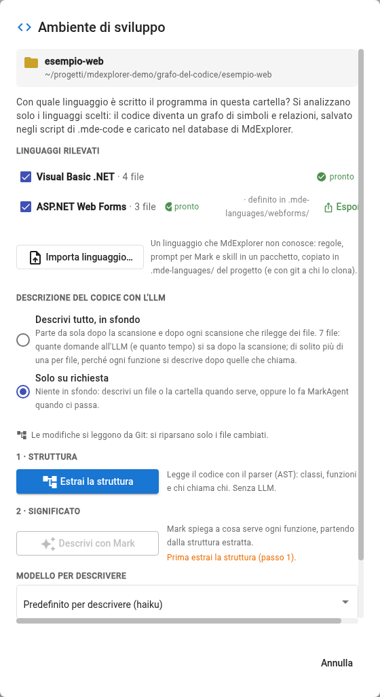
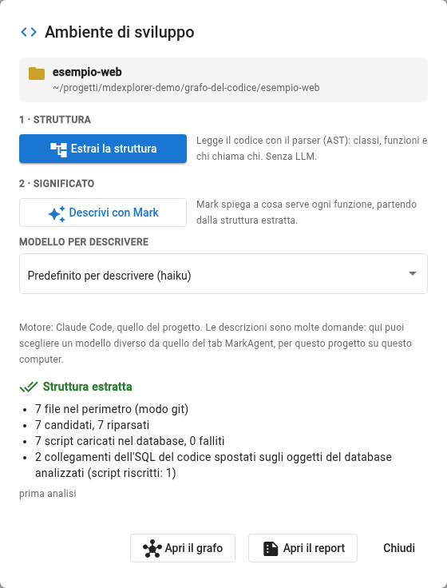
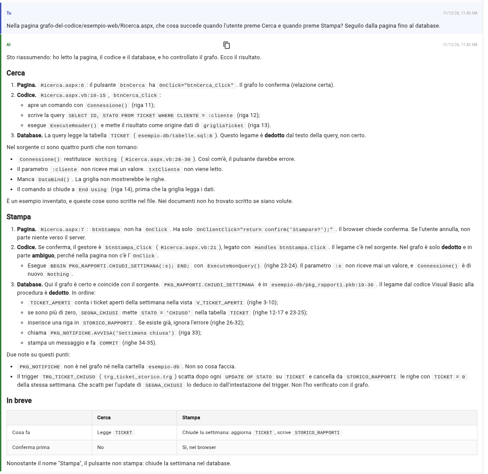

# Prova 9: le pagine web

## TL;DR

Anche le pagine ASP.NET Web Forms entrano nel grafo, con un **pacchetto di linguaggio** già nel progetto. Ogni pagina è
collegata alla sua classe di code-behind in Visual Basic, ogni pulsante al metodo che gli risponde, la pagina al suo
`Page_Load`. Con la [prova 8](08-il-codice-e-il-database.md) fatta prima, il percorso va dal pulsante fino alle tabelle.

- Segni `esempio-web` con **due** linguaggi, che la finestra propone già: Visual Basic .NET per il code-behind, ASP.NET Web Forms per le pagine.
- Il pulsante con `OnClick=` nella pagina e quello con `Handles` nel Visual Basic arrivano tutti e due al loro gestore, per due strade diverse.
- Mark segue «che cosa succede quando premo Stampa?» dalla pagina al database, e dice dove il grafo è certo e dove deduce.

## Il pacchetto Web Forms

È nella cartella `.mde-languages/webforms/`: regole, prompt per Mark, la skill `webforms-pacchetto` per metterlo a punto
su pagine vere, il `tbox.ttl`. È un **dialetto di pagine**: MdExplorer legge l'HTML da sé, e il pacchetto dice che cosa
riconoscere nelle direttive e negli attributi di ASP.NET.

| Nella pagina | Nel grafo |
|---|---|
| `<%@ Page … Inherits="Alpina.Web.Ricerca" %>` | la classe `Ricerca` del code-behind `renders` la pagina |
| `<asp:Button ID="btnCerca" OnClick="btnCerca_Click" …>` | il controllo `btnCerca` `calls` il metodo `btnCerca_Click` |
| `AutoEventWireup="true"` | la pagina `calls` il suo `Page_Load` |
| `MasterPageFile="~/Site.master"`, `<%@ Register Src="~/Controlli/Filtro.ascx" %>` | la pagina `includes` la master page e il controllo utente |
| `OnClientClick="return confirm(…)"` | il controllo, con il JavaScript che esegue nel browser |

Un pulsante agganciato nel Visual Basic con `Handles btnStampa.Click` non ha niente nella pagina: lo collega il Visual
Basic, dal campo `WithEvents` del file `.designer` al gestore.

## Cosa fare

1. Fai la [prova 8](08-il-codice-e-il-database.md), se non l'hai già fatta: il database deve essere nel grafo.
2. Tasto destro su `grafo-del-codice/esempio-web`, **«Segna come ambiente di sviluppo»**. La finestra trova due linguaggi,
   **Visual Basic .NET · 4 file** e **ASP.NET Web Forms · 3 file**, tutti e due spuntati. Lasciali così: senza il Visual
   Basic le pagine non avrebbero una classe a cui collegarsi. Scegli **«Solo su richiesta»**.

   

3. Premi **«Estrai la struttura»**: 7 file, 7 script caricati. E di nuovo la riga dell'SQL: il code-behind legge `TICKET`
   e chiama `PKG_RAPPORTI.CHIUDI_SETTIMANA`, che il grafo ha già dalla prova 8, quindi le due frecce vanno subito agli
   oggetti veri.

   

## La domanda

> Nella pagina grafo-del-codice/esempio-web/Ricerca.aspx, che cosa succede quando l'utente preme Cerca e quando preme Stampa? Seguilo dalla pagina fino al database.

Le cose da notare nella risposta:

- **Cerca**: pagina (`OnClick`, relazione certa) → `btnCerca_Click` → la query su `TICKET` (dedotta dal testo della query).
- **Stampa**: la pagina non ha `OnClick`, solo la conferma nel browser; il gestore lo trova attraverso `Handles`, e lo dice
  «dedotto e in parte ambiguo», perché il tipo del pulsante viene da una libreria che qui non c'è. Poi la procedura, il
  suo `UPDATE` di `TICKET`, l'`INSERT` nello storico, e il trigger che quell'`UPDATE` fa scattare, che Mark ricava dal
  sorgente e dichiara non verificato sul grafo.
- **Quello che non torna**: Mark legge il codice e segnala che `Connessione()` restituisce `Nothing`, che i parametri
  delle query non ricevono un valore, che la griglia non chiama `DataBind()`. È un esempio inventato e lo sa, ma su un
  programma vero sono proprio le cose che servono in un'analisi.
- **Il nome che inganna**: «il pulsante Stampa non stampa: chiude la settimana nel database». È il tipo di risposta che
  il grafo rende possibile senza leggere tutto a mano.

## Quello che il pacchetto non legge ancora

- I gestori agganciati nel codice C# con `+=` li vede il C#, non il pacchetto.
- Gli eventi dentro i template di una griglia (`OnRowCommand`, `CommandName`): il metodo dipende dal comando.
- La navigazione fra pagine (`Response.Redirect("Dettaglio.aspx")`): le stringhe ci sono nel grafo, una regola le può collegare.
- `SqlDataSource` e `ObjectDataSource` con la query o il metodo scritti nella pagina.

Su un progetto vero la skill `webforms-pacchetto` fa contare a MarkAgent queste forme, correggere le regole con il tuo sì
e scrivere una rilevazione per chi mantiene il pacchetto.

[Torna alla sezione](../README.md)
