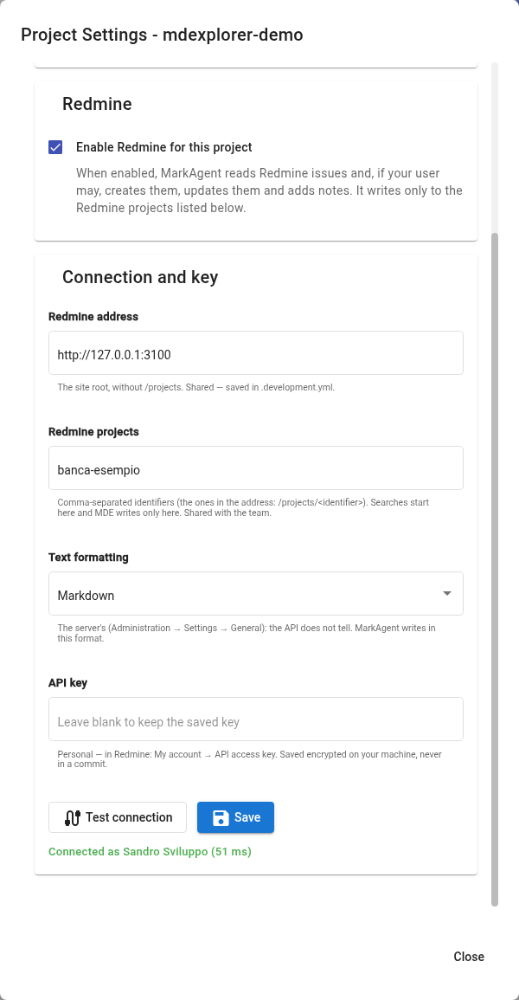

# Redmine issues

## TL;DR

MarkAgent reads Redmine issues and, if your user may, creates them, updates them and adds notes. The connection is
set up once per project: the server address is shared with the team, the key is personal and stays encrypted on
your computer. This page shows where to set it up and what to ask MarkAgent.

- Address, projects and text formatting go into `.development.yml`, the key never does.
- With no projects listed MarkAgent reads every issue you can see, but writes nowhere.
- "Test connection" tells you at once who you are connected as, or why it does not work.

## Where to set it up

In the project list, the gear of the project opens "Project Settings". The tab is "Issue trackers & wiki": Redmine
sits below Atlassian, in a section of its own.



| Field | What goes in it | Where it ends up |
|---|---|---|
| Redmine address | the site root, for example `https://redmine.example.com`, without `/projects` | `.development.yml`, shared |
| Redmine projects | the identifiers separated by commas, the ones in the address `/projects/<identifier>` | `.development.yml`, shared |
| Text formatting | the server's (Administration → Settings → General): Markdown or Textile | `.development.yml`, shared |
| API key | your personal key | encrypted on your computer, never in a commit |

You find the key in Redmine: "My account", right column, "API access key" → "Show". It works even if your account
signs in to the site with two-factor authentication: the API uses the key, not the password.

After "Save", `.development.yml` gets a section like this one, which your colleagues receive with their next pull:

```yaml
redmine:
  baseUrl: https://redmine.example.com
  projects:
  - banca-esempio
  textFormatting: markdown
```

## Read everywhere, write only where needed

Searches start from the listed projects. If the list is empty, MarkAgent searches every Redmine project your user
can see: that is fine for a read-only user.

Writing needs two conditions: the Redmine project must be in the list, and your user must have the permission in
Redmine. MarkAgent checks the permissions before sending anything; if either is missing, it says so and sends
nothing. Descriptions and notes go out only if the text formatting is chosen.

## To try

1. Fill in the section with your Redmine and press "Test connection": "Connected as" and your name must appear.
2. Press "Save" and look at the "Changes" tab: `.development.yml` changed, the key is not there.
3. Ask MarkAgent: "What are my open issues on Redmine?"
4. Pick an issue and ask: "Summarise issue 123 with its notes".
5. If you have the permissions on a listed project: "Add a note to issue 123 with the summary of this document".

## When the connection fails

| Message | What it means |
|---|---|
| does not accept the API key | the key is wrong or was regenerated: copy it again from "My account" |
| answered with a web page instead of Redmine's API | a firewall in front of Redmine stops programs that are not a browser: ask the administrators to let the API with the key through |
| is not a valid http(s) address | `https://` is missing in front of the address |

## What you need

A Redmine with the REST API enabled (Administration → Settings → API) and your key. Requests in plain language need
an AI engine: see [MarkAgent](03-markagent.md).

Next: [The Telegram remote control](10-telegram.md) · Back: [Tests written in plain language](08-e2e-tests.md) · [Back to the start](../README.md)
