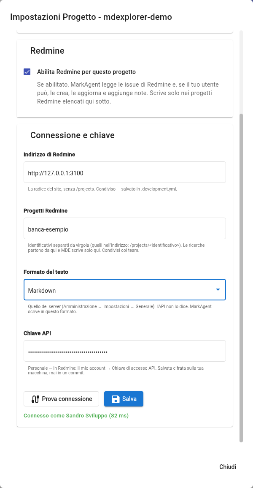

# Le issue di Redmine

## TL;DR

MarkAgent legge le issue di Redmine e, se il tuo utente può, le crea, le aggiorna e aggiunge note. Il collegamento
si configura una volta per progetto: l'indirizzo del server è condiviso con il team, la chiave è personale e resta
cifrata sul tuo computer. Questa pagina mostra dove si configura e cosa chiedere a MarkAgent.

- Indirizzo, progetti e formato del testo finiscono in `.development.yml`, la chiave mai.
- Senza progetti elencati MarkAgent legge tutte le issue che vedi, ma non scrive da nessuna parte.
- «Prova connessione» dice subito con chi sei collegato, o perché non va.

## Dove si configura

Nell'elenco dei progetti, l'ingranaggio del progetto apre «Impostazioni Progetto». La scheda è «Issue tracker e
wiki»: Redmine sta sotto Atlassian, in una sezione sua.



| Campo | Cosa ci va | Dove finisce |
|---|---|---|
| Indirizzo di Redmine | la radice del sito, per esempio `https://redmine.example.com`, senza `/projects` | `.development.yml`, condiviso |
| Progetti Redmine | gli identificativi separati da virgola, quelli nell'indirizzo `/projects/<identificativo>` | `.development.yml`, condiviso |
| Formato del testo | quello del server (Amministrazione → Impostazioni → Generale): Markdown o Textile | `.development.yml`, condiviso |
| Chiave API | la tua chiave personale | cifrata sul tuo computer, mai in un commit |

La chiave si trova in Redmine: «Il mio account», colonna di destra, «Chiave di accesso API» → «Mostra». Funziona
anche se il tuo account entra nel sito con la verifica in due passaggi: l'API usa la chiave, non la password.

Dopo «Salva», nel `.development.yml` compare una sezione come questa, che i colleghi ricevono con il primo pull:

```yaml
redmine:
  baseUrl: https://redmine.example.com
  projects:
  - banca-esempio
  textFormatting: markdown
```

## Leggere sempre, scrivere solo dove serve

Le ricerche partono dai progetti elencati. Se l'elenco è vuoto, MarkAgent cerca in tutti i progetti Redmine che il
tuo utente vede: va bene per chi ha un utente in sola lettura.

Per scrivere servono due condizioni: il progetto Redmine deve essere nell'elenco, e il tuo utente deve averne il
permesso in Redmine. MarkAgent controlla i permessi prima di mandare qualcosa; se manca uno dei due, lo dice e non
manda niente. Descrizioni e note partono solo se il formato del testo è scelto.

## Da provare

1. Compila la sezione con il tuo Redmine e premi «Prova connessione»: deve comparire «Connesso come» e il tuo nome.
2. Premi «Salva» e guarda la scheda «Differenze»: `.development.yml` è cambiato, la chiave non c'è.
3. Chiedi a MarkAgent: «Quali sono le mie issue aperte su Redmine?»
4. Scegli una issue e chiedi: «Riassumimi la issue 123 con le sue note».
5. Se hai i permessi su un progetto elencato: «Aggiungi alla issue 123 una nota con il riassunto di questo
   documento».

## Quando la connessione non va

| Messaggio | Cosa vuol dire |
|---|---|
| non accetta la chiave API | la chiave è sbagliata o rigenerata: copiala di nuovo da «Il mio account» |
| ha risposto con una pagina web invece che con l'API | davanti a Redmine c'è un firewall che ferma i programmi che non sono un browser: va chiesto agli amministratori di lasciar passare l'API con la chiave |
| non è un indirizzo http(s) valido | manca `https://` davanti all'indirizzo |

## Cosa serve

Un Redmine con l'API REST attiva (Amministrazione → Impostazioni → API) e la tua chiave. Per le richieste in
linguaggio naturale serve un motore AI: vedi [MarkAgent](03-markagent.md).

Avanti: [Il telecomando Telegram](10-telegram.md) · Indietro: [Test scritti in italiano](08-test-e2e.md) · [Torna all'inizio](../README.md)
