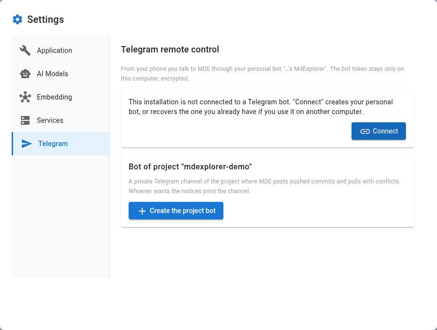
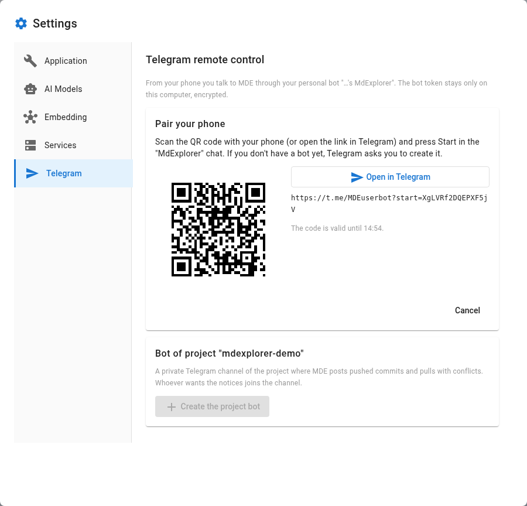

# The Telegram remote control

## TL;DR

From your phone you talk to your MdExplorer through a personal Telegram bot, created for you with a QR code. The
bot token stays only on your computer, encrypted, and messages go straight from Telegram to your computer. On top
of that, each project can have its own private channel where MdExplorer posts pushed commits and pulls that ended
with conflicts.

- "Connect" creates your bot, or recovers the one you already use on another computer.
- One installation listens at a time: "Take control" brings it back to this computer.
- The project bot lives in the repository: whoever has the project uses it without setting anything up.

## Where to set it up

The gear at the top right opens the menu: the entry is "Telegram". The same window has two sections: the remote
control, which is yours, and the bot of the open project, which belongs to the team.

## Your personal bot

1. Press "Connect". A QR code appears, valid for a few minutes.
2. Scan it with your phone (or press "Open in Telegram" and open the link there) and press Start in the
   "MdExplorer" chat. If you don't have a bot yet, Telegram asks you to create it.
3. MdExplorer asks "Is it you?" and shows your Telegram name and the bot. Confirm only if it is you: whoever opens
   the link first gets paired.

From then on the section shows the bot, who it answers to and its state:

| State | What it means |
|---|---|
| Listening | this computer receives the bot's messages |
| Standby | another installation listens to the bot: "Take control" brings it back here |
| Off | the "Remote control on" switch is off |

Telegram delivers the messages to one installation only. If you use MdExplorer on two computers, the bot is the
same: "Connect" on the second computer recovers the bot you have, it does not create another one. The "Name of
this installation" appears in the bot's messages, so you know who is answering you.

The other buttons:

| Button | When you need it |
|---|---|
| Reconnect | pairs again and recovers your bot's token |
| Regenerate token | you lost a computer: the other installations stay out until they reconnect |
| Disconnect | deletes the token from this computer; the bot stays yours |
| Delete the bot | opens BotFather in Telegram, where the bot is deleted |

Today the bot answers `/start` and `/status` saying which installation is listening. The dialogue with MarkAgent
from the phone comes with the next version.

## The project bot

The project bot writes in a private Telegram channel of the project. MdExplorer posts two kinds of notice there:
pushed commits and pulls that ended with conflicts. Whoever wants the notices joins the channel; whoever no longer
wants them leaves the channel in Telegram.

1. In "Bot of project" press "Create the project bot". Scan the QR code, press Start in the "MdExplorer" chat and
   then "Create the project bot".
2. In Telegram create a **private** channel for the project (New channel → Private), if you don't have one yet.
3. Press "Add to channel", choose that channel and confirm the bot as administrator: it needs "Post messages" and
   "Invite users".
4. As soon as the bot is in the channel, MdExplorer saves the bot in `.mde-keys.yml` and commits that file only.
   Push the project: from then on your colleagues have the bot too.

To join the channel, each person presses "Receive the project notifications": the link is for one person only and
valid for one day. "Test message" checks that the channel receives.

The project bot token is in the repository: anyone with the repository can post in the channel. On a public
repository, like this demo, MdExplorer advises against it and asks for confirmation: try the project bot on a
private copy.

## To try

1. Open the Telegram section and press "Connect".
2. Scan the QR code with your phone, press Start and confirm in MdExplorer.
3. Send `/status` to your bot: it answers with the name of this installation.
4. Change the "Name of this installation" and send `/status` again.
5. On a private copy of a project, create the project bot and push a commit: the notice arrives in the channel.

## What you need

Telegram on your phone, the network on your computer, and MdExplorer 2026.11.05 or newer. The project bot also
needs a remote repository, where `.mde-keys.yml` is pushed.

Back: [Redmine issues](09-redmine.md) · [Back to the start](../README.md)
