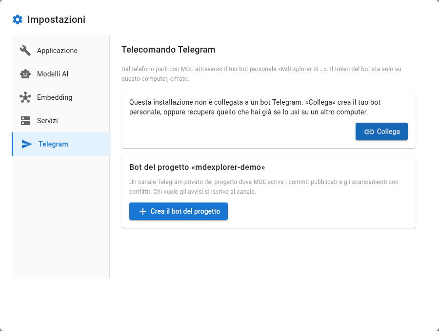
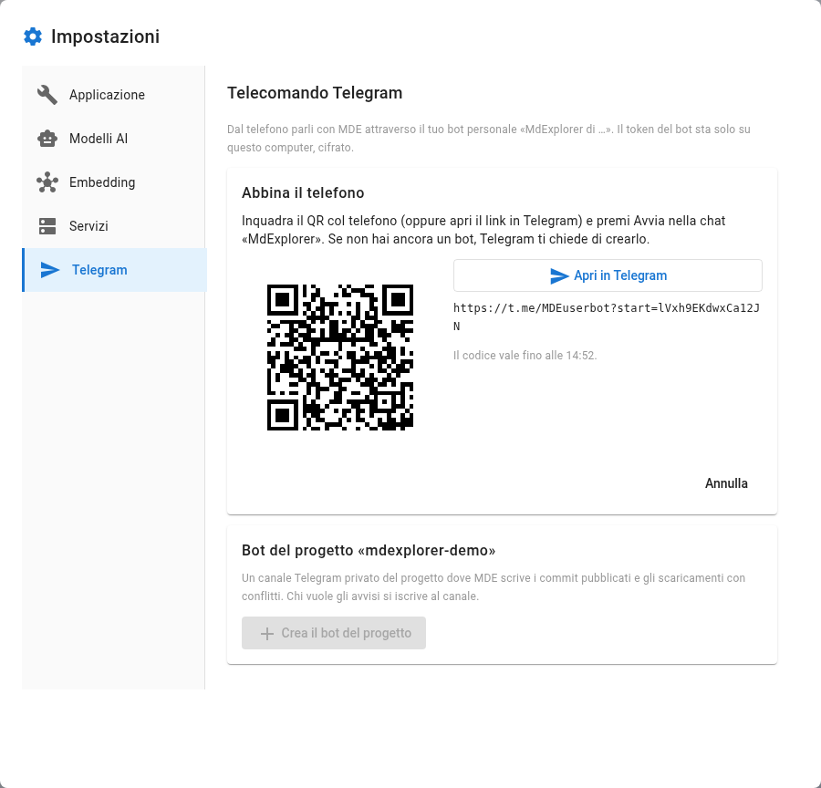

# Il telecomando Telegram

## TL;DR

Dal telefono parli con il tuo MdExplorer attraverso un bot Telegram personale, creato per te con un QR. Il token
del bot sta solo sul tuo computer, cifrato, e i messaggi vanno diretti da Telegram al tuo computer. In più, ogni
progetto può avere un suo canale privato dove MdExplorer avvisa dei commit pubblicati e degli scaricamenti con
conflitti.

- «Collega» crea il tuo bot, oppure recupera quello che usi già su un altro computer.
- Ascolta un'installazione alla volta: «Prendi il controllo» la riporta su questo computer.
- Il bot del progetto vive nel repository: chi ha il progetto lo usa senza configurare niente.

## Dove si configura

L'ingranaggio in alto a destra apre il menu: la voce è «Telegram». Nella stessa finestra ci sono due sezioni: il
telecomando, che è tuo, e il bot del progetto aperto, che è del team.

## Il tuo bot personale

1. Premi «Collega». Compare un QR, valido qualche minuto.
2. Inquadralo con il telefono (oppure premi «Apri in Telegram» e apri il link lì) e premi Avvia nella chat
   «MdExplorer». Se non hai ancora un bot, Telegram ti chiede di crearlo.
3. MdExplorer chiede «Sei tu?» e mostra il tuo nome Telegram e il bot. Conferma solo se sei tu: chi apre il link
   per primo si abbina.

Da quel momento la sezione mostra il bot, a chi risponde e lo stato:

| Stato | Cosa vuol dire |
|---|---|
| In ascolto | questo computer riceve i messaggi del bot |
| In attesa | un'altra installazione ascolta il bot: «Prendi il controllo» lo riporta qui |
| Spento | l'interruttore «Telecomando acceso» è spento |

Telegram consegna i messaggi a un'installazione sola. Se usi MdExplorer su due computer, il bot è lo stesso:
«Collega» sul secondo computer recupera il bot che hai, non ne crea un altro. Il «Nome di questa installazione»
compare nei messaggi del bot, così sai chi ti sta rispondendo.

Gli altri pulsanti:

| Pulsante | Quando serve |
|---|---|
| Ricollega | rifà l'abbinamento e recupera il token del tuo bot |
| Rigenera il token | hai perso un computer: le altre installazioni restano fuori finché non ricollegano |
| Scollega | cancella il token da questo computer; il bot resta tuo |
| Elimina il bot | apre BotFather su Telegram, dove il bot si elimina |

Oggi il bot risponde a `/start` e `/stato` dicendo quale installazione ascolta. Il dialogo con MarkAgent dal
telefono arriva con la prossima versione.

## Il bot del progetto

Il bot del progetto scrive in un canale Telegram privato del progetto. MdExplorer ci manda due avvisi: i commit
pubblicati e gli scaricamenti finiti con conflitti. Chi vuole gli avvisi entra nel canale; chi non li vuole più
esce dal canale su Telegram.

1. In «Bot del progetto» premi «Crea il bot del progetto». Inquadra il QR, premi Avvia nella chat «MdExplorer» e
   poi «Crea il bot del progetto».
2. Su Telegram crea un canale **privato** per il progetto (Nuovo canale → Privato), se non ce l'hai già.
3. Premi «Aggiungi al canale», scegli quel canale e conferma il bot come amministratore: servono «Pubblica
   messaggi» e «Invita utenti».
4. Appena il bot è nel canale, MdExplorer salva il bot in `.mde-keys.yml` e crea il commit di quel solo file.
   Pubblica il progetto: da lì il bot ce l'hanno anche i colleghi.

Per entrare nel canale, ognuno preme «Ricevi le notifiche del progetto»: il link vale per una persona sola e per un
giorno. «Messaggio di prova» controlla che il canale riceva.

Il token del bot del progetto sta nel repository: chiunque abbia il repository può scrivere nel canale. Su un
repository pubblico, come questa demo, MdExplorer lo sconsiglia e chiede conferma: prova il bot del progetto su una
copia privata.

## Da provare

1. Apri la sezione Telegram e premi «Collega».
2. Inquadra il QR con il telefono, premi Avvia e conferma in MdExplorer.
3. Scrivi `/stato` al tuo bot: risponde con il nome di questa installazione.
4. Cambia il «Nome di questa installazione» e rimanda `/stato`.
5. Su una copia privata di un progetto, crea il bot del progetto e fai un commit pubblicato: l'avviso arriva nel
   canale.

## Cosa serve

Telegram sul telefono, la rete sul computer, e MdExplorer 2026.11.05 o più nuovo. Per il bot del progetto serve
anche un repository remoto, dove pubblicare `.mde-keys.yml`.

Indietro: [Le issue di Redmine](09-redmine.md) · [Torna all'inizio](../README.md)
